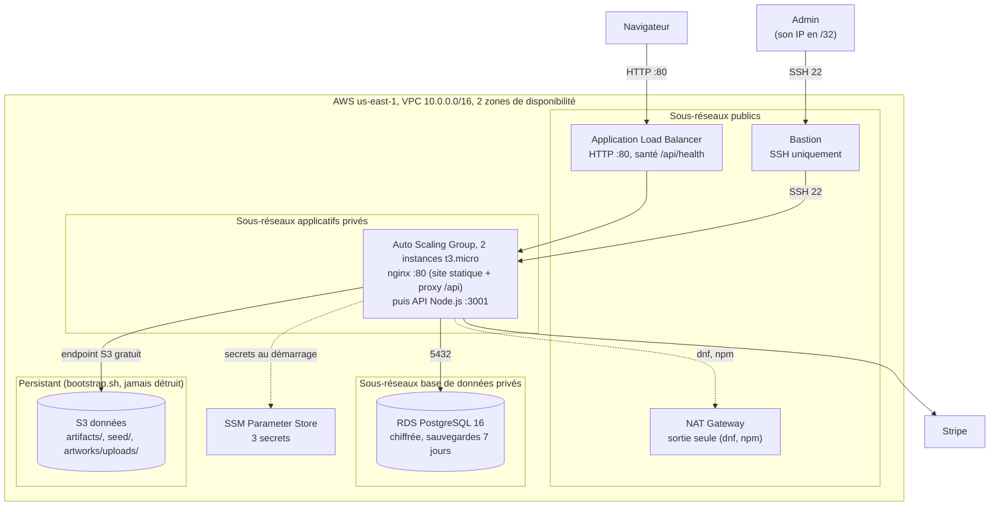

# Galerie d'art en ligne


Plateforme web où les artistes publient leurs œuvres (peintures, décoration murale, art numérique, croquis) et où les acheteurs les découvrent, contactent l'artiste et les achètent avec un vrai parcours de paiement. L'application est déployée sur une infrastructure AWS 3 tiers haute disponibilité, entièrement décrite avec Terraform.

Le projet comporte trois parties. **Ce README donne la vue d'ensemble ; le détail de chaque partie est dans le README de son dossier.**

## Sommaire

- [Les trois parties du projet](#les-trois-parties-du-projet)
- [Architecture globale](#architecture-globale)
- [Fonctionnalités](#fonctionnalités)
- [Rôles et permissions](#rôles-et-permissions)
- [Stack technique](#stack-technique)
- [Structure du dépôt](#structure-du-dépôt)
- [Démarrage rapide](#démarrage-rapide)
- [Scripts](#scripts)
- [Workflow Git](#workflow-git)
- [Feuille de route](#feuille-de-route)

## Les trois parties du projet

| | Frontend | Backend | Infrastructure |
|---|---|---|---|
| **Rôle** | Interface web : catalogue, espaces acheteur, artiste et administrateur | API REST : authentification, œuvres, commandes, paiement, messagerie, administration | Réseau, sécurité, calcul, base de données, stockage S3 et secrets sur AWS |
| **Technologies** | Next.js 15, React 19, TypeScript, CSS natif | NestJS 10, TypeORM, Passport JWT, Stripe, PostgreSQL 16 | Terraform, boto3, AWS Academy Learner Lab |
| **Livrable** | Export statique (`frontend/out`) servi par nginx sur les instances, derrière l'ALB | API Node.js sur EC2 (Auto Scaling Group, 2 zones) derrière un ALB, base sur RDS, images sur S3 | Modules Terraform `network`, `security`, `compute`, `secrets`, `alb`, `rds`, `asg` (41 ressources) et `bootstrap.sh` (buckets S3) |
| **État** | Fonctionnel en local et sur AWS | Fonctionnel en local et sur AWS | Architecture v3 déployée et vérifiée de bout en bout. Reste : CloudWatch, HTTPS, état Terraform distant, test de charge |
| **Documentation** | [`frontend/README.md`](frontend/README.md) | [`backend/README.md`](backend/README.md) | [`infra/README.md`](infra/README.md) |

Où trouver quoi :

- **Pages, captures d'écran, configuration de l'interface, build statique** : [frontend](frontend/README.md)
- **Variables d'environnement, modules, règles métier, modèle de données, base de données, seed** : [backend](backend/README.md)
- **VPC, groupes de sécurité, NAT, ALB, Auto Scaling Group, RDS, coûts, destruction, dépannage** : [infra](infra/README.md)
- **Base RDS (copie de départ restaurée automatiquement, requêtes, sauvegarde)** : [infra/RDS.md](infra/RDS.md)
- **Buckets S3 et images envoyées (commandes, coût)** : [infra/S3.md](infra/S3.md)

## Architecture globale

Architecture telle que construite (v3). Elle est créée par `terraform apply` et détruite en fin de session par `./destroy.sh` ; seuls les deux buckets S3 persistent.



.png)

*Schéma détaillé : sous-réseaux, groupes de sécurité et flux. Source modifiable : `infra/images/` (draw.io). Les éléments estompés sont prévus ou facultatifs, non construits.*

- Le **frontend** est exporté en fichiers statiques (`frontend/out`), empaqueté dans S3, décompressé au démarrage de chaque instance et servi par **nginx**. Nginx relaie `/api` vers l'API de la même instance : le load balancer est la **seule origine** (pas de CORS, pas de contenu mixte).
- Le **backend** tourne sur 2 instances EC2 privées, une par zone, dans un Auto Scaling Group (minimum 2) derrière l'Application Load Balancer. Si une instance tombe, le groupe la remplace. Chaque instance s'installe seule au démarrage à partir de paquets versionnés dans S3 (`artifacts/`).
- La **base** est une instance RDS PostgreSQL 16 privée, chiffrée, mono-AZ (choix de budget), avec sauvegardes sur 7 jours. Seules les instances applicatives atteignent le port 5432. Au premier démarrage d'une nouvelle infrastructure, la **copie de départ** `seed/gallery.sql` est restaurée automatiquement : `terraform apply` suffit pour retrouver l'application avec ses données.
- **S3** : deux buckets privés, créés par `bootstrap.sh` et jamais détruits. L'un garde l'état Terraform, l'autre les paquets de l'application, la copie de départ de la base et les **images envoyées par les artistes** (servies par l'API, le bucket reste privé).
- Les **secrets** (mot de passe de la base, clé JWT, mot de passe administrateur) sont générés par Terraform et stockés dans SSM Parameter Store, lus au démarrage grâce au rôle de l'instance. Aucun secret dans le code, dans `user_data` ni dans Git.
- L'**administration** passe par un bastion SSH limité à l'adresse IP de l'administrateur, ou par Session Manager.
- L'**infrastructure** est créée et détruite uniquement avec Terraform (41 ressources, environ 11 minutes et demie), jamais à la main dans la console AWS.

Réseau, sécurité, déploiement, coûts et tests sont détaillés dans [`infra/README.md`](infra/README.md#architecture).

| Choix ou limite actuelle | Raison |
|---|---|
| Site servi par nginx sur les instances, pas par CloudFront | Simple, une seule origine, dans la liste de services du cahier des charges |
| HTTP uniquement | Pas de nom de domaine, donc pas de certificat dans le laboratoire |
| Un seul NAT Gateway, base mono-AZ | Budget de 50 USD (le NAT ou le Multi-AZ doublerait une ligne importante) |
| Données créées sur AWS perdues à la destruction | RDS est supprimée : sauvegardez la base comme nouvelle copie de départ avant, voir [`infra/RDS.md`](infra/RDS.md) |
| État Terraform local, pas encore dans S3 | Migration prévue |

## Fonctionnalités

| Profil | Ce qu'il peut faire |
|---|---|
| **Visiteur** | Parcourir le catalogue par catégorie, rechercher, filtrer par prix, trier, consulter la fiche d'une œuvre |
| **Acheteur** | Demander l'achat d'une œuvre avec un message, suivre ses demandes, payer par carte, imprimer un reçu, écrire aux artistes |
| **Artiste** | Publier, modifier et supprimer ses œuvres (avec image), accepter ou refuser les demandes, contacter les acheteurs, suivre ses ventes (brut, commission, net), choisir un abonnement Gratuit, Premium ou Pro |
| **Administrateur** | Statistiques (dont commissions et abonnements perçus), gestion des utilisateurs, des œuvres, des commandes et des catégories, contact de tout utilisateur |
| **Tous les comptes** | Profil modifiable, changement de mot de passe, thème clair ou sombre (bouton dans l'en-tête, mémorisé, suit le réglage de l'appareil par défaut), langue français ou anglais (bouton FR / EN en bas de page et sur les pages de connexion) |

### Abonnements et commissions

La plateforme prélève une **commission sur chaque vente**, dont le taux dépend de l'abonnement de l'artiste. Les prix, taux et limites sont définis à un seul endroit : [`backend/src/subscriptions/plans.ts`](backend/src/subscriptions/plans.ts).

| Plan | Prix mensuel | Prix annuel | Commission | Œuvres en ligne | Avantages |
|---|---:|---:|---:|---:|---|
| **Gratuit** | 0 | 0 | 15 % | 10 | Publication et messagerie |
| **Premium** | 29 | 290 (2 mois offerts) | 8 % | 50 | Badge, œuvres en tête du catalogue |
| **Pro** | 79 | 790 (2 mois offerts) | 3 % | illimité | Badge, œuvres en tête du catalogue |

Les montants sont dans la devise de la plateforme (`CURRENCY`). Le taux de commission est **figé au moment du paiement** de chaque commande : changer de plan plus tard ne modifie pas les ventes passées.

Les pages correspondantes sont décrites dans [frontend](frontend/README.md#pages-par-rôle) et les règles métier dans [backend](backend/README.md#règles-métier).

## Rôles et permissions

Le rôle est choisi à l'inscription (acheteur ou artiste). Le compte administrateur est créé au premier démarrage du backend. L'API relit le rôle et l'état du compte en base à chaque requête : une suspension ou un changement de rôle prend effet immédiatement.

| Action | Visiteur | Acheteur | Artiste | Admin |
|---|:-:|:-:|:-:|:-:|
| Parcourir et rechercher les œuvres | oui | oui | oui | oui |
| Demander l'achat d'une œuvre | | oui | oui (pas la sienne) | |
| Payer une commande acceptée | | oui | oui | |
| Publier, modifier, supprimer ses œuvres | | | oui | toutes |
| Accepter ou refuser une demande | | | ses œuvres | toutes |
| Envoyer des messages | | oui (voir règles) | oui | à tous |
| Modifier son profil et son mot de passe | | oui | oui | oui |
| Statistiques, utilisateurs, catégories | | | | oui |

Les règles de la messagerie sont dans le [README du backend](backend/README.md#messagerie).

## Stack technique

| Couche | Technologie | Détail |
|---|---|---|
| Frontend | Next.js 15 (App Router, export statique), React 19, TypeScript, CSS natif | [frontend/](frontend/README.md#stack) |
| Backend | NestJS 10, TypeORM, Passport JWT, class-validator, Multer, Stripe SDK | [backend/](backend/README.md#stack) |
| Base de données | PostgreSQL 16 (Docker en local, Amazon RDS en production) | [backend/](backend/README.md#modèle-de-données) |
| Infrastructure | Terraform (VPC, ALB, Auto Scaling Group, RDS, S3, SSM), AWS Academy Learner Lab (`us-east-1`), scripts boto3 à venir | [infra/](infra/README.md) |
| Outillage | npm, concurrently, Docker Compose, Adminer, Python 3 (seed) | |

## Structure du dépôt

```
art-gallery-aws/
├── frontend/        # Next.js            → frontend/README.md
├── backend/         # NestJS             → backend/README.md
├── infra/           # Terraform (AWS)    → infra/README.md (+ RDS.md, S3.md)
├── scripts/         # seed de données, générateur d'images, scripts boto3
├── docs/            # schéma d'architecture, livrables, captures d'écran
├── docker-compose.yml            # PostgreSQL
├── docker-compose.override.yml   # Adminer (visualisation de la base)
├── package.json     # commandes racine (dev, seed, install:all)
└── README.md
```

## Démarrage rapide

Cette section lance l'application en local (frontend, backend et base). Pour l'infrastructure AWS, suivez [`infra/README.md`](infra/README.md#usage).

**Prérequis** : Node.js 20+, Docker, Python 3.9+ (pour le seed uniquement).

```bash
git clone https://github.com/AjmiOns/art-gallery-aws.git
cd art-gallery-aws

# 1. Configuration
cp backend/.env.example backend/.env          # changer JWT_SECRET et ADMIN_PASSWORD
cp frontend/.env.local.example frontend/.env.local

# 2. Dépendances (racine, backend et frontend)
npm run install:all

# 3. Base de données + backend + frontend
npm start

# 4. Données de test (dans un second terminal, API démarrée)
npm run seed -- --reset
```

| Service | Adresse |
|---|---|
| Site | <http://localhost:3000> |
| API | <http://localhost:3001/api> |
| Visualisation de la base (Adminer) | <http://localhost:8080> |

Ouvrez le site via `localhost` : une autre adresse est refusée par la politique CORS du backend.

**Comptes de démonstration** (créés par le seed, mot de passe `Password123!`) : `artiste01@gallery.test`, `acheteur01@gallery.test`. L'administrateur est `admin@gallery.test` avec le mot de passe `ADMIN_PASSWORD` de votre `backend/.env` (`Admin1234!` par défaut).

> **Windows PowerShell 5** : l'opérateur `&&` n'est pas reconnu. Utilisez `;` ou lancez les commandes une par une. Remplacez `cp` par `Copy-Item` si besoin.

Configuration détaillée : [frontend](frontend/README.md#configuration) et [backend](backend/README.md#configuration).

## Scripts

| Commande (racine) | Action |
|---|---|
| `npm run install:all` | Installe les dépendances de la racine, du backend et du frontend |
| `npm start` | Démarre PostgreSQL et Adminer (Docker), puis le backend et le frontend |
| `npm run dev` | Démarre uniquement le backend et le frontend |
| `npm run db` | Démarre uniquement PostgreSQL et Adminer |
| `npm run seed` | Injecte des données de test (options : [backend](backend/README.md#données-de-test)) |

Par application : `npm run build` produit le backend (`backend/dist`) ou l'export statique du frontend (`frontend/out`). Les commandes Terraform sont dans [`infra/README.md`](infra/README.md#usage).

## Workflow Git

- `main` est la branche stable : pas de push direct, modifications par pull request avec au moins une review.
- Chaque membre travaille sur sa branche personnelle `prenom-nom-Branch` (par exemple `ons-ajmi-Branch`), créée depuis `main` et mise à jour régulièrement avec `git pull origin main`.
- Les commits suivent la convention [Conventional Commits](https://www.conventionalcommits.org/fr/) : `type(scope): description`, à l'impératif et en anglais.
- Une pull request regroupe des commits atomiques. Elle est fusionnée avec **Create a merge commit** ou **Rebase and merge**, jamais en squash, afin de conserver l'historique par commit.

| Type | Usage |
|---|---|
| `feat` | Nouvelle fonctionnalité |
| `fix` | Correction de bug |
| `docs` | Documentation uniquement |
| `refactor` | Réécriture sans changement de comportement |
| `test` | Ajout ou correction de tests |
| `chore` | Outillage, configuration, dépendances |
| `infra` | Terraform, scripts AWS |

Ne committez jamais de fichier `.env`, de `node_modules`, d'état Terraform (`*.tfstate`), de clé `labsuser.pem` ni le contenu de `backend/uploads/`, ni un dump de base (`gallery.sql`, qui contient les données des utilisateurs) : le `.gitignore` les exclut.

> Pour le Terraform, détruire l'infrastructure (`./destroy.sh`) à la fin de **chaque** session afin de maîtriser le coût (budget Learner Lab limité).

## Feuille de route

Vue globale. Le détail de chaque partie est dans son README.

**Frontend** ([détail](frontend/README.md#feuille-de-route))
- [x] Catalogue, espaces par rôle, paiement, messagerie, interface responsive
- [x] Déploiement sur AWS : export statique servi par nginx derrière l'ALB
- [ ] Messagerie en temps réel, pagination, tests

**Backend** ([détail](backend/README.md#feuille-de-route))
- [x] Authentification JWT, trois rôles, œuvres, commandes, paiement (démonstration et Stripe test), messagerie, administration, seed
- [x] Déploiement sur AWS (Auto Scaling Group, RDS) et images envoyées stockées dans S3
- [ ] Migrations TypeORM, e-mails, webhooks Stripe, pagination, tests et CI, documentation des routes

**Infrastructure** ([détail](infra/README.md#roadmap-future-work))
- [x] VPC, sous-réseaux multi-AZ, groupes de sécurité, NAT, bastion, premier backend, script de destruction
- [x] ALB, Auto Scaling Group (2 zones), RDS PostgreSQL avec sauvegardes, buckets S3 persistants, secrets dans SSM Parameter Store
- [x] Copie de départ de la base restaurée automatiquement, images envoyées dans S3
- [ ] CloudWatch, état Terraform distant, HTTPS, test de charge k6, scripts boto3