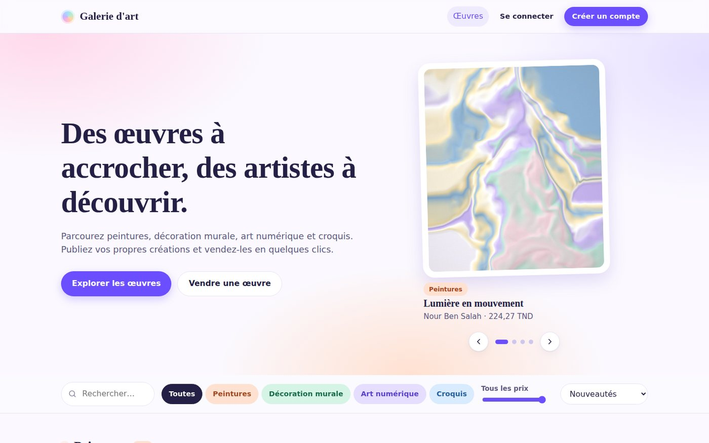
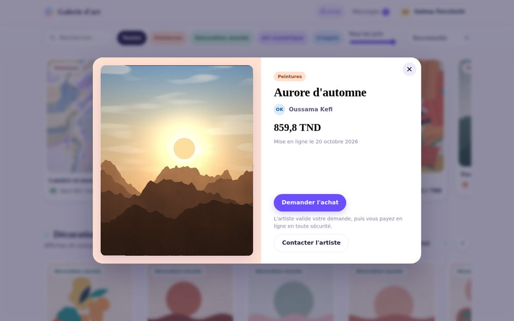
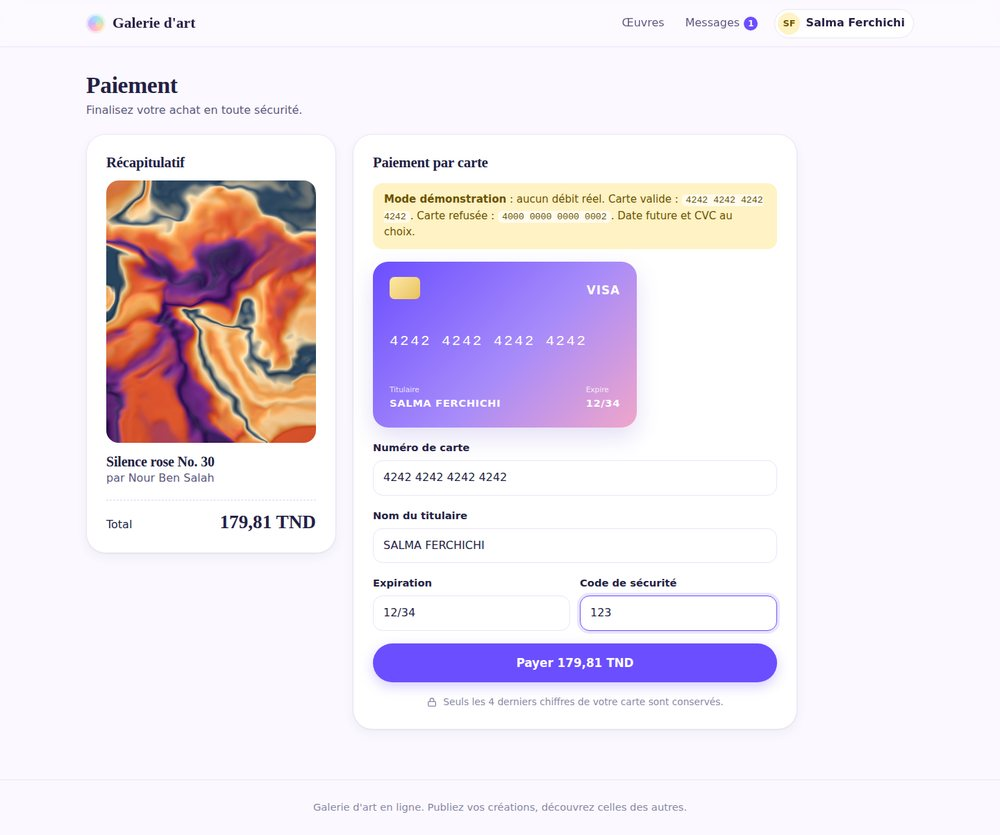
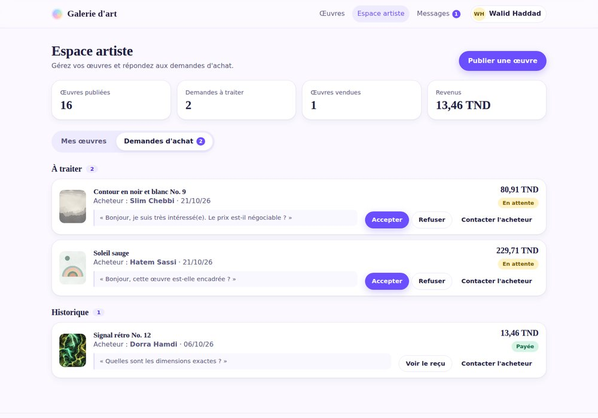
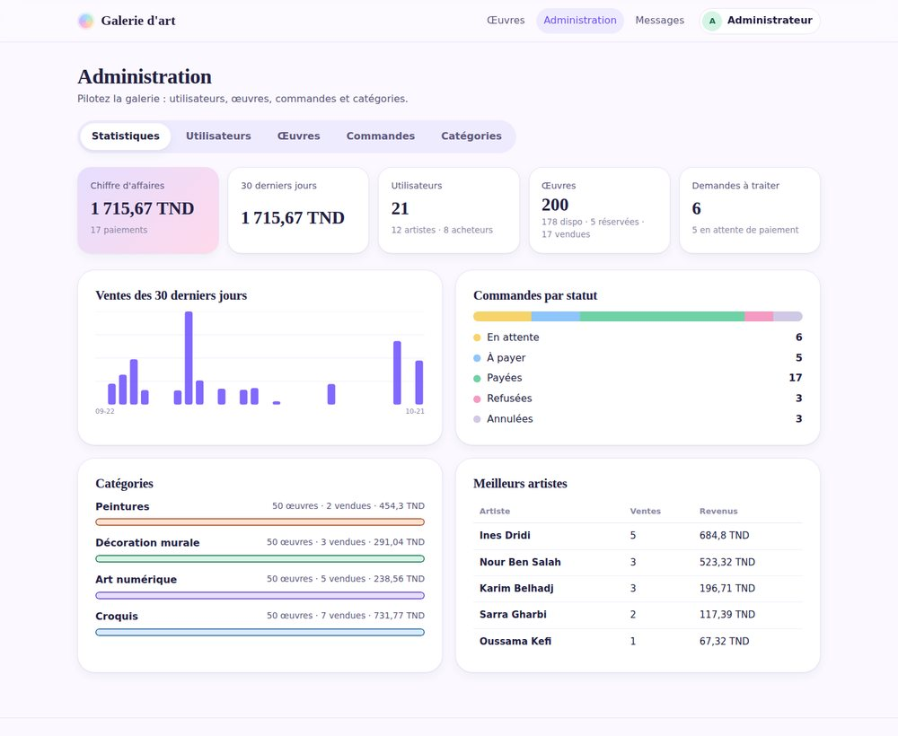
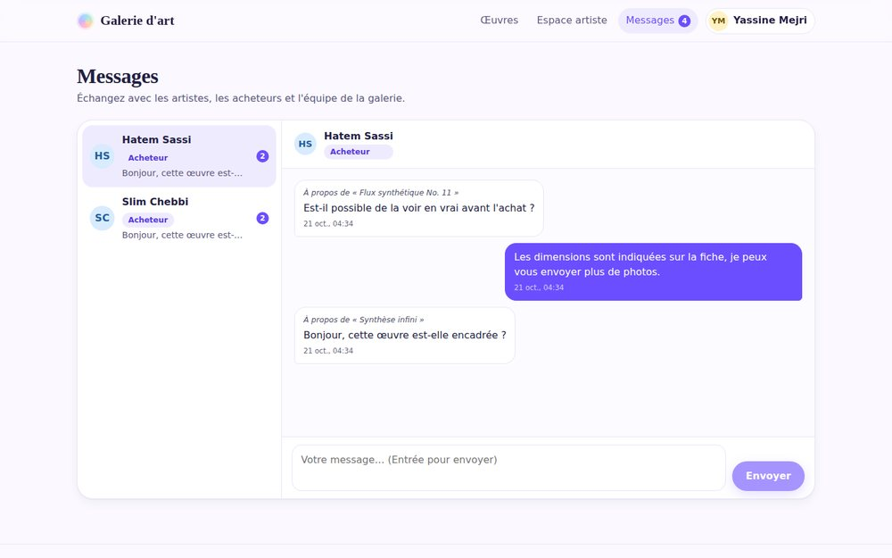
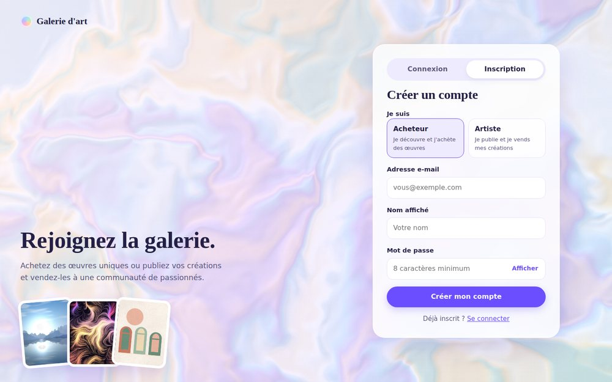
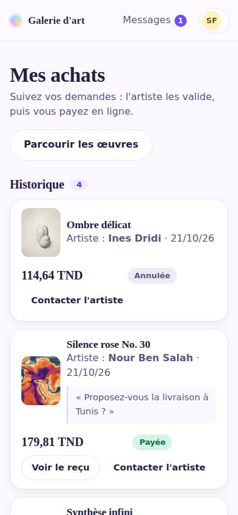
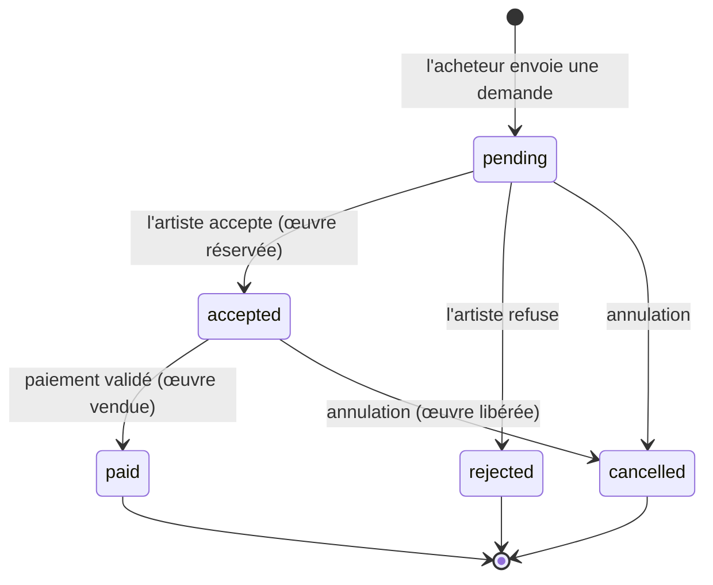
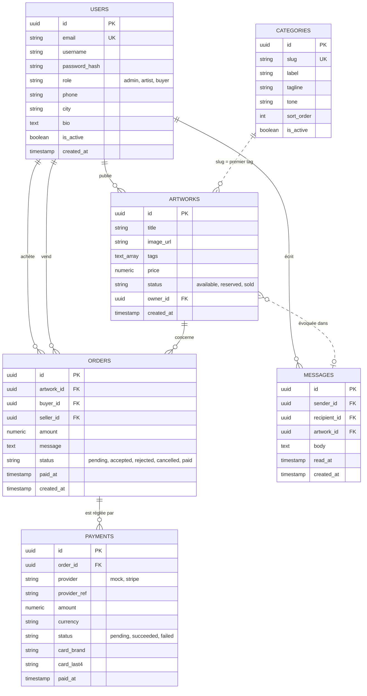

# Galerie d'art en ligne


Plateforme web où les artistes publient leurs œuvres (peintures, décoration murale, art numérique, croquis) et où les acheteurs les découvrent, contactent l'artiste et les achètent avec un vrai parcours de paiement. L'application est conçue pour être déployée sur une infrastructure AWS 3 tiers haute disponibilité, décrite dans la section [Architecture cible](#architecture-cible).



## Sommaire

- [Fonctionnalités](#fonctionnalités)
- [Aperçu](#aperçu)
- [Rôles et permissions](#rôles-et-permissions)
- [Achat et paiement](#achat-et-paiement)
- [Stack technique](#stack-technique)
- [Architecture cible](#architecture-cible)
- [Structure du dépôt](#structure-du-dépôt)
- [Démarrage rapide](#démarrage-rapide)
- [Configuration](#configuration)
- [Scripts](#scripts)
- [Référence de l'API](#référence-de-lapi)
- [Modèle de données](#modèle-de-données)
- [Visualiser la base de données](#visualiser-la-base-de-données)
- [Données de test](#données-de-test)
- [Déploiement](#déploiement)
- [Workflow Git](#workflow-git)
- [Dépannage](#dépannage)
- [Feuille de route](#feuille-de-route)
- [Auteur](#auteur)

## Fonctionnalités

**Pour tous les visiteurs**
- Catalogue classé par catégorie, avec carrousels, œuvre à la une, recherche, filtre de prix et tri.
- Fiche détaillée de chaque œuvre dans une fenêtre accessible au clavier.

**Acheteur**
- Demande d'achat avec message à l'artiste, suivi de ses demandes (en attente, à payer, historique).
- Paiement en ligne par carte et reçu imprimable.
- Messagerie pour contacter les artistes.

**Artiste**
- Publication, modification et suppression de ses œuvres, avec envoi d'image (JPG, PNG, WebP, 5 Mo).
- Gestion des demandes d'achat : accepter, refuser ou annuler une réservation.
- Contact direct des acheteurs et tableau de bord (œuvres, demandes à traiter, ventes, revenus).

**Administrateur**
- Statistiques : chiffre d'affaires, courbe des ventes sur 30 jours, répartition des commandes, catégories, meilleurs artistes.
- Gestion de tous les utilisateurs (artistes et acheteurs) : modification, changement de rôle, suspension, suppression.
- Gestion des œuvres et des commandes, gestion des catégories (nom, couleur, ordre, activation).
- Contact de n'importe quel utilisateur.

**Tous les comptes** : profil modifiable (nom, téléphone, ville, présentation) et changement de mot de passe.

## Aperçu

| Catalogue | Fiche d'une œuvre |
|---|---|
|  |  |

| Paiement par carte | Espace artiste |
|---|---|
|  |  |

| Administration | Messagerie |
|---|---|
|  |  |

| Inscription | Mobile |
|---|---|
|  |  |

## Rôles et permissions

Le rôle est choisi à l'inscription (acheteur ou artiste). Le compte administrateur est créé au premier démarrage du backend. L'API relit le rôle et l'état du compte en base à chaque requête : une suspension ou un changement de rôle prend effet immédiatement.

| Action | Visiteur | Acheteur | Artiste | Admin |
|---|:-:|:-:|:-:|:-:|
| Parcourir et rechercher les œuvres | oui | oui | oui | oui |
| Demander l'achat d'une œuvre | | oui | oui (pas la sienne) | |
| Payer une commande acceptée | | oui | oui | |
| Publier, modifier, supprimer ses œuvres | | | oui | toutes |
| Accepter ou refuser une demande | | | ses œuvres | toutes |
| Envoyer des messages | | oui (voir règles) | oui | à tous |
| Modifier son profil et son mot de passe | | oui | oui | oui |
| Statistiques, utilisateurs, catégories | | | | oui |

**Règles de la messagerie** : on écrit à l'artiste depuis la fiche d'une de ses œuvres, ou à une personne avec qui on a déjà échangé ou commandé. Les administrateurs peuvent écrire à tous et recevoir de tous. Ces règles limitent les messages non sollicités.

## Achat et paiement

Une œuvre n'est **jamais** déclarée vendue d'un simple clic. Le parcours passe par une demande validée par l'artiste, puis par un paiement confirmé.



- Quand l'artiste accepte, l'œuvre passe en **réservée** pour cet acheteur et les autres demandes sont refusées automatiquement.
- Le paiement valide la commande et marque l'œuvre **vendue** dans une seule transaction, avec verrou en base : impossible de vendre deux fois.
- Seuls la marque et les 4 derniers chiffres de la carte sont enregistrés, jamais le numéro complet.

Deux prestataires gratuits, sélectionnés par `PAYMENT_PROVIDER` :

| Prestataire | Usage | Configuration |
|---|---|---|
| `mock` (défaut) | Passerelle de démonstration : formulaire de carte réaliste avec aperçu, validation du numéro (Luhn), de la date et du CVC, délai bancaire simulé, refus simulés. Aucun débit. | Aucune |
| `stripe` | [Stripe Checkout](https://stripe.com/docs/checkout) en **mode test** : vraie page de paiement hébergée par Stripe, sans argent réel. | Compte Stripe gratuit, clé `sk_test_…` |

**Cartes de test** (passerelle `mock`) : `4242 4242 4242 4242` réussit, `4000 0000 0000 0002` est refusée, `4000 0000 0000 9995` simule des fonds insuffisants. Date future et CVC au choix.

**Activer Stripe** : créez un compte gratuit sur stripe.com, restez en mode test, copiez la clé secrète depuis *Développeurs → Clés API*, puis dans `backend/.env` :

```
PAYMENT_PROVIDER=stripe
STRIPE_SECRET_KEY=sk_test_...
STRIPE_CURRENCY=eur
```

Redémarrez le backend. Stripe ne gère pas le dinar tunisien : le même montant est débité en euros en mode test. Au retour de la page Stripe, le backend interroge Stripe pour confirmer le paiement au lieu de faire confiance à l'URL de retour.

## Stack technique

| Couche | Technologie |
|---|---|
| Frontend | Next.js 15 (App Router, export statique), React 19, TypeScript, CSS natif |
| Backend | NestJS 10, TypeORM, Passport JWT, class-validator, Multer, Stripe SDK |
| Base de données | PostgreSQL 16 (Docker en local, Amazon RDS en production) |
| Infrastructure | Terraform, scripts boto3, AWS Academy Learner Lab |
| Outillage | npm, concurrently, Docker Compose, Adminer, Python 3 (seed) |

## Architecture cible

Le frontend est exporté en fichiers statiques servis par S3 et CloudFront. L'API tourne sur des instances EC2 privées derrière un Application Load Balancer, sur deux zones de disponibilité. La base est une instance RDS PostgreSQL Multi-AZ, isolée dans des sous-réseaux privés.


> **État d'avancement** : l'application (frontend, API, base, paiement) est fonctionnelle en local. Les modules Terraform de `infra/` sont à écrire. Les images envoyées par les artistes sont stockées sur le disque du backend (`backend/uploads`) : en production, elles iront sur S3, car les instances de l'Auto Scaling Group ne partagent pas de disque.

## Structure du dépôt

```
art-gallery-aws/
├── frontend/        # Next.js (pages par rôle, composants, client API, images)
├── backend/         # NestJS (auth, users, categories, artworks, orders, payments, messages, uploads, admin)
├── infra/           # Terraform (modules : network, compute, rds, s3)
├── scripts/         # seed de données, générateur d'images, scripts boto3
├── docs/            # schéma d'architecture, livrables, captures d'écran
├── docker-compose.yml            # PostgreSQL
├── docker-compose.override.yml   # Adminer (visualisation de la base), fusionné automatiquement
├── package.json     # commandes racine (dev, seed, install:all)
└── README.md
```

## Démarrage rapide

**Prérequis** : Node.js 20+, Docker, Python 3.9+ (pour le seed uniquement).

```bash
git clone https://github.com/AjmiOns/art-gallery-aws.git
cd art-gallery-aws

# 1. Configuration
cp backend/.env.example backend/.env          # changer JWT_SECRET et ADMIN_PASSWORD
cp frontend/.env.local.example frontend/.env.local

# 2. Dépendances (racine, backend et frontend)
npm run install:all

# 3. Base de données + backend + frontend
npm start

# 4. Données de test (dans un second terminal, API démarrée)
npm run seed -- --reset
```

| Service | Adresse |
|---|---|
| Site | <http://localhost:3000> |
| API | <http://localhost:3001/api> |
| Visualisation de la base (Adminer) | <http://localhost:8080> |

Ouvrez le site via `localhost` : une autre adresse est refusée par la politique CORS du backend (voir [Configuration](#configuration)).

**Comptes de démonstration** (créés par le seed, mot de passe `Password123!`) : `artiste01@gallery.test`, `acheteur01@gallery.test`. L'administrateur est `admin@gallery.test` avec le mot de passe `ADMIN_PASSWORD` de votre `backend/.env` (`Admin1234!` par défaut).

> **Mise à jour d'une installation existante** : ajoutez à `backend/.env` les variables `ADMIN_EMAIL`, `ADMIN_PASSWORD`, `PUBLIC_API_URL`, `CURRENCY`, `PAYMENT_PROVIDER` et `STRIPE_*` de `backend/.env.example`, relancez `npm run install:all`, puis `npm run seed -- --reset`. Pour promouvoir un compte existant en administrateur, mettez son e-mail dans `ADMIN_EMAIL` : le backend lui donne le rôle admin au démarrage.

> **Windows PowerShell 5** : l'opérateur `&&` n'est pas reconnu. Utilisez `;` ou lancez les commandes une par une. Remplacez `cp` par `Copy-Item` si besoin.

## Configuration

### Backend (`backend/.env`)

| Variable | Défaut | Description |
|---|---|---|
| `PORT` | `3001` | Port de l'API |
| `NODE_ENV` | `development` | `production` désactive `synchronize` |
| `FRONTEND_URL` | `http://localhost:3000` | Origines CORS autorisées, séparées par des virgules ; sert aussi aux URL de retour Stripe |
| `PUBLIC_API_URL` | `http://localhost:3001` | URL publique de l'API, utilisée pour les liens des images envoyées |
| `DB_HOST` / `DB_PORT` | `localhost` / `5432` | Serveur PostgreSQL |
| `DB_USER` / `DB_PASSWORD` / `DB_NAME` | `gallery` / `gallery` / `art_gallery` | Identifiants de la base |
| `DB_SSL` | `false` | `true` pour Amazon RDS |
| `JWT_SECRET` | `change-me` | Secret de signature des jetons. **À remplacer.** |
| `JWT_EXPIRES_IN` | `1d` | Durée de validité d'un jeton |
| `ADMIN_EMAIL` / `ADMIN_PASSWORD` | `admin@gallery.test` / `Admin1234!` | Compte administrateur créé au premier démarrage. **À changer en production.** |
| `CURRENCY` | `TND` | Devise affichée pour les paiements de démonstration |
| `PAYMENT_PROVIDER` | `mock` | `mock` ou `stripe` |
| `STRIPE_SECRET_KEY` | vide | Clé secrète de test `sk_test_…` |
| `STRIPE_CURRENCY` | `eur` | Devise débitée par Stripe |

### Frontend (`frontend/.env.local`)

| Variable | Défaut | Description |
|---|---|---|
| `NEXT_PUBLIC_API_URL` | `http://localhost:3001/api` | URL de l'API, intégrée au build |
| `NEXT_PUBLIC_CURRENCY` | `TND` | Devise affichée sur le site |

Les fichiers `.env` ne sont jamais versionnés. En production, les secrets (`JWT_SECRET`, mot de passe RDS, clé Stripe) proviennent d'AWS Secrets Manager.

## Scripts

| Commande (racine) | Action |
|---|---|
| `npm run install:all` | Installe les dépendances de la racine, du backend et du frontend |
| `npm start` | Démarre PostgreSQL et Adminer (Docker), puis le backend et le frontend |
| `npm run dev` | Démarre uniquement le backend et le frontend |
| `npm run db` | Démarre uniquement PostgreSQL et Adminer |
| `npm run seed` | Injecte des données de test (voir [Données de test](#données-de-test)) |

Par application : `npm run build` produit le backend (`backend/dist`) ou l'export statique du frontend (`frontend/out`).

## Référence de l'API

Préfixe : `/api`. Les routes protégées attendent l'en-tête `Authorization: Bearer <accessToken>`. Les corps de requête sont validés : un champ inconnu est refusé (`400`).

| Méthode | Route | Accès | Description |
|---|---|---|---|
| `POST` | `/auth/register` | public | Crée un compte (`role` : `buyer` ou `artist`) |
| `POST` | `/auth/login` | public | Retourne un jeton et le rôle |
| `GET` | `/categories` | public | Catégories actives |
| `GET` | `/artworks` | public | Liste filtrable (`tag`, `maxPrice`, `q`, `status`) |
| `GET` | `/artworks/:id` | public | Détail d'une œuvre |
| `GET` | `/payments/config` | public | Prestataire de paiement actif |
| `GET` | `/health` | public | Santé de l'API et de la base (ALB) |
| `GET` `PATCH` | `/users/me` | connecté | Lire et modifier son profil |
| `PATCH` | `/users/me/password` | connecté | Changer son mot de passe |
| `GET` | `/artworks/mine` | connecté | Mes œuvres |
| `POST` | `/orders` | acheteur, artiste | Envoie une demande d'achat |
| `GET` | `/orders/bought` | connecté | Mes demandes et achats |
| `GET` | `/orders/:id` | acheteur, artiste concernés, admin | Détail d'une commande et reçu |
| `PATCH` | `/orders/:id/cancel` | acheteur, artiste concernés, admin | Annule une commande non payée |
| `POST` | `/payments/checkout` | acheteur | Démarre le paiement d'une commande acceptée |
| `POST` | `/payments/mock/confirm` | acheteur | Valide le paiement par carte (passerelle de démonstration) |
| `POST` | `/payments/stripe/confirm` | acheteur | Confirme un paiement Stripe au retour de Checkout |
| `POST` | `/messages` | connecté | Envoie un message |
| `GET` | `/messages/threads` | connecté | Conversations avec dernier message et non lus |
| `GET` | `/messages/with/:userId` | connecté | Conversation (marque les messages comme lus) |
| `GET` | `/messages/unread-count` | connecté | Nombre de messages non lus |
| `POST` `PATCH` `DELETE` | `/artworks`, `/artworks/:id` | artiste (ses œuvres), admin | Publie, modifie, supprime |
| `POST` | `/uploads` | artiste, admin | Envoie une image (`multipart`, champ `file`) |
| `GET` | `/orders/sales` | artiste, admin | Demandes reçues |
| `PATCH` | `/orders/:id/accept`, `/reject` | artiste de l'œuvre, admin | Accepte ou refuse une demande |
| `GET` | `/admin/stats` | admin | Statistiques |
| `GET` `PATCH` `DELETE` | `/admin/users`, `/admin/users/:id` | admin | Gestion des utilisateurs |
| `GET` | `/admin/orders` | admin | Toutes les commandes (`status`) |
| `GET` `POST` `PATCH` `DELETE` | `/admin/categories`, `/admin/categories/:id` | admin | Gestion des catégories |

**Parcours d'achat en ligne de commande**

```bash
# L'acheteur envoie une demande
curl -X POST http://localhost:3001/api/orders -H "Authorization: Bearer $BUYER" \
  -H "Content-Type: application/json" -d '{"artworkId":"<id>","message":"Bonjour !"}'

# L'artiste accepte : l'œuvre est réservée
curl -X PATCH http://localhost:3001/api/orders/<orderId>/accept -H "Authorization: Bearer $ARTIST"

# L'acheteur paie (passerelle de démonstration)
curl -X POST http://localhost:3001/api/payments/checkout -H "Authorization: Bearer $BUYER" \
  -H "Content-Type: application/json" -d '{"orderId":"<orderId>"}'
curl -X POST http://localhost:3001/api/payments/mock/confirm -H "Authorization: Bearer $BUYER" \
  -H "Content-Type: application/json" \
  -d '{"paymentId":"<paymentId>","cardNumber":"4242 4242 4242 4242","expiry":"12/34","cvc":"123","holder":"ONS AJMI"}'
```

**Erreurs courantes** : `400` données invalides ou action impossible, `401` jeton absent, expiré ou compte suspendu, `402` paiement refusé, `403` droits insuffisants, `404` ressource introuvable, `409` conflit (e-mail déjà utilisé, œuvre indisponible, suppression d'un élément lié à des commandes).

## Modèle de données



Le prix d'une commande est figé à la demande. Le premier tag d'une œuvre est sa catégorie principale. En développement, le schéma est créé et mis à jour automatiquement (`synchronize`). Avant la production, il devra passer par des migrations.

## Visualiser la base de données

**1. Adminer, dans le navigateur (le plus simple).** `npm start` (ou `docker compose up -d`) démarre aussi Adminer. Ouvrez <http://localhost:8080/?pgsql=db&username=gallery&db=art_gallery> et saisissez le mot de passe `gallery`. Vous pouvez parcourir chaque table (`users`, `artworks`, `orders`, `payments`, `messages`, `categories`), modifier des lignes, lancer du SQL et exporter les données.

Si vous saisissez les champs à la main : système **PostgreSQL**, serveur `db`, utilisateur `gallery`, mot de passe `gallery`, base `art_gallery`.

**2. En ligne de commande.**

```bash
docker compose exec db psql -U gallery -d art_gallery
```

Commandes utiles : `\dt` liste les tables, `\d artworks` décrit une table, `\q` quitte.

**3. Avec un client graphique** (DBeaver, pgAdmin, extension SQLTools de VS Code) : hôte `localhost`, port `5432` (ou `5433` si vous l'avez remappé dans `docker-compose.yml`), utilisateur `gallery`, mot de passe `gallery`, base `art_gallery`.

**Les images ne sont pas stockées dans la base.** La colonne `artworks.image_url` contient seulement le chemin ou le lien du fichier :

| Origine | Valeur de `image_url` | Emplacement du fichier |
|---|---|---|
| Bibliothèque intégrée | `/artworks/painting/painting-01.jpg` | `frontend/public/artworks/` |
| Envoyée par un artiste | `http://localhost:3001/uploads/<uuid>.jpg` | `backend/uploads/` |
| Lien externe | `https://…` | site distant |

Pour voir une image, ouvrez son lien dans le navigateur. En production, les envois iront sur S3.

**Requêtes pratiques**

```sql
-- Tous les utilisateurs et leur rôle
SELECT id, username, email, role, is_active, created_at FROM users ORDER BY created_at DESC;

-- Les œuvres avec leur artiste, leur catégorie et leur image
SELECT a.title, a.tags[1] AS categorie, a.price, a.status, a.image_url, u.username AS artiste
FROM artworks a JOIN users u ON u.id = a.owner_id ORDER BY a.created_at DESC;

-- Les commandes avec acheteur et artiste
SELECT o.status, a.title, b.username AS acheteur, s.username AS artiste, o.amount, o.paid_at
FROM orders o JOIN artworks a ON a.id = o.artwork_id
JOIN users b ON b.id = o.buyer_id JOIN users s ON s.id = o.seller_id ORDER BY o.created_at DESC;

-- Les paiements (jamais le numéro de carte complet)
SELECT provider, status, amount, currency, card_brand, card_last4, paid_at FROM payments ORDER BY created_at DESC;

-- Les messages
SELECT s.username AS de, r.username AS a, left(m.body, 60) AS message, m.read_at IS NOT NULL AS lu
FROM messages m JOIN users s ON s.id = m.sender_id JOIN users r ON r.id = m.recipient_id ORDER BY m.created_at DESC;

-- Passer un compte en administrateur
UPDATE users SET role = 'admin' WHERE email = 'vous@exemple.com';
```

## Données de test

`npm run seed` crée 12 artistes, 8 acheteurs et 200 œuvres réparties à parts égales entre les quatre catégories, avec des demandes d'achat à tous les stades (en attente, acceptées, refusées, annulées), des ventes payées pour alimenter les statistiques et des conversations. Le backend doit être démarré.

| Option | Effet |
|---|---|
| `--count 300` | Nombre d'œuvres à créer |
| `--reset` | Repart de zéro : supprime œuvres, commandes, paiements, messages et comptes `@gallery.test` (les administrateurs sont conservés). Nécessite Docker. |
| `--seed 42` | Graine aléatoire, pour des résultats reproductibles |
| `--paid-ratio 0.1` | Part des œuvres vendues |
| `--open-ratio 0.1` | Part des œuvres avec une demande en cours |
| `--dry-run` | Affiche des exemples sans rien envoyer |
| `--api <url>` | URL de l'API (défaut : `http://127.0.0.1:3001/api`) |

Comptes : `artiste01@gallery.test` à `artiste12@gallery.test`, `acheteur01@gallery.test` à `acheteur08@gallery.test`, mot de passe `Password123!`.

Les 72 images viennent de `frontend/public/artworks/<catégorie>/`. Elles sont générées par `scripts/generate_artworks.py` (prérequis : `pip install numpy scipy pillow opencv-python`). Pour utiliser vos propres images, déposez-les dans ces dossiers et relancez le seed avec `--reset`.

## Déploiement

1. **Frontend** : `npm run build --prefix frontend` produit `frontend/out/`, à déposer dans le bucket S3 derrière CloudFront. `NEXT_PUBLIC_API_URL` doit pointer vers l'URL publique de l'API avant le build.
2. **Backend** : `npm run build --prefix backend`, puis `npm run start:prod --prefix backend` sur les instances EC2 de l'Auto Scaling Group. Le health check de l'ALB cible `GET /api/health`.
3. **Base de données** : Amazon RDS PostgreSQL, `DB_SSL=true`, accessible uniquement depuis les sous-réseaux applicatifs.
4. **Configuration** : `NODE_ENV=production` (désactive `synchronize`), `JWT_SECRET`, `ADMIN_PASSWORD`, mot de passe RDS et clé Stripe dans AWS Secrets Manager, `FRONTEND_URL` réglé sur le domaine CloudFront, `PUBLIC_API_URL` sur le domaine de l'API.
5. **Images** : remplacer le stockage disque par S3 (URL présignées) avant de passer à plusieurs instances.

Tous les services doivent rester compatibles avec les restrictions d'AWS Academy Learner Lab (rôle IAM imposé, budget limité). Pensez à détruire l'infrastructure (`terraform destroy`) après chaque session pour maîtriser le coût.

## Workflow Git

- `main` est la branche stable : pas de push direct, modifications par pull request avec au moins une review.
- Chaque membre travaille sur sa branche personnelle `prenom-nom-Branch` (par exemple `ons-ajmi-Branch`), créée depuis `main` et mise à jour régulièrement avec `git pull origin main`.
- Les commits suivent la convention [Conventional Commits](https://www.conventionalcommits.org/fr/) : `type(scope): description`, à l'impératif et en anglais.
- Une pull request regroupe des commits atomiques. Elle est fusionnée avec **Create a merge commit** ou **Rebase and merge**, jamais en squash, afin de conserver l'historique par commit.

| Type | Usage |
|---|---|
| `feat` | Nouvelle fonctionnalité |
| `fix` | Correction de bug |
| `docs` | Documentation uniquement |
| `refactor` | Réécriture sans changement de comportement |
| `test` | Ajout ou correction de tests |
| `chore` | Outillage, configuration, dépendances |
| `infra` | Terraform, scripts AWS |

Ne committez jamais de fichier `.env`, de `node_modules`, d'état Terraform (`*.tfstate`) ni le contenu de `backend/uploads/` : le `.gitignore` les exclut.

## Dépannage

| Symptôme | Cause probable | Solution |
|---|---|---|
| `Failed to fetch` sur le site | Site ouvert via une adresse autre que `localhost`, ou API arrêtée | Ouvrir `http://localhost:3000` et vérifier `http://localhost:3001/api/health` |
| `EADDRINUSE` sur le port 3001 ou 3000 | Un ancien processus tourne encore | Trouver le processus avec `Get-NetTCPConnection -LocalPort 3001`, puis `Stop-Process -Id <PID>` |
| `password authentication failed for user "gallery"` | Un autre PostgreSQL occupe le port 5432 | Dans `docker-compose.yml`, mapper `5433:5432`, puis mettre `DB_PORT=5433` dans `backend/.env` |
| `ConnectionRefused` pendant le seed | Backend non démarré | Lancer `npm run dev` dans un autre terminal, puis relancer le seed |
| Pas de compte administrateur | `ADMIN_EMAIL` / `ADMIN_PASSWORD` absents de `backend/.env` | Les ajouter et redémarrer le backend |
| « Réservé aux artistes » après la mise à jour | Compte créé avant l'ajout des rôles (rôle `buyer`) | Se réinscrire en artiste, ou `UPDATE users SET role = 'artist' WHERE email = '…'` |
| Adminer inaccessible | Port 8080 occupé | Dans `docker-compose.override.yml`, remplacer `8080:8080` par `8081:8080` |
| `EIDLETIMEOUT` pendant `npm install` | Réseau lent | `npm config set fetch-timeout 600000`, puis relancer |
| `&&` non reconnu | PowerShell 5 | Séparer les commandes par `;` |

## Feuille de route

- [x] Authentification JWT et trois rôles (administrateur, artiste, acheteur)
- [x] CRUD des œuvres, envoi d'images, filtres et droits de propriété
- [x] Demande d'achat validée par l'artiste, puis paiement (passerelle de démonstration et Stripe en mode test)
- [x] Messagerie entre utilisateurs
- [x] Administration : statistiques, utilisateurs, œuvres, commandes, catégories
- [x] Profil et changement de mot de passe
- [x] Interface responsive avec carrousels par catégorie, seed de données
- [ ] Modules Terraform (réseau, calcul, RDS, S3, CloudFront)
- [ ] Scripts boto3 (snapshot et restauration RDS, test de résilience, rapport de coûts)
- [ ] Migrations TypeORM
- [ ] Stockage des images sur S3 par URL présignées
- [ ] Notifications par e-mail et réinitialisation du mot de passe par e-mail
- [ ] Webhooks Stripe, passage en mode réel
- [ ] Tests automatisés et intégration continue (GitHub Actions)
- [ ] Pagination de l'API
- [ ] Messagerie en temps réel (Socket.io)

## Auteur

**Ons Ajmi** ([@AjmiOns](https://github.com/AjmiOns))

Projet académique. Aucune licence n'est définie pour le moment : ajoutez un fichier `LICENSE` avant toute réutilisation publique.