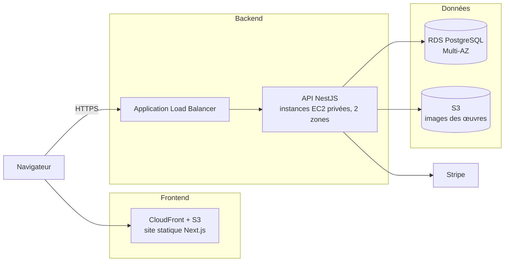

# Galerie d'art en ligne


Plateforme web où les artistes publient leurs œuvres (peintures, décoration murale, art numérique, croquis) et où les acheteurs les découvrent, contactent l'artiste et les achètent avec un vrai parcours de paiement. L'application est déployée sur une infrastructure AWS 3 tiers haute disponibilité, entièrement décrite avec Terraform.

Le projet comporte trois parties. **Ce README donne la vue d'ensemble ; le détail de chaque partie est dans le README de son dossier.**

## Sommaire

- [Les trois parties du projet](#les-trois-parties-du-projet)
- [Architecture globale](#architecture-globale)
- [Fonctionnalités](#fonctionnalités)
- [Rôles et permissions](#rôles-et-permissions)
- [Stack technique](#stack-technique)
- [Structure du dépôt](#structure-du-dépôt)
- [Démarrage rapide](#démarrage-rapide)
- [Scripts](#scripts)
- [Workflow Git](#workflow-git)
- [Feuille de route](#feuille-de-route)

## Les trois parties du projet

| | Frontend | Backend | Infrastructure |
|---|---|---|---|
| **Rôle** | Interface web : catalogue, espaces acheteur, artiste et administrateur | API REST : authentification, œuvres, commandes, paiement, messagerie, administration | Réseau, sécurité, calcul, base de données et stockage sur AWS |
| **Technologies** | Next.js 15, React 19, TypeScript, CSS natif | NestJS 10, TypeORM, Passport JWT, Stripe, PostgreSQL 16 | Terraform, boto3, AWS Academy Learner Lab |
| **Livrable** | Export statique (`frontend/out`) servi par S3 et CloudFront | API Node.js sur EC2 derrière un ALB, base sur RDS | Modules Terraform `network`, `security`, `compute` (puis `rds`, `s3`) |
| **État** | Fonctionnel en local | Fonctionnel en local | Réseau, sécurité, bastion et backend de test déployables. ALB, ASG, RDS, S3 et CloudFront à venir |
| **Documentation** | [`frontend/README.md`](frontend/README.md) | [`backend/README.md`](backend/README.md) | [`infra/README.md`](infra/README.md) |

Où trouver quoi :

- **Pages, captures d'écran, configuration de l'interface, build statique** : [frontend](frontend/README.md)
- **Variables d'environnement, modules, règles métier, modèle de données, base de données, seed** : [backend](backend/README.md)
- **VPC, groupes de sécurité, NAT, instances, coûts, destruction, dépannage** : [infra](infra/README.md)

## Architecture globale



- Le **frontend** est exporté en fichiers statiques et appelle l'API depuis le navigateur.
- Le **backend** tourne sur des instances EC2 privées réparties sur deux zones de disponibilité, derrière un Application Load Balancer.
- La **base** est une instance RDS PostgreSQL Multi-AZ, isolée dans des sous-réseaux privés. Les images envoyées par les artistes iront sur S3.
- L'**infrastructure** est créée et détruite uniquement avec Terraform, jamais à la main dans la console AWS.

Le réseau actuellement déployé (VPC, trois niveaux de sous-réseaux, NAT, groupes de sécurité) est détaillé et illustré dans [`infra/README.md`](infra/README.md#architecture).

> **État d'avancement** : l'application (frontend, API, base, paiement) est fonctionnelle en local. En production, les images devront passer du disque du backend (`backend/uploads`) à S3, car les instances de l'Auto Scaling Group ne partagent pas de disque.

## Fonctionnalités

| Profil | Ce qu'il peut faire |
|---|---|
| **Visiteur** | Parcourir le catalogue par catégorie, rechercher, filtrer par prix, trier, consulter la fiche d'une œuvre |
| **Acheteur** | Demander l'achat d'une œuvre avec un message, suivre ses demandes, payer par carte, imprimer un reçu, écrire aux artistes |
| **Artiste** | Publier, modifier et supprimer ses œuvres (avec image), accepter ou refuser les demandes, contacter les acheteurs, suivre ses ventes et revenus |
| **Administrateur** | Statistiques, gestion des utilisateurs, des œuvres, des commandes et des catégories, contact de tout utilisateur |
| **Tous les comptes** | Profil modifiable, changement de mot de passe |

Les pages correspondantes sont décrites dans [frontend](frontend/README.md#pages-par-rôle) et les règles métier dans [backend](backend/README.md#règles-métier).

## Rôles et permissions

Le rôle est choisi à l'inscription (acheteur ou artiste). Le compte administrateur est créé au premier démarrage du backend. L'API relit le rôle et l'état du compte en base à chaque requête : une suspension ou un changement de rôle prend effet immédiatement.

| Action | Visiteur | Acheteur | Artiste | Admin |
|---|:-:|:-:|:-:|:-:|
| Parcourir et rechercher les œuvres | oui | oui | oui | oui |
| Demander l'achat d'une œuvre | | oui | oui (pas la sienne) | |
| Payer une commande acceptée | | oui | oui | |
| Publier, modifier, supprimer ses œuvres | | | oui | toutes |
| Accepter ou refuser une demande | | | ses œuvres | toutes |
| Envoyer des messages | | oui (voir règles) | oui | à tous |
| Modifier son profil et son mot de passe | | oui | oui | oui |
| Statistiques, utilisateurs, catégories | | | | oui |

Les règles de la messagerie sont dans le [README du backend](backend/README.md#messagerie).

## Stack technique

| Couche | Technologie | Détail |
|---|---|---|
| Frontend | Next.js 15 (App Router, export statique), React 19, TypeScript, CSS natif | [frontend/](frontend/README.md#stack) |
| Backend | NestJS 10, TypeORM, Passport JWT, class-validator, Multer, Stripe SDK | [backend/](backend/README.md#stack) |
| Base de données | PostgreSQL 16 (Docker en local, Amazon RDS en production) | [backend/](backend/README.md#modèle-de-données) |
| Infrastructure | Terraform, scripts boto3, AWS Academy Learner Lab (`us-east-1`) | [infra/](infra/README.md) |
| Outillage | npm, concurrently, Docker Compose, Adminer, Python 3 (seed) | |

## Structure du dépôt

```
art-gallery-aws/
├── frontend/        # Next.js            → frontend/README.md
├── backend/         # NestJS             → backend/README.md
├── infra/           # Terraform (AWS)    → infra/README.md
├── scripts/         # seed de données, générateur d'images, scripts boto3
├── docs/            # schéma d'architecture, livrables, captures d'écran
├── docker-compose.yml            # PostgreSQL
├── docker-compose.override.yml   # Adminer (visualisation de la base)
├── package.json     # commandes racine (dev, seed, install:all)
└── README.md
```

## Démarrage rapide

Cette section lance l'application en local (frontend, backend et base). Pour l'infrastructure AWS, suivez [`infra/README.md`](infra/README.md#usage).

**Prérequis** : Node.js 20+, Docker, Python 3.9+ (pour le seed uniquement).

```bash
git clone https://github.com/AjmiOns/art-gallery-aws.git
cd art-gallery-aws

# 1. Configuration
cp backend/.env.example backend/.env          # changer JWT_SECRET et ADMIN_PASSWORD
cp frontend/.env.local.example frontend/.env.local

# 2. Dépendances (racine, backend et frontend)
npm run install:all

# 3. Base de données + backend + frontend
npm start

# 4. Données de test (dans un second terminal, API démarrée)
npm run seed -- --reset
```

| Service | Adresse |
|---|---|
| Site | <http://localhost:3000> |
| API | <http://localhost:3001/api> |
| Visualisation de la base (Adminer) | <http://localhost:8080> |

Ouvrez le site via `localhost` : une autre adresse est refusée par la politique CORS du backend.

**Comptes de démonstration** (créés par le seed, mot de passe `Password123!`) : `artiste01@gallery.test`, `acheteur01@gallery.test`. L'administrateur est `admin@gallery.test` avec le mot de passe `ADMIN_PASSWORD` de votre `backend/.env` (`Admin1234!` par défaut).

> **Windows PowerShell 5** : l'opérateur `&&` n'est pas reconnu. Utilisez `;` ou lancez les commandes une par une. Remplacez `cp` par `Copy-Item` si besoin.

Configuration détaillée : [frontend](frontend/README.md#configuration) et [backend](backend/README.md#configuration).

## Scripts

| Commande (racine) | Action |
|---|---|
| `npm run install:all` | Installe les dépendances de la racine, du backend et du frontend |
| `npm start` | Démarre PostgreSQL et Adminer (Docker), puis le backend et le frontend |
| `npm run dev` | Démarre uniquement le backend et le frontend |
| `npm run db` | Démarre uniquement PostgreSQL et Adminer |
| `npm run seed` | Injecte des données de test (options : [backend](backend/README.md#données-de-test)) |

Par application : `npm run build` produit le backend (`backend/dist`) ou l'export statique du frontend (`frontend/out`). Les commandes Terraform sont dans [`infra/README.md`](infra/README.md#usage).

## Workflow Git

- `main` est la branche stable : pas de push direct, modifications par pull request avec au moins une review.
- Chaque membre travaille sur sa branche personnelle `prenom-nom-Branch` (par exemple `ons-ajmi-Branch`), créée depuis `main` et mise à jour régulièrement avec `git pull origin main`.
- Les commits suivent la convention [Conventional Commits](https://www.conventionalcommits.org/fr/) : `type(scope): description`, à l'impératif et en anglais.
- Une pull request regroupe des commits atomiques. Elle est fusionnée avec **Create a merge commit** ou **Rebase and merge**, jamais en squash, afin de conserver l'historique par commit.

| Type | Usage |
|---|---|
| `feat` | Nouvelle fonctionnalité |
| `fix` | Correction de bug |
| `docs` | Documentation uniquement |
| `refactor` | Réécriture sans changement de comportement |
| `test` | Ajout ou correction de tests |
| `chore` | Outillage, configuration, dépendances |
| `infra` | Terraform, scripts AWS |

Ne committez jamais de fichier `.env`, de `node_modules`, d'état Terraform (`*.tfstate`), de clé `labsuser.pem` ni le contenu de `backend/uploads/` : le `.gitignore` les exclut.

> Pour le Terraform, détruire l'infrastructure (`./destroy.sh`) à la fin de **chaque** session afin de maîtriser le coût (budget Learner Lab limité).

## Feuille de route

Vue globale. Le détail de chaque partie est dans son README.

**Frontend** ([détail](frontend/README.md#feuille-de-route))
- [x] Catalogue, espaces par rôle, paiement, messagerie, interface responsive
- [ ] Messagerie en temps réel, pagination, tests, déploiement S3 + CloudFront

**Backend** ([détail](backend/README.md#feuille-de-route))
- [x] Authentification JWT, trois rôles, œuvres, commandes, paiement (démonstration et Stripe test), messagerie, administration, seed
- [ ] Migrations TypeORM, images sur S3, e-mails, webhooks Stripe, pagination, tests et CI, documentation des routes

**Infrastructure** ([détail](infra/README.md#roadmap-future-work))
- [x] VPC, sous-réseaux multi-AZ, groupes de sécurité, NAT, bastion, premier backend, script de destruction
- [ ] ALB, Auto Scaling Group, RDS Multi-AZ, S3 et CloudFront, Secrets Manager
- [ ] Scripts boto3, CloudWatch, état distant, test de charge k6