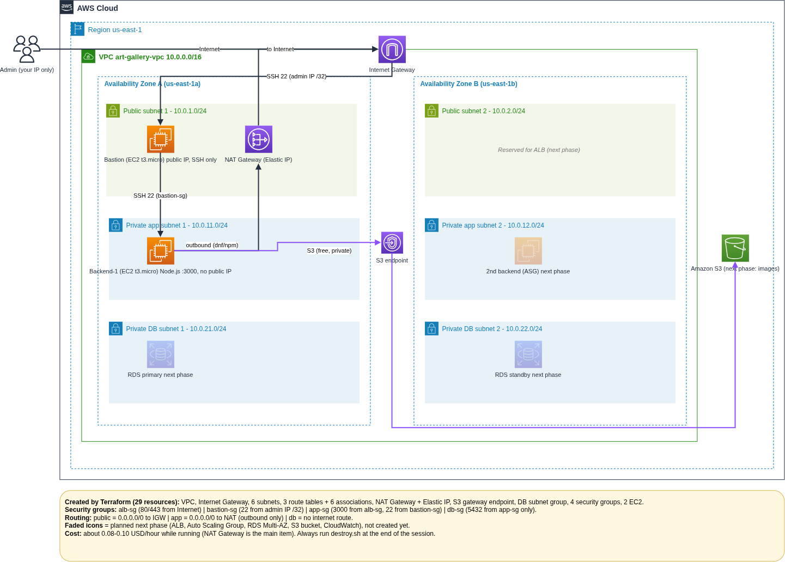

# Online Art Gallery - AWS Infrastructure (Terraform)


Infrastructure as Code for the **Online Art Gallery** project (exhibition and sale of artworks online), deployed on **AWS Academy Learner Lab** (region `us-east-1`).

- Application stack: PERN (PostgreSQL on Amazon RDS, Express, React, Node.js)
- Deliverable covered by this folder: **L3** (VPC, multi-AZ subnets, security groups, first instance, outbound access, destroy script)

> Rule of the course: nothing is built by hand in the AWS console. Everything is created and destroyed with Terraform.

## Team

- Ahmed Liwane
- Ala Eddine Sammouda
- Insaf Azizi
- Hamza Arfaoui
- Ons Ajmi

## Architecture



Editable source: `images/` (draw.io). Faded elements in the diagram are planned for the next phases and are **not created yet**.

```
Internet
   |
Internet Gateway
   |
[Public subnet 1 | Public subnet 2]   Bastion, NAT Gateway
   |  (NAT = outbound only)
[App subnet 1    | App subnet 2   ]   Backend (Node.js :3000)
   |  (port 5432 from app-sg only)
[DB subnet 1     | DB subnet 2    ]   reserved for RDS PostgreSQL Multi-AZ
```

## What is deployed today (29 resources)

### Network (`modules/network`)

| Resource | Count | Detail |
|---|---|---|
| VPC | 1 | `10.0.0.0/16`, DNS enabled |
| Internet Gateway | 1 | Two-way internet for public subnets |
| Subnets | 6 | 2 AZs (`us-east-1a`, `us-east-1b`) x 3 tiers |
| Route tables | 3 | public, app, db |
| Routes | 2 | public -> IGW, app -> NAT |
| Route table associations | 6 | one per subnet |
| Elastic IP | 1 | for the NAT Gateway |
| NAT Gateway | 1 | in public subnet 1, outbound-only access |
| S3 gateway endpoint | 1 | free private path to S3 (no bucket yet) |
| DB subnet group | 1 | ready for RDS Multi-AZ |

| Tier | AZ a | AZ b | Internet access |
|---|---|---|---|
| Public | 10.0.1.0/24 | 10.0.2.0/24 | Two-way, via Internet Gateway |
| App (private) | 10.0.11.0/24 | 10.0.12.0/24 | Outbound only, via NAT Gateway |
| DB (private) | 10.0.21.0/24 | 10.0.22.0/24 | None |

### Security (`modules/security`)

| Security group | Accepts | From |
|---|---|---|
| `alb-sg` | 80, 443 | Internet |
| `bastion-sg` | 22 (SSH) | Admin IP only (`/32`) |
| `app-sg` | 3000 (API), 22 | `alb-sg`, `bastion-sg` |
| `db-sg` | 5432 (PostgreSQL) | `app-sg` only |

Each tier trusts only the tier before it. Rules reference security groups, not IP addresses.

### Compute (`modules/compute`)

| Instance | Subnet | Public IP | Role |
|---|---|---|---|
| `art-gallery-bastion` | Public 1 | Yes | SSH jump server |
| `art-gallery-backend-1` | App 1 (private) | No | Node.js test server on port 3000 |

Both are `t3.micro` on Amazon Linux 2023. The backend runs a startup script (`user_data`) that installs Node.js through the NAT Gateway, which proves that outbound access works.

## Outbound access: justification

Private instances must download packages (dnf, npm) but must never be reachable from the internet.

| Option | Pros | Cons | Decision |
|---|---|---|---|
| NAT Gateway (one, AZ a) | Managed, simple, reliable | ~0.045 USD/h + data | **Chosen** |
| NAT Gateway per AZ | Highest availability | Doubles the cost | Rejected (budget) |
| NAT instance | Cheaper | We manage patching and failover | Rejected (operational risk) |
| VPC endpoints only | No NAT cost | Only covers AWS services | Used **in addition** (S3 gateway endpoint, free) |

Known weakness: one NAT in AZ a means an AZ a failure cuts the outbound traffic of AZ b. Inbound user traffic (through the future ALB) is not affected. This is an accepted cost trade-off for a 50 USD budget.

## Project structure

```
terraform/
|-- versions.tf                 provider + region + default tags
|-- variables.tf                inputs and defaults
|-- main.tf                     calls the 3 modules
|-- outputs.tf                  bastion IP, backend IP, SSH command
|-- terraform.tfvars.example    template for your personal values
|-- destroy.sh                  destroy + leftover check
|-- images/                     architecture diagrams
`-- modules/
    |-- network/                VPC, subnets, gateways, routes, endpoint
    |-- security/               4 security groups
    `-- compute/                bastion + first backend
```

Each module has `variables.tf` (inputs), `main.tf` (resources), `outputs.tf` (outputs).

## Prerequisites

- Terraform >= 1.5 (`sudo snap install terraform --classic`)
- AWS CLI v2 (`sudo snap install aws-cli --classic`)
- An active AWS Academy Learner Lab session
- The Learner Lab key `labsuser.pem` (`chmod 400 labsuser.pem`)

## Usage

### 1. Credentials (every lab session)

AWS Academy -> Start Lab -> AWS Details -> Show. Paste the 3 values into `~/.aws/credentials`:

```
[default]
aws_access_key_id=...
aws_secret_access_key=...
aws_session_token=...
```

Check: `aws sts get-caller-identity`. Credentials expire when the lab session ends.

### 2. Configure

```bash
cp terraform.tfvars.example terraform.tfvars
curl -4 ifconfig.me        # your public IPv4
nano terraform.tfvars      # admin_cidr = "YOUR.IP/32"
```

### 3. Deploy

```bash
terraform init
terraform validate
terraform plan             # expected: Plan: 29 to add
terraform apply
```

### 4. Test

```bash
eval "$(ssh-agent -s)"
ssh-add labsuser.pem
ssh -J ec2-user@<bastion_public_ip> ec2-user@<backend_private_ip>
curl localhost:3000        # expected: art-gallery backend OK
```

### 5. Destroy (mandatory at the end of every session)

```bash
./destroy.sh
```

The script runs `terraform destroy`, then checks EC2, NAT Gateways, Elastic IPs, load balancers and RDS. It must finish with `OK: nothing billable left.`

## Cost

| Item | Approx. cost while running |
|---|---|
| NAT Gateway | 0.045 USD/h + data |
| 2 x t3.micro | ~0.02 USD/h |
| Public IPv4 addresses | ~0.005 USD/h each |
| VPC, subnets, routes, security groups, endpoint | free |

About **0.08-0.10 USD per hour**. A forgotten week costs about 35% of the 50 USD credit, so **always destroy at the end of the session**.

## Non-functional objectives (from L1)

| Objective | Target | How it is addressed |
|---|---|---|
| Instance loss tolerance | No downtime if one app instance stops | 2 AZs now; ALB + Auto Scaling Group next |
| Load | 50 concurrent users (100 peak) | k6 load test planned |
| Rebuild time | <= 15 minutes | Terraform apply from scratch, timed |
| Max data loss | <= 5 minutes | RDS automated backups with point-in-time recovery (planned) |
| Budget | <= 50 USD | Destroy after every session, single NAT, t3.micro |

## Roadmap (future work)

- [x] VPC, multi-AZ subnets, route tables
- [x] Security groups (ALB -> app -> DB)
- [x] NAT Gateway outbound access + S3 gateway endpoint
- [x] Bastion + first backend instance
- [x] Destroy script with leftover check
- [ ] Application Load Balancer (public subnets)
- [ ] Launch Template + Auto Scaling Group (min 2, one per AZ)
- [ ] RDS PostgreSQL Multi-AZ with automated backups (5-minute RPO)
- [ ] S3 bucket for artwork images
- [ ] CloudWatch logs, metrics and alarms
- [ ] Deploy the React + Node.js application
- [ ] Remote state in S3 (team collaboration)
- [ ] k6 load test and full rebuild-time measurement
- [ ] Architecture diagram version 2 (with ALB, ASG, RDS)

## Security notes

- Never commit `terraform.tfvars`, `*.tfstate`, `.terraform/`, `labsuser.pem` or AWS credentials (all covered by `.gitignore`).
- Commit `.terraform.lock.hcl`.
- Keep `terraform.tfstate` until you have run `destroy`; without it Terraform cannot find your resources.
- Database passwords must be passed as `sensitive` variables, never written in Git.
- If your public IP changes, update `admin_cidr` and run `terraform apply` again.

## Troubleshooting

| Problem | Fix |
|---|---|
| `Permission denied: ./destroy.sh` | `chmod +x destroy.sh` |
| `ExpiredToken` / auth error | Restart the lab, paste new credentials |
| SSH to bastion hangs | Your IP changed: update `admin_cidr`, `terraform apply` |
| `Permission denied (publickey)` | `ssh-add labsuser.pem`, check with `ssh-add -l` |
| `curl localhost:3000` fails | Wait 1-2 minutes (Node.js installing), check `/var/log/cloud-init-output.log` |
