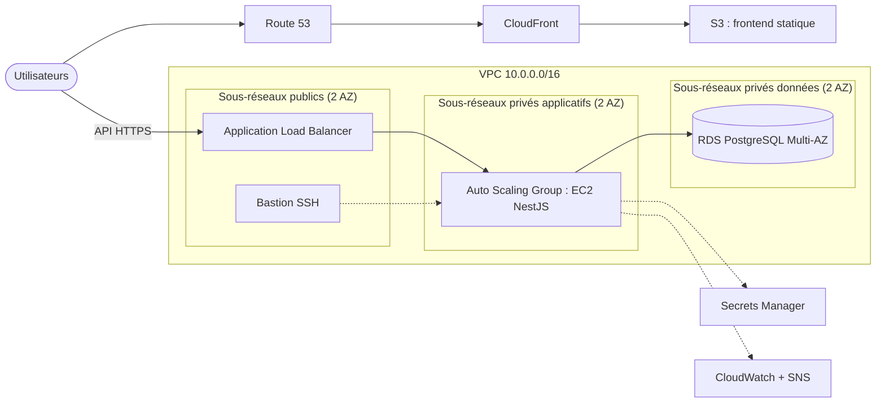
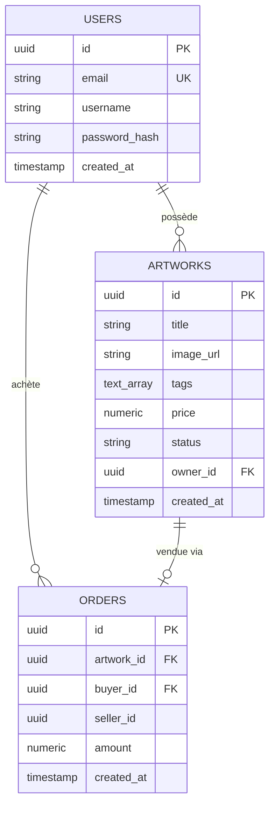

# Galerie d'art en ligne


Plateforme web où les artistes publient leurs œuvres (peintures, décoration murale, art numérique, croquis) et où les visiteurs les découvrent et les achètent. L'application est conçue pour être déployée sur une infrastructure AWS 3 tiers haute disponibilité, décrite dans la section [Architecture cible](#architecture-cible).


## Sommaire

- [Fonctionnalités](#fonctionnalités)
- [Aperçu](#aperçu)
- [Stack technique](#stack-technique)
- [Architecture cible](#architecture-cible)
- [Structure du dépôt](#structure-du-dépôt)
- [Démarrage rapide](#démarrage-rapide)
- [Configuration](#configuration)
- [Scripts](#scripts)
- [Référence de l'API](#référence-de-lapi)
- [Modèle de données](#modèle-de-données)
- [Données de test](#données-de-test)
- [Déploiement](#déploiement)
- [Workflow Git](#workflow-git)
- [Dépannage](#dépannage)
- [Feuille de route](#feuille-de-route)
- [Auteur](#auteur)

## Fonctionnalités

- **Catalogue par catégorie** : œuvres classées en quatre catégories, chacune avec son carrousel, plus une sélection à la une.
- **Recherche et filtres combinables** : titre, catégorie, prix maximum, tri par date ou par prix.
- **Compte utilisateur** : inscription, connexion, session par jeton JWT.
- **Publication d'œuvres** : un artiste choisit une catégorie, une image et un prix. Lui seul peut modifier ou supprimer son œuvre.
- **Achat direct** : confirmation avant achat, transaction verrouillée côté base pour qu'une œuvre ne soit jamais vendue deux fois.
- **Interface responsive** : design pastel, navigation clavier, fenêtre de détail accessible, respect de `prefers-reduced-motion`.

## Aperçu

| Catalogue | Détail d'une œuvre |
|---|---|
|  |  |

| Connexion | Mobile |
|---|---|
|  |  |

## Stack technique

| Couche | Technologie |
|---|---|
| Frontend | Next.js 15 (App Router, export statique), React 19, TypeScript, CSS natif |
| Backend | NestJS 10, TypeORM, Passport JWT, class-validator |
| Base de données | PostgreSQL 16 (Docker en local, Amazon RDS en production) |
| Infrastructure | Terraform, scripts boto3, AWS Academy Learner Lab |
| Outillage | npm, concurrently, Docker Compose, Python 3 (seed) |

## Architecture cible

Le frontend est exporté en fichiers statiques servis par S3 et CloudFront. L'API tourne sur des instances EC2 privées derrière un Application Load Balancer, sur deux zones de disponibilité. La base est une instance RDS PostgreSQL Multi-AZ, isolée dans des sous-réseaux privés.



> **État d'avancement** : l'application (frontend, API, base) est fonctionnelle en local. Les modules Terraform de `infra/` sont à écrire (voir la [feuille de route](#feuille-de-route)).

## Structure du dépôt

```
art-gallery-aws/
├── frontend/        # Next.js (pages, composants, client API, images)
├── backend/         # NestJS (auth, users, artworks, orders, health)
├── infra/           # Terraform (modules : network, compute, rds, s3)
├── scripts/         # seed de données, générateur d'images, scripts boto3
├── docs/            # schéma d'architecture, livrables, captures d'écran
├── docker-compose.yml
├── package.json     # commandes racine (dev, seed, install:all)
└── README.md
```

## Démarrage rapide

**Prérequis** : Node.js 20+, Docker, Python 3.9+ (pour le seed uniquement).

```bash
git clone https://github.com/AjmiOns/art-gallery-aws.git
cd art-gallery-aws

# 1. Configuration
cp backend/.env.example backend/.env          # changer JWT_SECRET
cp frontend/.env.local.example frontend/.env.local

# 2. Dépendances (racine, backend et frontend)
npm run install:all

# 3. Base de données + backend + frontend
npm start

# 4. Données de test (dans un second terminal, API démarrée)
npm run seed -- --reset
```

Le frontend est disponible sur <http://localhost:3000> et l'API sur <http://localhost:3001/api>. Ouvrez bien le site via `localhost` : une autre adresse est refusée par la politique CORS du backend (voir [Configuration](#configuration)).

> **Windows PowerShell 5** : l'opérateur `&&` n'est pas reconnu. Utilisez `;` ou lancez les commandes une par une. Remplacez `cp` par `Copy-Item` si besoin.

## Configuration

### Backend (`backend/.env`)

| Variable | Défaut | Description |
|---|---|---|
| `PORT` | `3001` | Port de l'API |
| `NODE_ENV` | `development` | `production` désactive `synchronize` |
| `FRONTEND_URL` | `http://localhost:3000` | Origines CORS autorisées, séparées par des virgules |
| `DB_HOST` | `localhost` | Hôte PostgreSQL |
| `DB_PORT` | `5432` | Port PostgreSQL |
| `DB_USER` / `DB_PASSWORD` / `DB_NAME` | `gallery` / `gallery` / `art_gallery` | Identifiants de la base |
| `DB_SSL` | `false` | `true` pour Amazon RDS |
| `JWT_SECRET` | `change-me` | Secret de signature des jetons. **À remplacer.** |
| `JWT_EXPIRES_IN` | `1d` | Durée de validité d'un jeton |

### Frontend (`frontend/.env.local`)

| Variable | Défaut | Description |
|---|---|---|
| `NEXT_PUBLIC_API_URL` | `http://localhost:3001/api` | URL de l'API, intégrée au build |
| `NEXT_PUBLIC_CURRENCY` | `TND` | Devise affichée |

Les fichiers `.env` ne sont jamais versionnés. En production, les secrets proviennent d'AWS Secrets Manager.

## Scripts

| Commande (racine) | Action |
|---|---|
| `npm run install:all` | Installe les dépendances de la racine, du backend et du frontend |
| `npm start` | Démarre PostgreSQL (Docker), puis le backend et le frontend |
| `npm run dev` | Démarre uniquement le backend et le frontend |
| `npm run db` | Démarre uniquement PostgreSQL |
| `npm run seed` | Injecte des œuvres de test (voir [Données de test](#données-de-test)) |

Par application : `npm run build` produit le backend (`backend/dist`) ou l'export statique du frontend (`frontend/out`).

## Référence de l'API

Préfixe : `/api`. Les routes protégées attendent l'en-tête `Authorization: Bearer <accessToken>`. Les corps de requête sont validés : un champ inconnu est refusé (`400`).

| Méthode | Route | Accès | Description |
|---|---|---|---|
| `POST` | `/auth/register` | public | Crée un compte |
| `POST` | `/auth/login` | public | Retourne un jeton |
| `GET` | `/auth/me` | connecté | Profil de l'utilisateur |
| `GET` | `/artworks` | public | Liste filtrable des œuvres |
| `GET` | `/artworks/:id` | public | Détail d'une œuvre |
| `POST` | `/artworks` | connecté | Publie une œuvre |
| `PATCH` | `/artworks/:id` | propriétaire | Modifie une œuvre |
| `DELETE` | `/artworks/:id` | propriétaire | Supprime une œuvre |
| `POST` | `/orders` | connecté | Achète une œuvre disponible |
| `GET` | `/orders/me` | connecté | Achats et ventes de l'utilisateur |
| `GET` | `/health` | public | Santé de l'API et de la base (health check ALB) |

Il n'y a pas de route `logout` : le jeton JWT est sans état, le client le supprime.

**Inscription**

```bash
curl -X POST http://localhost:3001/api/auth/register \
  -H "Content-Type: application/json" \
  -d '{"email":"ons@example.com","username":"Ons","password":"motdepasse8"}'
```

```json
{
  "accessToken": "eyJhbGciOi...",
  "user": { "id": "7f0c...", "email": "ons@example.com", "username": "Ons" }
}
```

**Filtrer les œuvres** : `GET /artworks?tag=painting&maxPrice=200&q=lumière`

| Paramètre | Valeurs |
|---|---|
| `tag` | `painting`, `wall art`, `digital`, `sketch` |
| `maxPrice` | nombre, prix maximum inclus |
| `q` | recherche insensible à la casse sur le titre |

**Publier une œuvre**

```bash
curl -X POST http://localhost:3001/api/artworks \
  -H "Authorization: Bearer $TOKEN" -H "Content-Type: application/json" \
  -d '{"title":"Horizon d'\''automne","imageUrl":"/artworks/painting/painting-08.jpg","tags":["painting"],"price":120}'
```

`imageUrl` accepte un lien `http(s)` ou un chemin du site commençant par `/`. Le premier tag est la catégorie principale de l'œuvre.

**Erreurs courantes** : `400` données invalides ou achat impossible (œuvre déjà vendue, achat de sa propre œuvre), `401` jeton absent ou expiré, `403` œuvre appartenant à un autre utilisateur, `404` ressource introuvable, `409` e-mail déjà utilisé.

## Modèle de données



`status` vaut `available` ou `sold`. Le montant d'une commande est figé au moment de la vente. En développement, le schéma est créé automatiquement (`synchronize`). Avant la production, il devra passer par des migrations.

## Données de test

`npm run seed` crée 12 comptes artistes et 200 œuvres réparties à parts égales entre les quatre catégories, dont environ 8 % déjà vendues. Le backend doit être démarré.

| Option | Effet |
|---|---|
| `--count 300` | Nombre d'œuvres à créer |
| `--reset` | Vide d'abord les œuvres et les commandes (les comptes sont conservés). Nécessite Docker. |
| `--seed 42` | Graine aléatoire, pour des résultats reproductibles |
| `--buy-ratio 0` | Aucune œuvre vendue |
| `--dry-run` | Affiche des exemples sans rien envoyer |
| `--api <url>` | URL de l'API (défaut : `http://127.0.0.1:3001/api`) |

Comptes de test : `artiste01@gallery.test` à `artiste12@gallery.test`, mot de passe `Password123!`.

Les 72 images viennent de `frontend/public/artworks/<catégorie>/`. Elles sont générées par `scripts/generate_artworks.py` (prérequis : `pip install numpy scipy pillow opencv-python`). Pour utiliser vos propres images, déposez-les dans ces dossiers et relancez le seed avec `--reset`.

## Déploiement

1. **Frontend** : `npm run build --prefix frontend` produit `frontend/out/`, à déposer dans le bucket S3 derrière CloudFront. `NEXT_PUBLIC_API_URL` doit pointer vers l'URL publique de l'API avant le build.
2. **Backend** : `npm run build --prefix backend`, puis `npm run start:prod --prefix backend` sur les instances EC2 de l'Auto Scaling Group. Le health check de l'ALB cible `GET /api/health`.
3. **Base de données** : Amazon RDS PostgreSQL, `DB_SSL=true`, accessible uniquement depuis les sous-réseaux applicatifs.
4. **Configuration** : `NODE_ENV=production` (désactive `synchronize`), `JWT_SECRET` et mot de passe RDS stockés dans AWS Secrets Manager, `FRONTEND_URL` réglé sur le domaine CloudFront.

Tous les services doivent rester compatibles avec les restrictions d'AWS Academy Learner Lab (rôle IAM imposé, budget limité). Pensez à détruire l'infrastructure (`terraform destroy`) après chaque session pour maîtriser le coût.

## Workflow Git

- `main` est la branche stable : pas de push direct, modifications par pull request avec au moins une review.
- Chaque membre travaille sur sa branche personnelle `prenom-nom-Branch` (par exemple `ons-ajmi-Branch`), créée depuis `main` et mise à jour régulièrement avec `git pull origin main`.
- Les commits suivent la convention [Conventional Commits](https://www.conventionalcommits.org/fr/) : `type(scope): description`, à l'impératif et en anglais.
- Une pull request regroupe des commits atomiques. Elle est fusionnée avec **Create a merge commit** ou **Rebase and merge**, jamais en squash, afin de conserver l'historique par commit.

| Type | Usage |
|---|---|
| `feat` | Nouvelle fonctionnalité |
| `fix` | Correction de bug |
| `docs` | Documentation uniquement |
| `refactor` | Réécriture sans changement de comportement |
| `test` | Ajout ou correction de tests |
| `chore` | Outillage, configuration, dépendances |
| `infra` | Terraform, scripts AWS |

Ne committez jamais de fichier `.env`, de `node_modules`, ni d'état Terraform (`*.tfstate`) : le `.gitignore` les exclut déjà.

## Dépannage

| Symptôme | Cause probable | Solution |
|---|---|---|
| `Failed to fetch` sur le site | Site ouvert via une adresse autre que `localhost`, ou API arrêtée | Ouvrir `http://localhost:3000` et vérifier `http://localhost:3001/api/health` |
| `EADDRINUSE` sur le port 3001 ou 3000 | Un ancien processus tourne encore | Trouver le processus avec `Get-NetTCPConnection -LocalPort 3001`, puis `Stop-Process -Id <PID>` |
| `password authentication failed for user "gallery"` | Un autre PostgreSQL occupe le port 5432 | Dans `docker-compose.yml`, mapper `5433:5432`, puis mettre `DB_PORT=5433` dans `backend/.env` |
| `ConnectionRefused` pendant le seed | Backend non démarré | Lancer `npm run dev` dans un autre terminal, puis relancer le seed |
| `EIDLETIMEOUT` pendant `npm install` | Réseau lent | `npm config set fetch-timeout 600000`, puis relancer |
| `&&` non reconnu | PowerShell 5 | Séparer les commandes par `;` |

## Feuille de route

- [x] Authentification JWT
- [x] CRUD des œuvres avec filtres et droits de propriété
- [x] Achat direct transactionnel
- [x] Interface responsive avec carrousels par catégorie
- [x] Seed de données et images de démonstration
- [ ] Modules Terraform (réseau, calcul, RDS, S3, CloudFront)
- [ ] Scripts boto3 (snapshot et restauration RDS, test de résilience, rapport de coûts)
- [ ] Migrations TypeORM
- [ ] Envoi d'images vers S3 par URL présignées
- [ ] Notifications par e-mail (acheteur et vendeur)
- [ ] Tests automatisés et intégration continue (GitHub Actions)
- [ ] Pagination de l'API et page « Mes commandes »
- [ ] Enchères en temps réel (Socket.io)

