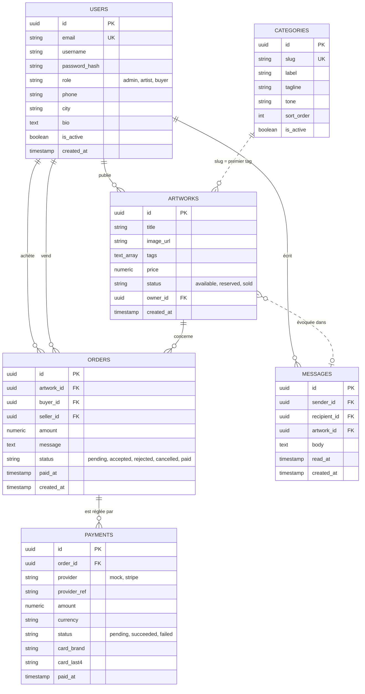

# Backend : API de la galerie d'art


API REST de la [galerie d'art en ligne](../README.md). Elle gère l'authentification, les œuvres, les commandes, le paiement, la messagerie et l'administration. Elle est consommée par le [frontend](../frontend/README.md) et déployée sur des instances EC2 décrites dans [`infra/`](../infra/README.md).

## Sommaire

- [Stack](#stack)
- [Démarrage](#démarrage)
- [Configuration](#configuration)
- [Modules](#modules)
- [Règles métier](#règles-métier)
- [Modèle de données](#modèle-de-données)
- [Visualiser la base de données](#visualiser-la-base-de-données)
- [Données de test](#données-de-test)
- [Déploiement](#déploiement)
- [Feuille de route](#feuille-de-route)

## Stack

| Élément | Technologie |
|---|---|
| Framework | NestJS 10, TypeScript |
| Base de données | PostgreSQL 16 via TypeORM |
| Authentification | Passport JWT |
| Validation | class-validator |
| Envoi de fichiers | Multer |
| Paiement | Stripe SDK (mode test) et passerelle de démonstration |

## Démarrage

Prérequis : Node.js 20+ et Docker.

```bash
# depuis la racine du dépôt
cp backend/.env.example backend/.env     # changer JWT_SECRET et ADMIN_PASSWORD
npm run install:all
npm run db                               # PostgreSQL + Adminer
npm run dev                              # backend + frontend
```

L'API écoute sur <http://localhost:3001/api>. Le health check est `GET /api/health`.

Depuis `backend/` : `npm run build` produit `backend/dist`, `npm run start:prod` lance la version compilée. Les autres scripts sont listés dans `backend/package.json`.

## Configuration

Toutes les variables sont dans `backend/.env` (modèle : `backend/.env.example`, qui fait foi pour la liste complète, y compris les paramètres de connexion à la base).

| Variable | Rôle |
|---|---|
| `NODE_ENV` | `production` désactive la synchronisation automatique du schéma (`synchronize`) |
| `JWT_SECRET` | Clé de signature des jetons. À changer, jamais commitée |
| `ADMIN_EMAIL` | E-mail du compte administrateur. Un compte existant avec cet e-mail est promu admin au démarrage |
| `ADMIN_PASSWORD` | Mot de passe de l'administrateur créé au premier démarrage (`Admin1234!` par défaut en local) |
| `FRONTEND_URL` | Origine autorisée par la politique CORS (en local : `http://localhost:3000`) |
| `PUBLIC_API_URL` | URL publique de l'API, utilisée pour construire les liens des images envoyées |
| `CURRENCY` | Devise des paiements |
| `PAYMENT_PROVIDER` | `mock` (passerelle de démonstration) ou `stripe` |
| `STRIPE_*` | Clés Stripe (mode test) |
| `DB_SSL` | `true` pour Amazon RDS |

> **Mise à jour d'une installation existante** : ajoutez à `backend/.env` les variables `ADMIN_EMAIL`, `ADMIN_PASSWORD`, `PUBLIC_API_URL`, `CURRENCY`, `PAYMENT_PROVIDER` et `STRIPE_*` de `backend/.env.example`, relancez `npm run install:all`, puis `npm run seed -- --reset`.

## Modules

| Module | Responsabilité |
|---|---|
| `auth` | Inscription, connexion, jetons JWT, contrôle des rôles |
| `users` | Profil, changement de mot de passe, gestion des comptes (admin) |
| `categories` | Catégories (nom, couleur, ordre, activation) |
| `artworks` | CRUD des œuvres, filtres, droits de propriété |
| `orders` | Demandes d'achat et leur cycle de vie |
| `payments` | Paiement par carte (passerelle de démonstration ou Stripe) |
| `messages` | Messagerie entre utilisateurs |
| `uploads` | Envoi d'images (JPG, PNG, WebP, 5 Mo max) |
| `admin` | Statistiques et gestion globale |

> À compléter : la liste des routes de chaque module (méthode, chemin, rôle requis). Un export Swagger (`@nestjs/swagger`) ferait gagner du temps.

## Règles métier

**Rôles.** L'API relit le rôle et l'état (`is_active`) du compte en base à chaque requête. Une suspension ou un changement de rôle est donc immédiat, sans attendre l'expiration du jeton. Le tableau des permissions est dans le [README racine](../README.md#rôles-et-permissions).

**Commandes.** Le prix d'une commande est figé à la demande. Statuts : `pending`, `accepted`, `rejected`, `cancelled`, `paid`. L'artiste accepte ou refuse, l'acheteur paie une commande acceptée. Un artiste ne peut pas acheter sa propre œuvre.

**Œuvres.** Statuts : `available`, `reserved`, `sold`. Le premier tag d'une œuvre est sa catégorie principale (il correspond au `slug` d'une catégorie).

**Paiement.** Deux fournisseurs : `mock` et `stripe`. Seuls la marque et les 4 derniers chiffres de la carte sont conservés, jamais le numéro complet.

### Messagerie

On écrit à l'artiste depuis la fiche d'une de ses œuvres, ou à une personne avec qui on a déjà échangé ou commandé. Les administrateurs peuvent écrire à tous et recevoir de tous. Ces règles limitent les messages non sollicités.

**Images.** Les images envoyées par les artistes sont stockées sur le disque du backend (`backend/uploads`). En production elles iront sur S3, car les instances de l'Auto Scaling Group ne partagent pas de disque.

## Modèle de données



En développement, le schéma est créé et mis à jour automatiquement (`synchronize`). Avant la production, il devra passer par des migrations TypeORM.

## Visualiser la base de données

**1. Adminer, dans le navigateur (le plus simple).** `npm start` (ou `docker compose up -d`) démarre aussi Adminer. Ouvrez <http://localhost:8080/?pgsql=db&username=gallery&db=art_gallery> et saisissez le mot de passe `gallery`. Vous pouvez parcourir chaque table, modifier des lignes, lancer du SQL et exporter les données.

Si vous saisissez les champs à la main : système **PostgreSQL**, serveur `db`, utilisateur `gallery`, mot de passe `gallery`, base `art_gallery`.

**2. En ligne de commande.**

```bash
docker compose exec db psql -U gallery -d art_gallery
```

Commandes utiles : `\dt` liste les tables, `\d artworks` décrit une table, `\q` quitte.

**3. Avec un client graphique** (DBeaver, pgAdmin, extension SQLTools de VS Code) : hôte `localhost`, port `5432` (ou `5433` si vous l'avez remappé dans `docker-compose.yml`), utilisateur `gallery`, mot de passe `gallery`, base `art_gallery`.

**Les images ne sont pas stockées dans la base.** La colonne `artworks.image_url` contient seulement le chemin ou le lien du fichier :

| Origine | Valeur de `image_url` | Emplacement du fichier |
|---|---|---|
| Bibliothèque intégrée | `/artworks/painting/painting-01.jpg` | `frontend/public/artworks/` |
| Envoyée par un artiste | `http://localhost:3001/uploads/<uuid>.jpg` | `backend/uploads/` |
| Lien externe | `https://…` | site distant |

**Requêtes pratiques**

```sql
-- Tous les utilisateurs et leur rôle
SELECT id, username, email, role, is_active, created_at FROM users ORDER BY created_at DESC;

-- Les œuvres avec leur artiste, leur catégorie et leur image
SELECT a.title, a.tags[1] AS categorie, a.price, a.status, a.image_url, u.username AS artiste
FROM artworks a JOIN users u ON u.id = a.owner_id ORDER BY a.created_at DESC;

-- Les commandes avec acheteur et artiste
SELECT o.status, a.title, b.username AS acheteur, s.username AS artiste, o.amount, o.paid_at
FROM orders o JOIN artworks a ON a.id = o.artwork_id
JOIN users b ON b.id = o.buyer_id JOIN users s ON s.id = o.seller_id ORDER BY o.created_at DESC;

-- Les paiements (jamais le numéro de carte complet)
SELECT provider, status, amount, currency, card_brand, card_last4, paid_at FROM payments ORDER BY created_at DESC;

-- Les messages
SELECT s.username AS de, r.username AS a, left(m.body, 60) AS message, m.read_at IS NOT NULL AS lu
FROM messages m JOIN users s ON s.id = m.sender_id JOIN users r ON r.id = m.recipient_id ORDER BY m.created_at DESC;

-- Passer un compte en administrateur
UPDATE users SET role = 'admin' WHERE email = 'vous@exemple.com';
```

## Données de test

`npm run seed` (depuis la racine) crée 12 artistes, 8 acheteurs et 200 œuvres réparties à parts égales entre les quatre catégories, avec des demandes d'achat à tous les stades, des ventes payées pour alimenter les statistiques et des conversations. **Le backend doit être démarré.** Le script se trouve dans `scripts/`.

| Option | Effet |
|---|---|
| `--count 300` | Nombre d'œuvres à créer |
| `--reset` | Repart de zéro : supprime œuvres, commandes, paiements, messages et comptes `@gallery.test` (les administrateurs sont conservés). Nécessite Docker. |
| `--seed 42` | Graine aléatoire, pour des résultats reproductibles |
| `--paid-ratio 0.1` | Part des œuvres vendues |
| `--open-ratio 0.1` | Part des œuvres avec une demande en cours |
| `--dry-run` | Affiche des exemples sans rien envoyer |
| `--api <url>` | URL de l'API (défaut : `http://127.0.0.1:3001/api`) |

Comptes : `artiste01@gallery.test` à `artiste12@gallery.test`, `acheteur01@gallery.test` à `acheteur08@gallery.test`, mot de passe `Password123!`.

Les 72 images viennent de `frontend/public/artworks/<catégorie>/`. Elles sont générées par `scripts/generate_artworks.py` (prérequis : `pip install numpy scipy pillow opencv-python`). Pour utiliser vos propres images, déposez-les dans ces dossiers et relancez le seed avec `--reset`.

## Déploiement

1. `npm run build --prefix backend`, puis `npm run start:prod --prefix backend` sur les instances EC2 de l'Auto Scaling Group.
2. Le health check de l'ALB cible `GET /api/health`.
3. Base : Amazon RDS PostgreSQL, `DB_SSL=true`, accessible uniquement depuis les sous-réseaux applicatifs.
4. `NODE_ENV=production` (désactive `synchronize`). `JWT_SECRET`, `ADMIN_PASSWORD`, mot de passe RDS et clé Stripe dans AWS Secrets Manager. `FRONTEND_URL` réglé sur le domaine CloudFront, `PUBLIC_API_URL` sur le domaine de l'API.
5. Images : remplacer le stockage disque par S3 (URL présignées) avant de passer à plusieurs instances.

> **Port** : en local l'API écoute sur `3001`. Le groupe de sécurité `app-sg` et le serveur de test de l'infrastructure utilisent `3000` pour l'instant. Aligner les deux avant de déployer l'API (voir [`infra/`](../infra/README.md#security-modulessecurity)).

Contraintes AWS Academy Learner Lab : rôle IAM imposé, budget limité. Voir [`infra/README.md`](../infra/README.md).

## Feuille de route

- [x] Authentification JWT et trois rôles
- [x] CRUD des œuvres, envoi d'images, filtres et droits de propriété
- [x] Demande d'achat, validation par l'artiste, paiement (démonstration et Stripe test)
- [x] Messagerie entre utilisateurs
- [x] Administration : statistiques, utilisateurs, œuvres, commandes, catégories
- [x] Profil et changement de mot de passe
- [ ] Migrations TypeORM
- [ ] Stockage des images sur S3 par URL présignées
- [ ] Notifications par e-mail et réinitialisation du mot de passe
- [ ] Webhooks Stripe, passage en mode réel
- [ ] Tests automatisés et intégration continue (GitHub Actions)
- [ ] Pagination de l'API
- [ ] Messagerie en temps réel (Socket.io)
- [ ] Documentation des routes (Swagger)