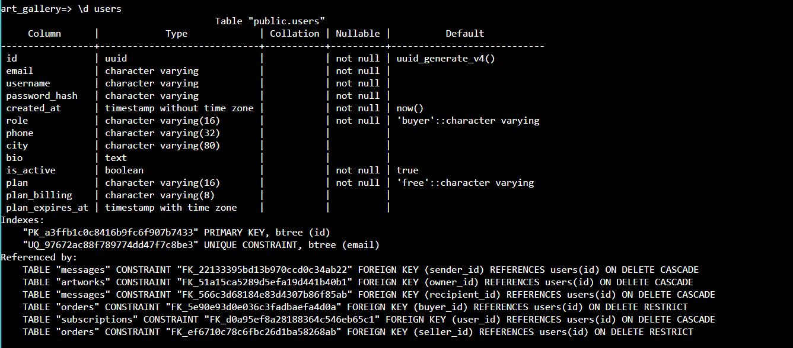
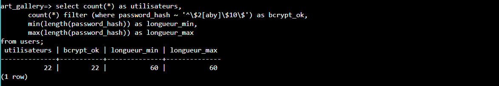
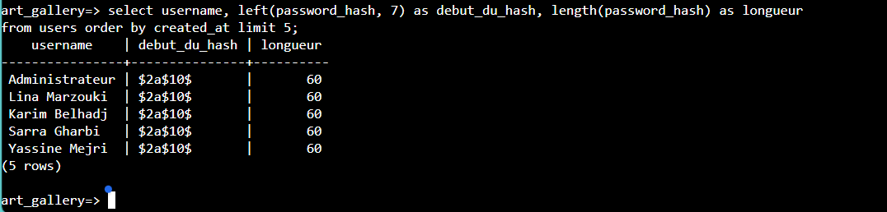
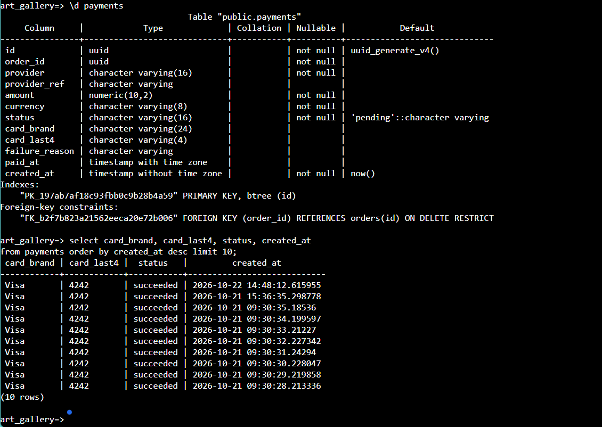
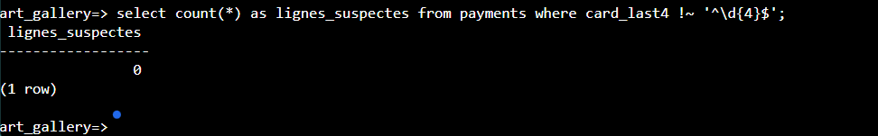

# RDS PostgreSQL: seed, queries and backup

Companion of the [infrastructure README](README.md). It answers four questions:

1. How does `terraform apply` bring the application back **with its data**?
2. How do I **look inside** the database (tables, `select` on `users`, `payments`...)?
3. How do I **keep the data created on AWS** before a destroy?
4. What do I do when something goes wrong?
5. How do I **prove that passwords and cards are protected** in the database (test T12)?

The database is `art-gallery-db` (PostgreSQL 16, private subnets, no public access). Only the app instances can reach port 5432, so every command in sections 2 to 4 is run **on an app instance**, in a Session Manager terminal (no SSH key needed).

## 1. The seed: data that comes back at every apply

```
local Docker database --pg_dump--> s3://art-gallery-data-<suffix>/seed/gallery.sql   (persistent bucket)
terraform apply --> new RDS (empty) --> first app instance boots --> restores the seed --> backend starts
```

The boot script (`modules/asg/user_data.sh.tpl`, step 3b) loads the dump **only if the `users` table does not exist yet**, in one transaction, **before** the backend starts. Nothing to run by hand during a normal apply.

### Create or refresh the seed (PowerShell, Docker Desktop running, from `infra/`)

```powershell
docker exec art-gallery-db pg_dump -U gallery --no-owner --no-acl -f /tmp/gallery.sql art_gallery
docker cp art-gallery-db:/tmp/gallery.sql ..\gallery.sql
aws s3 cp ..\gallery.sql s3://art-gallery-data-<suffix>/seed/gallery.sql
aws s3 ls s3://art-gallery-data-<suffix>/seed/ --human-readable
```

Do this once, then again only when you want the next deployments to contain newer local data. A UTF-8 dump of this project is about 70 KB.

> Never use `pg_dump ... > gallery.sql` in Windows PowerShell: it writes UTF-16 and the restore fails (`invalid byte sequence for encoding "UTF8": 0xff`). The `-f` then `docker cp` way keeps UTF-8.

### Check that the seed was applied

On an app instance:

```bash
sudo grep -E "seed:|=== mode" /var/log/art-gallery-boot.log
```

| Line | Meaning |
|---|---|
| `seed: database restored from the dump` | fresh database, data loaded |
| `seed: users table already present ... skipping` | the other instance did it first, or the database came from a snapshot |
| `seed: no dump in s3://.../seed/, skipping` | nothing uploaded: the database is empty (upload the dump and rebuild) |
| `seed: restore failed or done by another instance` | read the lines above it in the log |

## 2. Look inside the database: tables and select

### Open a terminal on an app instance

AWS console, EC2, Instances, select an `art-gallery-app` instance (not the bastion), **Connect**, tab **Session Manager**, **Connect**. If the button is disabled, wait 2 to 3 minutes after the instance started.

### Open `psql` (nothing to type but this line)

The instance already knows the database host, user and password (file `/etc/art-gallery.env`, readable by root only). This line loads them and opens `psql`:

```bash
sudo bash -c 'set -a; . /etc/art-gallery.env; PGPASSWORD=$DB_PASSWORD psql "host=$DB_HOST port=$DB_PORT dbname=$DB_NAME user=$DB_USER sslmode=require"'
```

The prompt becomes `art_gallery=>`. If `psql` is missing: `sudo dnf install -y postgresql16`.

### Commands inside `psql`

```sql
\dt                      -- list the tables
\d users                 -- columns of a table (do this before selecting)
\d payments
\x                       -- toggle expanded display (one column per line, easier to read)
\q                       -- quit
```

Tables of this application: `users`, `artworks`, `categories`, `orders`, `payments`, `messages`, `subscriptions`.

### Select examples

Run `\d <table>` first: use the column names it shows, the lines below are examples.

```sql
select count(*) from users;
select count(*) from artworks;
select count(*) from orders;
select count(*) from payments;

select * from payments order by 1 desc limit 10;      -- last 10 payments
select * from orders   order by 1 desc limit 10;
select * from categories;
select * from subscriptions order by 1 desc limit 10;

select id, username, plan from users order by id limit 10;
select plan, count(*) from users group by plan;       -- users per plan
```

Do not run `select * from users`: it prints every password hash. Pick the columns you need.

### One query without opening `psql`

```bash
sudo bash -c 'set -a; . /etc/art-gallery.env; PGPASSWORD=$DB_PASSWORD psql "host=$DB_HOST port=$DB_PORT dbname=$DB_NAME user=$DB_USER sslmode=require" -c "select count(*) from users;"'
```

## 3. Keep the data created on AWS before a destroy

`./destroy.sh` deletes RDS. The next apply restores the **seed**, so anything created on the live site since (orders, new accounts) is lost. To keep it, turn the live database into the new seed **before** destroying. On an app instance:

```bash
sudo bash -c 'set -a; . /etc/art-gallery.env; PGPASSWORD=$DB_PASSWORD pg_dump "host=$DB_HOST port=$DB_PORT dbname=$DB_NAME user=$DB_USER sslmode=require" --no-owner --no-acl -f /tmp/seed.sql'
aws s3 cp /tmp/seed.sql s3://art-gallery-data-<suffix>/seed/gallery.sql
rm /tmp/seed.sql
```

Check with `aws s3 ls s3://art-gallery-data-<suffix>/seed/ --human-readable` (new time and size), then destroy. If the upload is denied in your lab, use a snapshot instead:

```powershell
aws rds create-db-snapshot --region us-east-1 --db-instance-identifier art-gallery-db --db-snapshot-identifier art-gallery-final-1
aws rds wait db-snapshot-available --region us-east-1 --db-snapshot-identifier art-gallery-final-1
./destroy.sh
# next time: terraform apply -var db_snapshot_identifier=art-gallery-final-1
```

A restored snapshot already contains the tables, so the seed step skips itself.

## 4. Common problems

| Problem | Cause and fix |
|---|---|
| Site loads, no artworks, `\dt` shows empty tables | The backend created empty tables before any seed. Upload the dump (section 1), then restore by hand (below) |
| `invalid byte sequence for encoding "UTF8": 0xff` | The dump was written with PowerShell `>` (UTF-16). Make it again with the `-f` + `docker cp` commands |
| `relation "artworks" already exists` | The database already has tables. Drop them first (below) |
| `invalid command \restrict` | Older `psql`: `sed -i '/^\\restrict/d;/^\\unrestrict/d' /tmp/gallery.sql` (the boot script does this itself) |
| `docker exec ... pg_dump` fails | Docker Desktop is not running, or the container is down: `docker ps`, `docker compose up -d db` |
| `502 Bad Gateway` after replacing instances | The new instances are still booting (3 to 5 minutes). Wait for `healthy` targets |
| Session Manager button disabled | The instance has not registered yet (wait 2 to 3 minutes), or it is the bastion |

### Restore by hand into an existing database (on an app instance)

This **erases the `public` schema** of the application database, then loads the seed. Use it on a database whose tables are empty or disposable.

```bash
aws s3 cp s3://art-gallery-data-<suffix>/seed/gallery.sql /tmp/gallery.sql
sed -i '/^\\restrict/d;/^\\unrestrict/d' /tmp/gallery.sql
grep -c "^COPY" /tmp/gallery.sql        # must print 7: a dump without data prints 0
sudo bash -c 'set -a; . /etc/art-gallery.env; export PGPASSWORD=$DB_PASSWORD; C="host=$DB_HOST port=$DB_PORT dbname=$DB_NAME user=$DB_USER sslmode=require"; psql "$C" -v ON_ERROR_STOP=1 -c "DROP SCHEMA public CASCADE; CREATE SCHEMA public;" && psql "$C" -v ON_ERROR_STOP=1 -1 -q -f /tmp/gallery.sql && psql "$C" -c "select count(*) from users;"'
sudo systemctl restart art-gallery
rm /tmp/gallery.sql
```

Compare the final count with your local database:
`docker exec art-gallery-db psql -U gallery art_gallery -c "select count(*) from users;"`

## 5. Verification: passwords and cards

Test **T12** of the [infrastructure README](README.md#t12-sensitive-data-passwords-and-cards). It checks, on the RDS database itself, that the sensitive data is protected. Run it in the `psql` session of section 2 (Session Manager on an app instance). The queries never print a full hash.

**What the application does** (code: `backend/src/auth/auth.service.ts` and `backend/src/payments/`):

| Data | How it is stored | Where |
|---|---|---|
| Password | **bcrypt hash** (cost 10, 60 characters, starts with `$2a$10$`). The clear password is never stored | `users.password_hash` |
| Card number, expiry, security code | **Not stored at all.** They are checked in memory (format and Luhn check) and then discarded | nowhere |
| Card shown on a payment | Only the brand and the **last 4 digits** | `payments.card_brand`, `payments.card_last4` (4 characters maximum) |

So there is no card hash to verify: there is no card number to hash. A database leak would expose neither card numbers nor passwords.

### Step 1: the `users` table has a hash column, not a password column

```sql
\d users
```



*The only password-related column is `password_hash`. There is no clear-text password column.*

### Step 2: every password is a bcrypt hash

```sql
select count(*) as utilisateurs,
       count(*) filter (where password_hash ~ '^\$2[aby]\$10\$') as bcrypt_ok,
       min(length(password_hash)) as longueur_min,
       max(length(password_hash)) as longueur_max
from users;
```



*Result: 22 users, 22 bcrypt hashes with cost 10, all 60 characters long.*

### Step 3: only the hash prefix, for a few users

```sql
select username, left(password_hash, 7) as debut_du_hash, length(password_hash) as longueur
from users order by created_at limit 5;
```



*Only the 7-character prefix `$2a$10$` and the length (60) are shown: the hashes themselves are not displayed.*

### Step 4: payments keep only the brand and the last 4 digits

```sql
\d payments

select card_brand, card_last4, status, created_at
from payments order by created_at desc limit 10;
```



*The table has no column for a card number or a security code. The demonstration payments use the test card ending in 4242.*

### Step 5: no full card number anywhere in `payments`

```sql
select count(*) as lignes_suspectes from payments where card_last4 !~ '^\d{4}$';
```



*Result: 0 rows. Every `card_last4` is exactly four digits.*

> A bcrypt hash cannot be decoded. To prove a hash matches a known password, sign in on the site with that account: the API runs `bcrypt.compare` against the stored hash. Never run `select * from users` in a screenshot: it prints every hash.

## Security

The seed holds users' emails and password hashes. It lives only in the private, encrypted data bucket. It is listed in `.gitignore` and must never be committed. Delete temporary copies after use (`/tmp/*.sql` on an instance, `tmp/` prefix in S3).
