<!--
TODO before submission (delete this block when done):
1. Every [ADD SCREENSHOT] marker names the file to add in images/screenshots/. The other screenshots are listed in EVIDENCE.md (same folder).
2. Blur the admin IP, the AWS account ID and any password in each screenshot.
3. Fill every "___" in the measurement tables (real-mode apply time, destroy time, artifact sizes, test results).
4. Never screenshot the output of `--with-decryption` (it prints a secret).
-->

# Online Art Gallery - AWS Infrastructure (Terraform)


Infrastructure as Code for the **Online Art Gallery** project ([project overview](../README.md)), deployed on **AWS Academy Learner Lab** (region `us-east-1`).

- This README covers **infrastructure only**. The application is documented in its own READMEs: [`frontend/`](../frontend/README.md) and [`backend/`](../backend/README.md).
- Deliverables covered here: **L3** (network, security, outbound access, destroy script) and **L4/L5** (ALB, Auto Scaling Group, RDS, secrets, artifact deployment). Architecture v2 has been **applied end to end**: 41 resources, the real application answers behind the load balancer.
- Still to do (see [Roadmap](#roadmap-future-work)): resilience demo evidence, rolling update demo, snapshot restore demo, CloudWatch, k6 load test.

> **Evidence.** This README keeps only the key screenshots. Every command has its screenshot in [EVIDENCE.md](EVIDENCE.md), grouped under the same headings.

> Rule of the course: nothing is built by hand in the AWS console. Everything is created and destroyed with Terraform (or, for the persistent buckets, a documented AWS CLI script). The console is used **only to look**, and this document shows resources with the **AWS CLI**.

## Contents

- [At a glance](#at-a-glance)
- [Architecture](#architecture)
- [How do we deploy the application? Options compared](#how-do-we-deploy-the-application-options-compared)
- [Other decisions](#other-decisions)
- [What is deployed (41 resources)](#what-is-deployed-41-resources)
- [Project structure](#project-structure)
- [Bootstrap (persistent buckets)](#bootstrap-persistent-buckets)
- [How an instance boots](#how-an-instance-boots)
- [Prerequisites](#prerequisites)
- [Usage](#usage)
- [Build time](#build-time)
- [Cost](#cost)
- [Verification with the AWS CLI (every resource)](#verification-with-the-aws-cli-every-resource)
- [Tests](#tests)
- [Non-functional objectives](#non-functional-objectives)
- [Roadmap (future work)](#roadmap-future-work)
- [Known limits](#known-limits)
- [Security notes](#security-notes)
- [Troubleshooting](#troubleshooting)
- [Appendix: L3 baseline (29 resources)](#appendix-l3-baseline-29-resources)
- [Full screenshot evidence (EVIDENCE.md)](EVIDENCE.md)

## At a glance

| Item | Value |
|---|---|
| Region / account type | `us-east-1`, AWS Academy Learner Lab (`LabRole`, `LabInstanceProfile`) |
| Resources in the main stack | **41 managed** (`terraform state list` shows 45 lines: the 41 resources + 4 read-only data sources) |
| Full build time (measured) | **about 11.5 minutes**: RDS 9 min 14 s is the critical path |
| Running cost | **about 0.15 USD per hour** (approximate, see [Cost](#cost)) |
| Deployment method | Versioned **tar.gz artifacts in S3**, installed at boot by `user_data` (no Docker, no ECR) |
| Entry point | One public URL: the ALB (`terraform output app_url`) |
| Persistent between sessions | 2 S3 buckets (Terraform state, artifacts/images), created by `bootstrap/bootstrap.sh` |
| Destroyed every session | Everything else (`./destroy.sh`, ends with `OK: nothing billable left.`) |

## Architecture

Editable source: `images/architecture-v2.1.drawio` (draw.io).

.png)

```
Customers -> Internet Gateway -> ALB :80 (public subnets 1+2, health check /api/health)
                                   |
                  ASG min 2, one per AZ (private app subnets)
                  nginx :80 (static frontend, proxies /api) -> Node.js :3001
                                   |  (5432, from app-sg only)
                       RDS PostgreSQL (private DB subnets, no internet route)

Admin -> Bastion (SSH 22, admin IP /32) -> app instances (SSH 22, from bastion-sg)
App instances -> NAT Gateway -> Internet Gateway   (dnf, npm: outbound only)
App instances -> S3 gateway endpoint -> S3         (artifacts, free path)
Persistent (bootstrap/): S3 state bucket + S3 data bucket (artifacts/, artworks/)
```

| Tier | AZ a | AZ b | Internet access |
|---|---|---|---|
| Public | 10.0.1.0/24 | 10.0.2.0/24 | Two-way, via Internet Gateway (ALB, bastion, NAT) |
| App (private) | 10.0.11.0/24 | 10.0.12.0/24 | Outbound only, via NAT Gateway |
| DB (private) | 10.0.21.0/24 | 10.0.22.0/24 | None |

### Security (`modules/security`)

| Security group | Accepts | From |
|---|---|---|
| `art-gallery-alb-sg` | 80 (443 reserved) | Internet |
| `art-gallery-bastion-sg` | 22 | Admin IP only (`/32`) |
| `art-gallery-app-sg` | 80 (nginx), 22 | `alb-sg`, `bastion-sg` |
| `art-gallery-db-sg` | 5432 | `app-sg` only |

Each tier trusts only the tier before it. Rules reference security groups, not IP addresses.

## How do we deploy the application? Options compared

### The question

The application instances sit in **private subnets** inside an **Auto Scaling Group**. Any instance can be replaced at any time, so each new instance must install the right version of the application **on its own, at first boot**. How does the code reach it?

Constraints that decide the answer:

| Constraint | Source |
|---|---|
| ASG of EC2 instances built from a Launch Template + `user_data` is the required architecture | cahier §4/§5 |
| The AWS services list is closed (EC2, ASG, ALB, RDS, S3, CloudWatch, ...). Containers (ECR/ECS/EKS) are not on it | cahier §4, §7 |
| No secret in `user_data` or in Git | cahier §5.2 |
| Rebuild from zero in 15 minutes or less (our own L1 target) | L1 |
| Budget 50 USD, everything destroyed after each session | cahier §3 |
| Instances are `t3.micro` (1 GB RAM, 2 vCPU) | cost |

### Options

| # | Option | How it works | Weight per new version | Boot work | On the cahier list | Main drawback | Verdict |
|---|---|---|---|---|---|---|---|
| 1 | **Plain artifacts in S3** | The application is built once and packed into two versioned `.tar.gz` files (backend, frontend) uploaded to S3. `user_data` downloads them, installs production dependencies and starts the services with systemd | **A few MB** (backend ___ MB, frontend ___ MB) | `dnf install nginx nodejs`, `aws s3 cp`, `npm ci` (~25 s) | Yes (S3, LT, user_data) | `npm ci` needs the npm registry at boot (through the NAT) | **Chosen** |
| 2 | Docker image as tarball in S3 | `docker build`, `docker save`, upload tar. `user_data` installs Docker, `docker load`, `docker run` | ~224 MB, whole file every time | Install Docker, load image | Yes (S3) | Heavy upload, Docker daemon on 1 GB RAM, IMDS hop-limit setting needed | Rejected |
| 3 | Docker image in **ECR** | `docker push` / `docker pull` with the instance role | Only changed layers (~224 MB first time) | Install Docker, log in, pull | **Grey zone** (not listed, not forbidden) | Permissions in the Learner Lab unverified, Docker daemon on 1 GB RAM, repository to clean | Kept as a **possible upgrade**, not built |
| 4 | ECS (EC2 or Fargate) | Container service schedules the containers | Image in ECR | Task definitions, services | **No** (replaces the required ASG design) | Changes the architecture the grading expects | Rejected |
| 5 | EKS (Kubernetes) | Managed control plane | Image in ECR | Cluster, node groups, manifests | **No** | About +0.10 USD/h for the control plane alone, large complexity | Rejected |
| 6 | `git clone` + build on the instance | Instance clones the repo and builds | Zero upload | Needs git credentials, `npm run build` on 1 GB RAM, slow and heavy | Needs a secret or public repo | Not reproducible, build can run out of memory, slower boot | Rejected |
| 7 | Pre-baked AMI (Packer) | Image already contains the app | New AMI per version | Fastest boot | Extra tool, not in course | More tooling, AMI storage, rebuild of the AMI at each change | Rejected (over-engineering) |
| 8 | Elastic Beanstalk | AWS manages EC2/ASG/ALB from a zip | Zip upload | Managed | **No** | Hides the infrastructure the course wants us to write in Terraform | Rejected |

### Why option 1 (plain artifacts in S3)

1. **It matches the cahier exactly.** S3 is on the list, the instances come from a Launch Template with `user_data`, and no credential appears anywhere: the instance role reads S3 and SSM by itself.
2. **Smallest upload.** A few MB instead of a ~224 MB image. Uploads only happen **when the code changes**, never during a normal apply/destroy cycle, because the bucket is persistent.
3. **Fast and light boot.** No Docker install, no image load, no daemon eating RAM on a 1 GB `t3.micro`. `npm ci` takes about 25 s.
4. **Versioned and reversible.** `backend-v1.tar.gz` / `frontend-v1.tar.gz` are immutable by name. A new version is a new file plus one Terraform variable (`app_version`), which triggers an ASG **rolling replacement**: no total interruption.
5. **Reproducible.** `package-lock.json` pins the dependency versions, and the artifact is the same on every instance.
6. **Safe fallback.** If the artifacts are missing, the instance still boots in *fallback mode* and answers `/api/health`, so the infrastructure can be demonstrated before the application is packaged.

What we give up, and why it is acceptable:

| We give up | Why acceptable |
|---|---|
| "Identical everywhere" guarantee of an image | `package-lock.json` pins versions, Amazon Linux 2023 is the same base on every instance |
| Image scanning (ECR) | Out of scope for this deliverable, listed as a possible upgrade |
| Independence from the npm registry at boot | The NAT Gateway already exists for outbound access. Fallback if needed: bundle `node_modules` in the artifact |

### Why not ECR (and what changes if we add it later)

ECR is technically a good service and is billed by storage (about 0.10 USD per GB per month), not by the hour, so it would be consistent with the "destroy hourly-billed resources" rule. We did not build on it because it is **not on the closed §4 list**, because the Docker daemon costs RAM and boot time on a `t3.micro`, and because option 1 already meets every requirement. The registry would live in `bootstrap/` (never destroyed), only the download step in `user_data` would change, and `destroy.sh` would need an ECR check in its leftover list.

> Check that no ECR repository is left over from earlier experiments (see [leftover check](#leftover-check)): `aws ecr describe-repositories`.

### Entry point: one origin behind the ALB

| Option | Description | Verdict |
|---|---|---|
| **A. nginx on the app instances** | nginx serves the static site and proxies `/api` to the API on the same instance. The ALB is the only public entry point and exposes **one origin** (no CORS, no mixed HTTP/HTTPS content) | **Chosen** |
| B. S3 + CloudFront | Static site on S3, CloudFront in front, `/api/*` as a second origin to the ALB | Rejected for now: CloudFront is optional in the cahier, heavier, and needs an extra origin to avoid mixed content |

How the site and API are built is described in the [frontend](../frontend/README.md#build-et-déploiement) and [backend](../backend/README.md#déploiement) READMEs.

## Other decisions

| Topic | Chosen | Alternatives | Why |
|---|---|---|---|
| Outbound access | 1 NAT Gateway (AZ a) + free S3 gateway endpoint | NAT per AZ, NAT instance, endpoints only | Budget: a second NAT doubles the biggest line. A NAT instance means patching and failover to manage. Endpoints only cover AWS services |
| Secrets | SSM Parameter Store (SecureString), generated by Terraform | Secrets Manager | Secrets Manager is not on the §4 list, Parameter Store standard tier is free. **Verified:** `LabRole` can read the parameters (instances booted and reached RDS) |
| Persistent buckets | `bootstrap/bootstrap.sh` (AWS CLI) | Terraform `aws_s3_bucket` | The Learner Lab denies `s3:GetBucketObjectLockConfiguration`, which the Terraform provider reads after creating any bucket (fails on v4, v5, v6). The main stack only *reads* the bucket with a data source |
| Bucket layout | 1 data bucket, 2 prefixes (`artifacts/`, `artworks/`) + 1 state bucket | Separate buckets per use | Fewer resources, simpler leftover check |
| Database | RDS PostgreSQL 16, `db.t3.micro`, **single-AZ**, encrypted, 7-day backups | Multi-AZ, DB in a container on EC2 | Multi-AZ doubles RDS hours and is not required. A DB on an ASG instance would vanish at replacement, and the cahier requires RDS with backups |
| Load balancer protocol | HTTP :80 | HTTPS with ACM | No domain name, so no certificate in the lab |
| ASG health check | `ELB` type, 300 s grace period | `EC2` type | An instance the ALB sees as unhealthy is replaced, not only one that is powered off |
| Instance metadata | IMDSv2 required, hop limit 2 | IMDSv1 | Security hardening. Hop limit 2 lets the AWS SDK work if a container is ever used |
| Deregistration delay | 30 s | 300 s default | Faster demos and faster destroy |

## What is deployed (41 resources)

Full list: `terraform state list`. By area:

| Area | Resources | Module |
|---|---|---|
| Network | VPC, Internet Gateway, 6 subnets, 3 route tables + routes + 6 associations, Elastic IP, NAT Gateway, S3 gateway endpoint, DB subnet group | `network` |
| Security | 4 security groups (rules defined in the module) | `security` |
| Bastion | 1 `t3.micro` in public subnet 1 | `compute` |
| Secrets | 3 random values + 3 SSM SecureString parameters (`/art-gallery/db-password`, `jwt-secret`, `admin-password`) | `secrets` |
| Load balancer | ALB, target group (`/api/health`, 15 s), HTTP :80 listener | `alb` |
| Database | RDS PostgreSQL instance + parameter group | `rds` |
| Application | Launch Template, Auto Scaling Group (min 2, max 3, one instance per AZ) | `asg` |
| Read-only lookups | Data bucket, availability zones, AMI (latest Amazon Linux 2023) | root / `asg` |

## Project structure

```
infra/
|-- versions.tf                 providers (aws ~> 5.0, random ~> 3.6) + region + default tags
|-- variables.tf                inputs and defaults
|-- main.tf                     wires the modules together
|-- outputs.tf                  app URL, health URL, bastion IP, RDS endpoint, helper commands
|-- terraform.tfvars.example    template for your personal values
|-- destroy.sh                  destroy + leftover check (EC2, NAT, EIP, ALB, RDS)
|-- .gitignore                  state, tfvars, keys, credentials
|-- .terraform.lock.hcl         provider versions (committed)
|-- images/                     architecture diagrams + screenshots
|-- bootstrap/                  bootstrap.sh: 2 persistent S3 buckets (AWS CLI)
`-- modules/
    |-- network/                VPC, subnets, gateways, routes, endpoint
    |-- security/               4 security groups
    |-- compute/                bastion
    |-- secrets/                DB password, JWT secret, admin password (SSM)
    |-- alb/                    load balancer, target group, listener
    |-- rds/                    PostgreSQL in the private DB subnets
    `-- asg/                    launch template (+ boot script) and Auto Scaling Group
```

Each module has `variables.tf` (inputs), `main.tf` (resources), `outputs.tf` (outputs).

## Bootstrap (persistent buckets)

`bootstrap/bootstrap.sh` creates two S3 buckets that are **not** removed by `./destroy.sh`:

| Bucket | Purpose | Protection |
|---|---|---|
| `art-gallery-tfstate-<suffix>` | Terraform state of the main stack | public access blocked, AES256 encryption, **versioning on** |
| `art-gallery-data-<suffix>` | Application artifacts (`artifacts/`) and artwork images (`artworks/`) | public access blocked, AES256 encryption |

```bash
cd bootstrap
./bootstrap.sh <unique_suffix>     # e.g. ./bootstrap.sh hamza-tek26 (idempotent, safe to run again)
```

Why a persistent stack: the state must survive `destroy` (cahier rule 7), and re-uploading the artifacts after every session would waste time. Buckets are billed by storage (cents), not by the hour, so keeping them is consistent with the destroy rule. Bucket names are global: if the script says `BucketAlreadyExists`, change the suffix, and use the **same** suffix as `unique_suffix` in `terraform.tfvars`. At the end of the semester, delete the buckets so nothing keeps costing.

The main stack still uses a **local** state file. Migrating it to the state bucket is a planned step.

## How an instance boots

`modules/asg/user_data.sh.tpl`, run once at first boot of every app instance:

1. Installs nginx and Node.js 20 (`dnf`, through the NAT Gateway).
2. Reads the 3 secrets from SSM Parameter Store (retries 5 times). **No secret is in `user_data` or in Git.** The script never uses `set -x`, so secrets are not printed in logs.
3. Downloads `artifacts/backend-<version>.tar.gz` and `artifacts/frontend-<version>.tar.gz` from the data bucket (through the free S3 endpoint), runs `npm ci --omit=dev`.
4. Starts the API with **systemd** (`Restart=always`) on `127.0.0.1:3001`, and serves the frontend with nginx on port 80, proxying `/api` to the API.
5. **Fallback:** if the artifacts are missing or `npm ci` fails, a tiny server answers `/api/health` with `{"status":"fallback"}`, so the ALB sees healthy targets and the page says what is missing.

Logs on an instance: `/var/log/art-gallery-boot.log`, `/var/log/cloud-init-output.log`, `journalctl -u art-gallery`.

## Prerequisites

- Terraform >= 1.5 (`sudo snap install terraform --classic`)
- AWS CLI v2 (`sudo snap install aws-cli --classic`)
- Node.js 20+ and npm (to build the artifacts)
- An active AWS Academy Learner Lab session
- The Learner Lab key `labsuser.pem` (`chmod 400 labsuser.pem`)

## Usage

All commands are run from the `infra/` folder.

### 1. Credentials (every lab session)

AWS Academy -> Start Lab -> AWS Details -> Show. Paste the 3 values into `~/.aws/credentials`:

```
[default]
aws_access_key_id=...
aws_secret_access_key=...
aws_session_token=...
```

Check: `aws sts get-caller-identity`. Credentials expire when the lab session ends.

### 2. Configure

```bash
cp terraform.tfvars.example terraform.tfvars
curl -4 ifconfig.me          # your public IPv4
nano terraform.tfvars        # admin_cidr = "YOUR.IP/32", unique_suffix = "<same as bootstrap>"
```

Each variable name must appear **once** in the file (a duplicated line keeps the last value and is easy to miss).

*Screenshot: [admin IP and tfvars](EVIDENCE.md#2-configure)*

### 3. Bootstrap (once)

```bash
cd bootstrap && ./bootstrap.sh <unique_suffix> && cd ..
```

*Screenshot: [bootstrap](EVIDENCE.md#3-bootstrap-once)*

### 4. Upload the artifacts (only when the code changes)

The infrastructure expects two files in the persistent data bucket, one pair per version:

| File | Content | Built following |
|---|---|---|
| `artifacts/backend-<version>.tar.gz` | the backend build output and its package files | [backend README](../backend/README.md#déploiement) |
| `artifacts/frontend-<version>.tar.gz` | the static export of the site | [frontend README](../frontend/README.md#build-et-déploiement) |

```bash
ls -lh /tmp/backend-v1.tar.gz /tmp/frontend-v1.tar.gz      # sizes for the comparison table
aws s3 cp /tmp/backend-v1.tar.gz  s3://art-gallery-data-<suffix>/artifacts/
aws s3 cp /tmp/frontend-v1.tar.gz s3://art-gallery-data-<suffix>/artifacts/
```

The version in the file names must match the Terraform variable `app_version` (default `v1`).

*Screenshot: [artifact sizes and upload](EVIDENCE.md#4-upload-the-artifacts-only-when-the-code-changes)*

### 5. Deploy

```bash
cd infra
terraform init
terraform validate
terraform plan                       # expected: Plan: 41 to add
time terraform apply -auto-approve   # about 11 minutes, RDS is the slowest
```

*Screenshot: [terraform plan summary](EVIDENCE.md#5-deploy)*

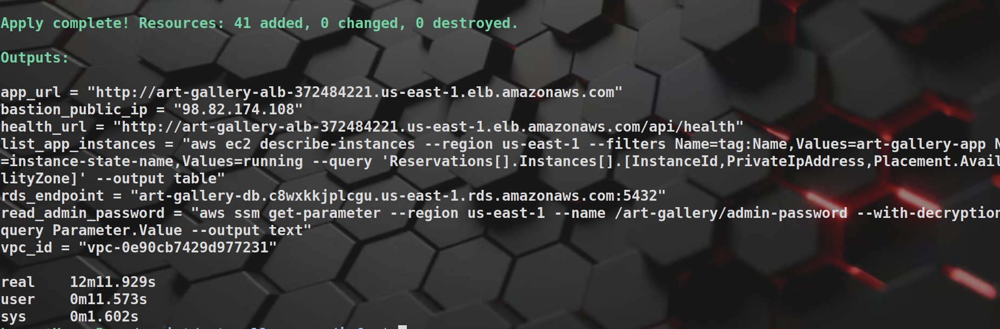

```bash
terraform output app_url                                # open it in a browser
curl "$(terraform output -raw health_url)"
eval "$(terraform output -raw read_admin_password)"     # admin password of this session
```

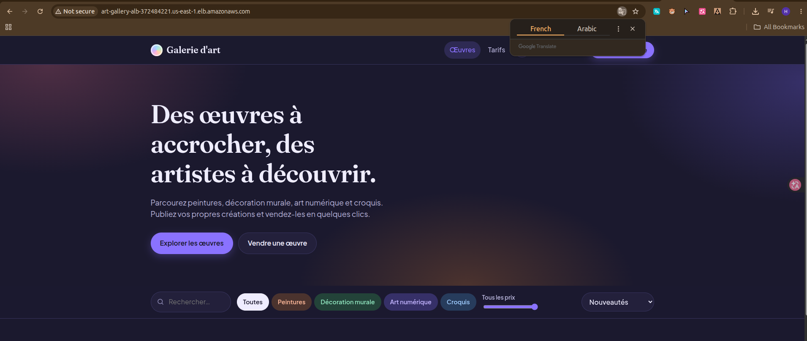

### 6. Destroy (mandatory at the end of every session)

```bash
time ./destroy.sh
```

The script runs `terraform destroy`, then checks EC2, NAT Gateways, Elastic IPs, load balancers and RDS. It must finish with `OK: nothing billable left.` RDS takes several minutes to delete, so do not close the terminal early.

*Screenshot: [destroy and leftover check](EVIDENCE.md#6-destroy-mandatory-at-the-end-of-every-session)*

## Build time

### Measured: first full apply of architecture v2 (fallback mode, 41 resources)

Taken from the `terraform apply` log. Resources are created in parallel, so the total is the **critical path**, not the sum.

| Resource | Time to create | On the critical path |
|---|---|---|
| VPC | 15 s | start |
| Subnets, route tables, security groups, endpoint | 1 to 12 s each | no |
| NAT Gateway | 1 min 38 s | no (finishes long before RDS) |
| Application Load Balancer | 2 min 18 s | no |
| **RDS PostgreSQL** | **9 min 14 s** | **yes** |
| Launch Template | 8 s | yes (waits for the RDS endpoint) |
| **Auto Scaling Group** (waits for healthy targets) | **1 min 38 s** | **yes** |
| **Total** | **about 11.5 minutes** | RDS (9m14s) + Launch Template (8s) + ASG (1m38s) + network start |

The ASG depends on the RDS endpoint (the boot script needs the DB host), which is why it cannot start earlier.

### Measurements to complete

| Measurement | Command | Result |
|---|---|---|
| Full apply, real mode (artifacts in S3) | `time terraform apply -auto-approve` | ___ min ___ s |
| Destroy and leftover check | `time ./destroy.sh` | ___ min ___ s |
| Replacement of a killed instance (until `healthy`) | see [T7](#t7-resilience-kill-one-instance) | ___ min |
| Rolling update to `v2` | see [T8](#t8-new-version-without-total-interruption) | ___ min |
| Rebuild target (L1) | 15 minutes or less | Met in fallback mode (11.5 min). Real mode: ___ |

> **[ADD SCREENSHOT]** `v2-08-timing.png`: timing of apply and destroy


## Cost

> Approximate, from public **on-demand `us-east-1`** prices. They can change, so confirm with the [AWS Pricing Calculator](https://calculator.aws/). The Learner Lab credit counter is the real source for what was charged.

### While the stack is running

| Item | Quantity | Price | Per hour |
|---|---|---|---|
| NAT Gateway | 1 | 0.045 USD/h (+ 0.045 USD per GB processed) | 0.045 |
| Application Load Balancer | 1 | 0.0225 USD/h | 0.0225 |
| ALB capacity units (low traffic) | about 1 | about 0.008 USD/h | 0.008 |
| EC2 `t3.micro` (2 app + 1 bastion) | 3 | 0.0104 USD/h | 0.031 |
| RDS `db.t3.micro` PostgreSQL, single-AZ | 1 | 0.018 USD/h | 0.018 |
| Public IPv4 addresses (NAT, bastion, 2 for the ALB) | 4 | 0.005 USD/h | 0.020 |
| EBS gp3, 3 x 8 GB | 24 GB | 0.08 USD/GB-month | 0.003 |
| RDS storage gp3, 20 GB | 20 GB | about 0.115 USD/GB-month | 0.003 |
| VPC, subnets, route tables, security groups, S3 gateway endpoint, SSM standard parameters | | free | 0 |
| **Total** | | | **about 0.15 USD/h** |

### What it means for the budget (50 USD)

| Scenario | Estimate |
|---|---|
| One 2-hour session | about 0.30 USD |
| 10 sessions of 3 hours | about 4.50 USD |
| Left running one day | about 3.60 USD |
| Left running one week | about 25 USD (half the credit) |
| Left running one month | about 110 USD (more than the credit) |
| Hours of running time the whole 50 USD buys | about 330 hours |

### What stays between sessions

| Item | Cost |
|---|---|
| 2 S3 buckets (a few MB of artifacts, small state file) | well under 0.01 USD per month (about 0.023 USD/GB-month) |
| Manual RDS snapshot (if kept) | cents per month (billed on used size, about 0.095 USD/GB-month) |
| ECR (not used) | would be about 0.10 USD/GB-month |

### Where the money goes and how to reduce it

- **NAT Gateway + public IPv4 + ALB** are about 60% of the hourly cost and are billed even with zero traffic. Destroying at the end of each session is the biggest saving.
- **Multi-AZ RDS** would add about 0.018 USD/h. A second NAT would add 0.045 USD/h. Neither is enabled (budget decision).
- Cost of the deployment options not chosen: EKS would add about 0.10 USD/h for the control plane alone, more than the whole database and compute together.

### Check what was actually spent

```bash
# Often denied in the Learner Lab: if so, read the credit counter in the AWS Academy panel instead
aws ce get-cost-and-usage --time-period Start=2026-11-01,End=2026-11-09 \
  --granularity DAILY --metrics UnblendedCost --query 'ResultsByTime[].[TimePeriod.Start,Total.UnblendedCost.Amount]' --output table
```

*Screenshot: [cost evidence](EVIDENCE.md#check-what-was-actually-spent)*

## Verification with the AWS CLI (every resource)

Run these **while the stack is up**, in one terminal, and take one screenshot per block. Nothing here changes anything. Set the variables first:

```bash
cd ~/projet/art-gallery-aws/infra
export AWS_REGION=us-east-1
SUFFIX=<your unique_suffix>
VPC=$(terraform output -raw vpc_id)
DATA=art-gallery-data-$SUFFIX
STATE=art-gallery-tfstate-$SUFFIX
```

### V0. Who am I, and what does Terraform manage?

```bash
aws sts get-caller-identity --query '[Arn]' --output text      # blur the account ID
terraform state list | wc -l                                    # expected: 45 (41 resources + 4 data sources)
terraform state list | grep -vE '(^|\.)data\.' | wc -l          # expected: 41 (resources only)
terraform output
```

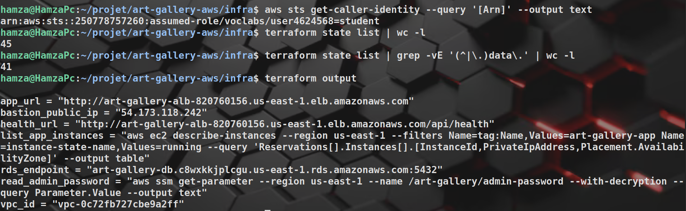

### V1. Inventory of everything tagged for the project

```bash
aws resourcegroupstaggingapi get-resources --tag-filters Key=Project,Values=art-gallery \
  --query 'ResourceTagMappingList[].ResourceARN' --output text | tr '\t' '\n' | sed 's/:[0-9]\{12\}:/:ACCOUNT:/' | sort
```

If this call is denied in the lab, skip it: the blocks below cover each resource type. (Some resources, such as route table associations, are not taggable, so the count is lower than 41.)

*Screenshot: [tagged resource inventory](EVIDENCE.md#v1-inventory-of-everything-tagged-for-the-project)*

### V2. Persistent buckets and artifacts

```bash
aws s3api list-buckets --query "Buckets[?starts_with(Name,'art-gallery-')].Name" --output table
for b in $STATE $DATA; do
  echo "== $b"
  aws s3api get-public-access-block --bucket $b --query 'PublicAccessBlockConfiguration' --output table
  aws s3api get-bucket-encryption   --bucket $b --query 'ServerSideEncryptionConfiguration.Rules[0].ApplyServerSideEncryptionByDefault.SSEAlgorithm' --output text
  aws s3api get-bucket-versioning   --bucket $b --query 'Status' --output text
done
aws s3 ls s3://$DATA/artifacts/ --human-readable
```

Expected: all four public-access settings `True`, encryption `AES256`, versioning `Enabled` on the state bucket, and both `.tar.gz` artifacts listed.

*Screenshot: [S3 buckets and artifacts](EVIDENCE.md#v2-persistent-buckets-and-artifacts)*

### V3. VPC and subnets

```bash
aws ec2 describe-vpcs --vpc-ids $VPC \
  --query 'Vpcs[].[VpcId,CidrBlock,State,EnableDnsSupport]' --output table

aws ec2 describe-subnets --filters Name=vpc-id,Values=$VPC \
  --query 'sort_by(Subnets,&CidrBlock)[].[Tags[?Key==`Name`]|[0].Value,CidrBlock,AvailabilityZone,MapPublicIpOnLaunch]' --output table
```

Expected: `10.0.0.0/16` and 6 subnets over `us-east-1a` / `us-east-1b` (`MapPublicIpOnLaunch` true only for the 2 public ones, if set in the module).

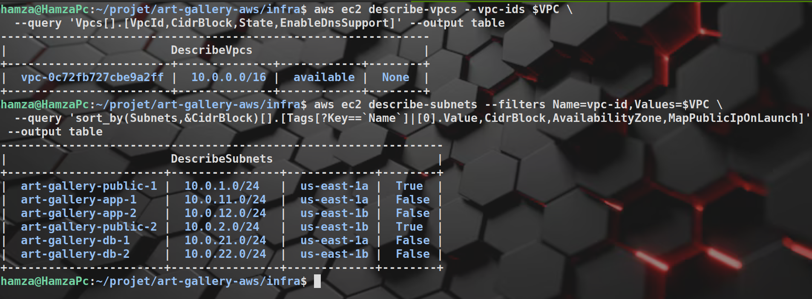

### V4. Internet Gateway, NAT Gateway, Elastic IP, S3 endpoint

```bash
aws ec2 describe-internet-gateways --filters Name=attachment.vpc-id,Values=$VPC \
  --query 'InternetGateways[].[InternetGatewayId,Attachments[0].State]' --output table

aws ec2 describe-nat-gateways --filter Name=vpc-id,Values=$VPC \
  --query 'NatGateways[].[NatGatewayId,State,ConnectivityType,SubnetId,NatGatewayAddresses[0].PublicIp]' --output table

aws ec2 describe-addresses \
  --query 'Addresses[].[AllocationId,PublicIp,AssociationId,Tags[?Key==`Name`]|[0].Value]' --output table

aws ec2 describe-vpc-endpoints --filters Name=vpc-id,Values=$VPC \
  --query 'VpcEndpoints[].[VpcEndpointId,ServiceName,VpcEndpointType,State]' --output table
```

Expected: IGW `available`, NAT `available` and `public` in a public subnet, an Elastic IP attached to the NAT, an S3 endpoint of type `Gateway` (keep the NAT public IP: [T6](#t6-outbound-access-goes-through-the-nat-gateway) compares it).

*Screenshot: [gateways and endpoint](EVIDENCE.md#v4-internet-gateway-nat-gateway-elastic-ip-s3-endpoint)*

### V5. Route tables

```bash
aws ec2 describe-route-tables --filters Name=vpc-id,Values=$VPC \
  --query 'RouteTables[].{Name:Tags[?Key==`Name`]|[0].Value,Subnets:length(Associations[?SubnetId]),Routes:Routes[].[DestinationCidrBlock,GatewayId,NatGatewayId]}' \
  --output yaml
```

Expected: `rt-public` (2 subnets) has `0.0.0.0/0` to the Internet Gateway, `rt-app` (2 subnets) has `0.0.0.0/0` to the NAT Gateway, `rt-db` (2 subnets) has **only the local route**. The unnamed table is the VPC's automatic main route table (0 subnets).

*Screenshot: [route tables](EVIDENCE.md#v5-route-tables)*

### V6. Security groups and their rules

```bash
aws ec2 describe-security-groups --filters Name=vpc-id,Values=$VPC Name=group-name,Values='art-gallery-*' \
  --query 'SecurityGroups[].{Name:GroupName,Id:GroupId,Ingress:IpPermissions[].{Port:FromPort,FromCidr:IpRanges[].CidrIp,FromGroup:UserIdGroupPairs[].GroupId}}' \
  --output yaml     # blur the admin IP
```

Expected: `alb-sg` open to `0.0.0.0/0` on 80, `bastion-sg` only to the admin `/32` on 22, `app-sg` only from the ALB and bastion groups, `db-sg` only from the `app-sg` id on 5432.

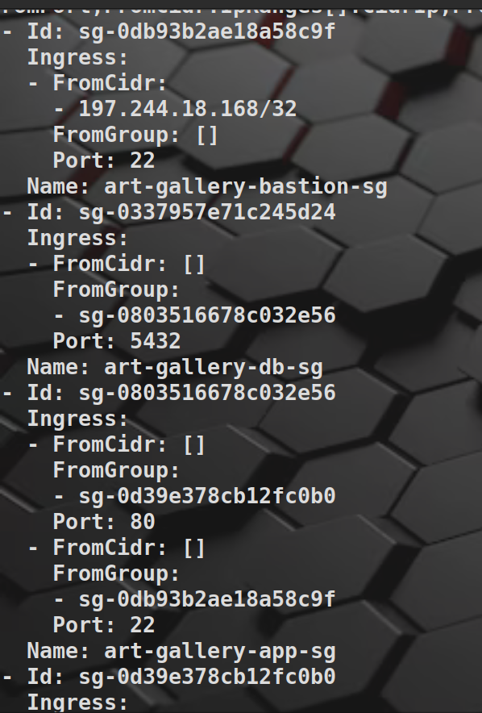

### V7. Instances (bastion and application)

```bash
aws ec2 describe-instances --filters Name=tag:Project,Values=art-gallery Name=instance-state-name,Values=running \
  --query 'Reservations[].Instances[].[Tags[?Key==`Name`]|[0].Value,InstanceId,InstanceType,Placement.AvailabilityZone,PrivateIpAddress,PublicIpAddress]' --output table
```

Expected: 1 `art-gallery-bastion` with a public IP, 2 `art-gallery-app` in **different AZs** and with **no public IP** (blur the bastion IP).

*Screenshot: [instances](EVIDENCE.md#v7-instances-bastion-and-application)*

### V8. Launch Template and Auto Scaling Group

```bash
ASG=art-gallery-asg
aws autoscaling describe-auto-scaling-groups --auto-scaling-group-names $ASG \
  --query 'AutoScalingGroups[].{Min:MinSize,Max:MaxSize,Desired:DesiredCapacity,HealthCheck:HealthCheckType,Grace:HealthCheckGracePeriod,Subnets:VPCZoneIdentifier,Instances:Instances[].[InstanceId,AvailabilityZone,LifecycleState,HealthStatus]}' \
  --output yaml

LT=$(aws autoscaling describe-auto-scaling-groups --auto-scaling-group-names $ASG --query 'AutoScalingGroups[0].LaunchTemplate.LaunchTemplateId' --output text)
aws ec2 describe-launch-template-versions --launch-template-id $LT --versions '$Latest' \
  --query 'LaunchTemplateVersions[0].LaunchTemplateData.{Type:InstanceType,Profile:IamInstanceProfile.Name,IMDS:MetadataOptions,Disk:BlockDeviceMappings[0].Ebs}' --output yaml
```

Expected: min 2, max 3, desired 2, health check `ELB`, 2 instances `InService` / `Healthy` in two AZs. Launch template: `t3.micro`, `LabInstanceProfile`, `HttpTokens: required`, encrypted 8 GB gp3 volume.

*Screenshot: [auto scaling group and launch template](EVIDENCE.md#v8-launch-template-and-auto-scaling-group)*

### V9. Load balancer, listener, target group, target health

```bash
ALB=$(aws elbv2 describe-load-balancers --names art-gallery-alb --query 'LoadBalancers[0].LoadBalancerArn' --output text)
aws elbv2 describe-load-balancers --names art-gallery-alb \
  --query 'LoadBalancers[].[LoadBalancerName,Scheme,Type,State.Code,AvailabilityZones[].ZoneName]' --output yaml

aws elbv2 describe-listeners --load-balancer-arn $ALB \
  --query 'Listeners[].[Port,Protocol,DefaultActions[0].Type]' --output table

TG=$(aws elbv2 describe-target-groups --names art-gallery-tg --query 'TargetGroups[0].TargetGroupArn' --output text)
aws elbv2 describe-target-groups --target-group-arns $TG \
  --query 'TargetGroups[].[TargetGroupName,Port,HealthCheckPath,HealthCheckIntervalSeconds,HealthyThresholdCount,UnhealthyThresholdCount]' --output table

aws elbv2 describe-target-health --target-group-arn $TG \
  --query 'TargetHealthDescriptions[].[Target.Id,Target.Port,TargetHealth.State]' --output table
```

Expected: `internet-facing` `application` ALB `active` in 2 AZs, listener `80 HTTP forward`, health path `/api/health` every 15 s, **both targets `healthy`**.

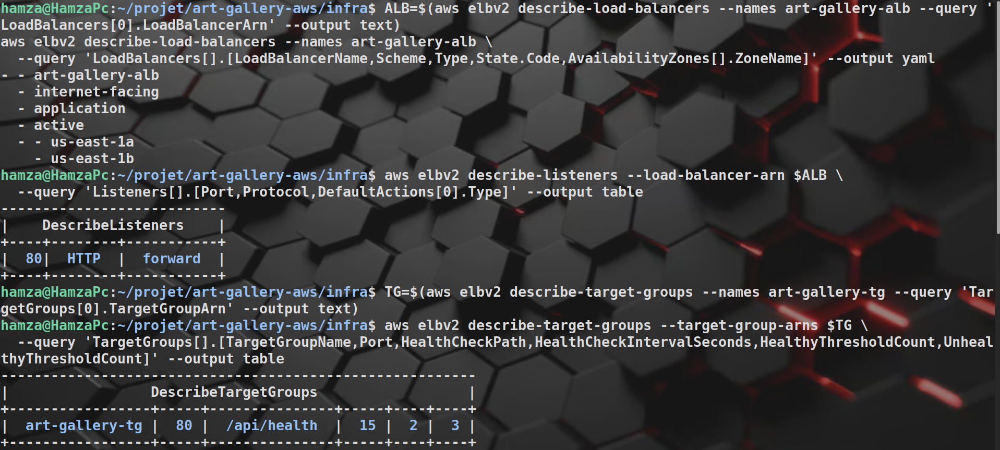

### V10. RDS

```bash
aws rds describe-db-instances --db-instance-identifier art-gallery-db \
  --query 'DBInstances[].{Status:DBInstanceStatus,Engine:Engine,Version:EngineVersion,Class:DBInstanceClass,MultiAZ:MultiAZ,Public:PubliclyAccessible,Encrypted:StorageEncrypted,BackupDays:BackupRetentionPeriod,Storage:AllocatedStorage,AZ:AvailabilityZone,Endpoint:Endpoint.Address}' --output yaml

PG=$(aws rds describe-db-instances --db-instance-identifier art-gallery-db --query 'DBInstances[0].DBParameterGroups[0].DBParameterGroupName' --output text)
aws rds describe-db-parameters --db-parameter-group-name $PG \
  --query "Parameters[?ParameterName=='rds.force_ssl'].[ParameterName,ParameterValue]" --output table
```

Expected: `available`, PostgreSQL 16, `db.t3.micro`, `Public: false`, `Encrypted: true`, 7 backup days, endpoint in the DB subnets, `rds.force_ssl` = `0` (documented limit).

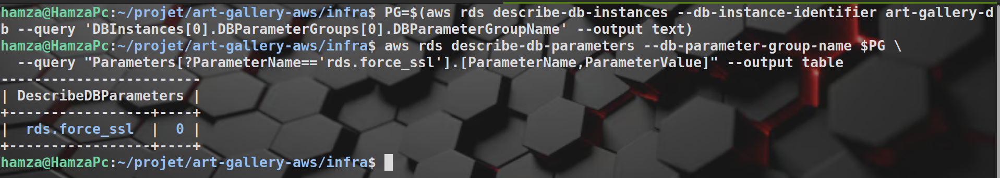

### V11. Secrets (names and type only, never the values)

```bash
aws ssm describe-parameters --parameter-filters Key=Name,Option=BeginsWith,Values=/art-gallery/ \
  --query 'Parameters[].[Name,Type,LastModifiedDate]' --output table
```

Expected: 3 parameters of type `SecureString`. **Do not** add `get-parameter --with-decryption` to a screenshot.

*Screenshot: [SSM parameters](EVIDENCE.md#v11-secrets-names-and-type-only-never-the-values)*

### Leftover check

After `./destroy.sh`, the same check as the script, written out so it can be shown:

```bash
aws ec2 describe-instances --filters Name=instance-state-name,Values=pending,running,stopping,stopped --query 'Reservations[].Instances[].InstanceId' --output text
aws ec2 describe-nat-gateways --filter Name=state,Values=pending,available --query 'NatGateways[].NatGatewayId' --output text
aws ec2 describe-addresses --query 'Addresses[].AllocationId' --output text
aws elbv2 describe-load-balancers --query 'LoadBalancers[].LoadBalancerArn' --output text
aws rds describe-db-instances --query 'DBInstances[].DBInstanceIdentifier' --output text
aws ecr describe-repositories --query 'repositories[].repositoryName' --output text   # old experiments
aws s3api list-buckets --query "Buckets[?starts_with(Name,'art-gallery-')].Name" --output text   # expected: the 2 persistent buckets
```

Expected: every line empty except the 2 persistent buckets.

> **[ADD SCREENSHOT]** `v2-22-leftover.png`: leftover check


## Tests

Each test: what it proves, the commands, the expected result, a screenshot. Run T1 to T6 on a fresh apply, then the destructive ones (T7, T8) and finish with T10.

| # | Test | Proves | Status |
|---|---|---|---|
| T1 | Health endpoint | ALB, target group, API alive | to capture |
| T2 | Frontend and DB-backed API through the single URL | nginx serves the pages and proxies `/api`, DB reachable | done (200 and `[]`), screenshot to add |
| T3 | Instances booted in real mode, secrets read | Artifacts, SSM access, no fallback | to capture |
| T4 | Database reachable only from the app tier | Network isolation | to capture |
| T5 | Private instances not reachable from the Internet | Security groups, no public IP | to capture |
| T6 | Outbound goes through the NAT | NAT route works | done in L3, repeat on v2 |
| T7 | Resilience: kill one instance | Fault tolerance (graded) | to do |
| T8 | New version without total interruption | Rolling update | to do |
| T9 | Backup and restore | Data protection (graded) | to do |
| T10 | Rebuild from zero, timed | Rebuild target | partly done (11.5 min fallback) |
| T11 | Load test (k6) | 50 concurrent users, 100 peak | planned |

### T1. Health endpoint

```bash
URL=$(terraform output -raw app_url)
curl -s "$(terraform output -raw health_url)"; echo
```

Expected: JSON with a healthy status (`fallback` means the artifacts were not found, see T3).

*Screenshot: [T1 health](EVIDENCE.md#t1-health-endpoint)*

### T2. Frontend and API through the one URL

```bash
curl -s -o /dev/null -w "frontend: %{http_code}\n" "$URL/"
curl -s "$URL/api/artworks" | head -c 300; echo
```

Expected: `frontend: 200`, and a JSON answer from a route that reads the database (`/api/artworks` here, defined by the [backend](../backend/README.md)): it proves the path ALB, instance, RDS works. An empty list is fine on a new database. A `500` means the API cannot reach the database.

*Screenshot: [T2 frontend and API](EVIDENCE.md#t2-frontend-and-api-through-the-one-url)*

### T3. Real mode and secrets

```bash
eval "$(ssh-agent -s)"; ssh-add ~/path/to/labsuser.pem
eval "$(terraform output -raw list_app_instances)"          # private IPs
ssh -J ec2-user@$(terraform output -raw bastion_public_ip) ec2-user@<private-ip>
```

On the instance:

```bash
sudo grep -E "=== mode:|rror|enied" /var/log/art-gallery-boot.log
systemctl is-active art-gallery nginx
```

Expected: `=== mode: real`, **no** `AccessDenied`, both services `active`.

*Screenshot: [T3 boot log](EVIDENCE.md#t3-real-mode-and-secrets)*

### T4. Database reachable from the app tier only

On your **laptop**, get the host name (the output ends with `:5432`, which is cut off here):

```bash
terraform output -raw rds_endpoint | cut -d: -f1
```

Copy the result, then on an **app instance** (inside the SSH session above) paste it into a variable and test. Do not type the `<` `>` signs: bash would read them as redirections.

```bash
DB=art-gallery-db.xxxxxxxx.us-east-1.rds.amazonaws.com      # your real value
timeout 3 bash -c "</dev/tcp/$DB/5432" && echo "DB port open" || echo "blocked"
```

On the **bastion** (a different security group, so it must fail), set `DB` the same way and run the same test:

```bash
ssh ec2-user@$(terraform output -raw bastion_public_ip)
timeout 3 bash -c "</dev/tcp/$DB/5432" && echo "DB port open" || echo "blocked (expected)"
```

Expected: `DB port open` from the app instance, `blocked (expected)` from the bastion. Together with `Public: false` in V10, this shows the database is not exposed.

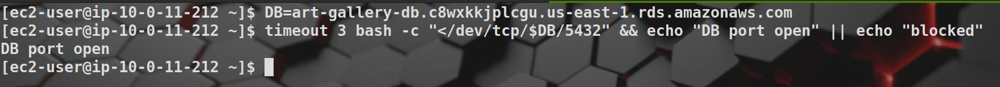

### T5. Private instances are not reachable from the Internet

```bash
# App instances have no public IP (V7 shows the empty column). From your laptop, the private IP must time out:
curl -m 5 http://<app-private-ip>/ ; echo "exit code: $?"      # expected: timeout, exit code 28
# Direct SSH to an app instance without the bastion must fail:
ssh -o ConnectTimeout=5 ec2-user@<app-private-ip>               # expected: timeout
# On an app instance, IMDSv1 must be refused (IMDSv2 required):
curl -s -o /dev/null -w "%{http_code}\n" http://169.254.169.254/latest/meta-data/    # expected: 401
```

*Screenshot: [T5 no direct access](EVIDENCE.md#t5-private-instances-are-not-reachable-from-the-internet)*

### T6. Outbound access goes through the NAT Gateway

From an app instance:

```bash
curl -s https://ifconfig.me; echo
```

Expected: the **same public IP as the NAT Gateway** in V4, not an address of the instance.

*Screenshot: [T6 NAT outbound IP](EVIDENCE.md#t6-outbound-access-goes-through-the-nat-gateway)*

### T7. Resilience: kill one instance

Terminal 1, a check every 2 seconds:

```bash
cd ~/projet/art-gallery-aws/infra
while true; do echo "$(date +%T) $(curl -s -o /dev/null -w '%{http_code}' "$(terraform output -raw health_url)")"; sleep 2; done
```

Terminal 2:

```bash
eval "$(terraform output -raw list_app_instances)"            # note an instance id
aws ec2 terminate-instances --instance-ids <id>

aws autoscaling describe-scaling-activities --auto-scaling-group-name art-gallery-asg --max-items 3 \
  --query 'Activities[].[StartTime,StatusCode,Description]' --output table

TG=$(aws elbv2 describe-target-groups --names art-gallery-tg --query 'TargetGroups[0].TargetGroupArn' --output text)
aws elbv2 describe-target-health --target-group-arn $TG \
  --query 'TargetHealthDescriptions[].[Target.Id,TargetHealth.State]' --output table
```

Expected: the loop keeps printing `200` (an occasional non-200 for a few seconds is normal while the ALB notices the dead target, note it), the ASG launches a replacement within minutes, and target health returns to 2 `healthy`. Record the time until the replacement is `healthy`: ___ min.

> **[ADD SCREENSHOT]** `v2-29-t7-loop.png`: T7 loop


*Screenshot: [T7 scaling activities](EVIDENCE.md#t7-resilience-kill-one-instance)*

> **[ADD SCREENSHOT]** `v2-31-t7-targets.png`: T7 target health


### T8. New version without total interruption

```bash
# upload backend-v2 / frontend-v2 (same commands as above, v2 in the file names), then:
terraform apply -var app_version=v2     # rolling replacement, one instance at a time
```

While it runs, keep the loop from T7 open. Expected: the answers stay `200` and the instances are replaced one by one (`aws autoscaling describe-instance-refreshes --auto-scaling-group-name art-gallery-asg`). Rollback is `terraform apply -var app_version=v1`.

*Screenshot: [T8 rolling update](EVIDENCE.md#t8-new-version-without-total-interruption)*

### T9. Backup and restore

```bash
aws rds create-db-snapshot --db-instance-identifier art-gallery-db --db-snapshot-identifier art-gallery-manual-1
aws rds wait db-snapshot-available --db-snapshot-identifier art-gallery-manual-1
./destroy.sh
terraform apply -var db_snapshot_identifier=art-gallery-manual-1
curl -s "$(terraform output -raw app_url)/api/artworks" | head -c 300; echo      # the data is back
```

Also show that automated backups and point-in-time recovery are on: `aws rds describe-db-instances --db-instance-identifier art-gallery-db --query 'DBInstances[0].[BackupRetentionPeriod,LatestRestorableTime]'`.

> **[ADD SCREENSHOT]** `v2-33-t9-restore.png`: T9 snapshot and restore


### T10. Rebuild from zero, timed

After a full `./destroy.sh` (leftover check clean):

```bash
time terraform apply -auto-approve
curl -s "$(terraform output -raw health_url)"; echo
```

Expected: 15 minutes or less and a healthy application. Result: ___ min ___ s.

*Screenshot: [T10 rebuild time](EVIDENCE.md#t10-rebuild-from-zero-timed)*

### T11. Load test (planned)

k6 against `app_url`: 50 concurrent users, 100 at peak, report p95 latency and error rate, while watching `aws autoscaling describe-auto-scaling-groups`. Script and results to add.

## Non-functional objectives

| Objective | Target | Status |
|---|---|---|
| Instance loss tolerance | No downtime if one app instance stops | 2 AZs, ALB, ASG with ELB health check built. Demonstration: T7 |
| Load | 50 concurrent users (100 peak) | k6 test planned (T11) |
| Rebuild time | 15 minutes or less | **11.5 min measured** in fallback mode. Real mode: ___ |
| Max data loss | 5 minutes or less | RDS automated backups (7 days) with point-in-time recovery enabled. Restore demonstration: T9 |
| Budget | 50 USD or less | About 0.15 USD/h, destroy after every session, single NAT, `t3.micro` |

## Roadmap (future work)

- [x] VPC, multi-AZ subnets, route tables
- [x] Security groups (ALB -> app -> DB)
- [x] NAT Gateway outbound access + S3 gateway endpoint
- [x] Bastion
- [x] Destroy script with leftover check
- [x] Persistent S3 buckets for state and app data (`bootstrap/bootstrap.sh`, CLI because of a Learner Lab restriction)
- [x] Secrets in SSM Parameter Store (applied, readable by `LabRole`)
- [x] Application Load Balancer, health check `GET /api/health` (applied)
- [x] Launch Template + Auto Scaling Group, min 2, one per AZ (applied)
- [x] RDS PostgreSQL with automated backups (applied)
- [x] Application artifacts deployed from S3 (real mode: API and site answer)
- [x] Architecture diagram version 2 (`images/architecture-v2.1.drawio`)
- [x] First full-stack timing (11.5 min, fallback mode)
- [ ] One-command rebuild script (`rebuild.sh`: bootstrap, apply, health check)
- [ ] Resilience demo evidence (T7)
- [ ] Rolling update demo (T8)
- [ ] Snapshot and restore demo (T9), snapshot step in `destroy.sh`
- [ ] Migrate the main stack state to the S3 state bucket
- [ ] CloudWatch logs, metrics and alarms
- [ ] k6 load test and real-mode rebuild timing
- [ ] boto3 scripts (RDS snapshot and restore, resilience test, cost report)
- [ ] Optional: ECR registry in `bootstrap/` as an upgrade of the deployment method

## Known limits

| Topic | Today | Why / what to do |
|---|---|---|
| Single NAT | One NAT in AZ a: if AZ a fails, AZ b loses outbound traffic (npm, dnf). Inbound user traffic through the ALB is not affected | Accepted cost trade-off. Test and mention in the defence |
| DB data between sessions | Lost at `destroy` (no final snapshot) | Manual snapshot + `db_snapshot_identifier` (T9) |
| TLS to PostgreSQL | `db_force_ssl = false` (RDS PostgreSQL 15+ forces TLS by default) | Traffic stays in the private VPC. Set `true` once the API connects with TLS (`DB_SSL`, see the [backend](../backend/README.md#configuration)) |
| Secrets in state | Generated values are also in the Terraform state | Keep the state in the private, encrypted, versioned bucket |
| HTTPS | HTTP only | Needs a domain + ACM certificate, or CloudFront in front |
| Remote state | Main stack uses a local state file | Migrate it to the S3 state bucket |
| `npm ci` at boot | Depends on the npm registry through the NAT | Bundle `node_modules` in the artifact if it becomes a problem |

## Security notes

- Never commit `terraform.tfvars`, `*.tfstate`, `.terraform/`, `labsuser.pem` or AWS credentials (covered by `.gitignore`). Commit `.terraform.lock.hcl`.
- Keep `terraform.tfstate` until you have run `destroy`: without it Terraform cannot find your resources.
- The database password, JWT secret and admin password are generated by Terraform, stored in SSM Parameter Store and never in Git or in `user_data`. Read the admin password with `terraform output read_admin_password`.
- If your public IP changes, update `admin_cidr` and run `terraform apply` again.
- Blur the admin IP, the account ID, public IPs and any secret in every screenshot before committing.

## Troubleshooting

| Problem | Fix |
|---|---|
| `Permission denied: ./destroy.sh` | `chmod +x destroy.sh` |
| `ExpiredToken` / auth error, or `UnauthorizedOperation ... explicit deny ... voc-cancel-cred` | The lab session ended or was cancelled and the old credentials are blocked. Start the lab again, paste the new credentials into `~/.aws/credentials`, check with `aws sts get-caller-identity` |
| SSH to bastion hangs | Your IP changed: update `admin_cidr`, `terraform apply` |
| `Permission denied (publickey)` | `ssh-add labsuser.pem`, check with `ssh-add -l` |
| `plan` fails on `data.aws_s3_bucket.data` | `bootstrap.sh` not run, or `unique_suffix` differs from the one used there |
| Wrong `unique_suffix` or `admin_cidr` still a placeholder | A variable defined twice in `terraform.tfvars`: the last line wins. Keep one line each |
| `GetObjectLockConfiguration` AccessDenied | Lab policy, see Bootstrap: never create buckets with `aws_s3_bucket` in this lab |
| ALB targets stay unhealthy | On an instance: `/var/log/art-gallery-boot.log`, `systemctl status art-gallery nginx`, `journalctl -u art-gallery` |
| Boot log says `mode: fallback` | Artifacts missing in `s3://<bucket>/artifacts/` for this `app_version`, or `npm ci` failed |
| `/api/artworks` returns 500 | Backend cannot reach the DB: check `db_force_ssl`, test `nc -vz <rds endpoint> 5432` from an instance, `journalctl -u art-gallery` |
| SSM `AccessDenied` in the boot log | LabRole cannot read Parameter Store in your lab: the secret mechanism must change |
| `apply` times out waiting for capacity | Instances never became healthy: read the boot log of one before destroying |
| Old ECR repositories show up | Leftovers from earlier tests: `aws ecr delete-repository --repository-name <name> --force` |

## Appendix: L3 baseline (29 resources)

The first verified deployment (VPC, NAT, bastion, one test backend on port 3000). It was applied, tested through the bastion, and destroyed cleanly (29 created, 29 destroyed). The screenshots are kept as history; the v2 verification above replaces them.

<details>
<summary>Show the L3 screenshots</summary>

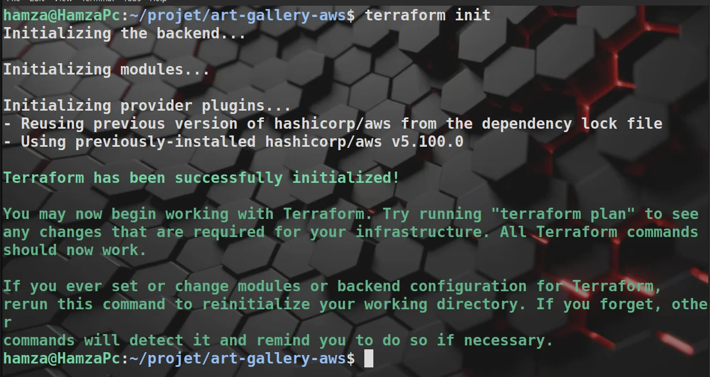

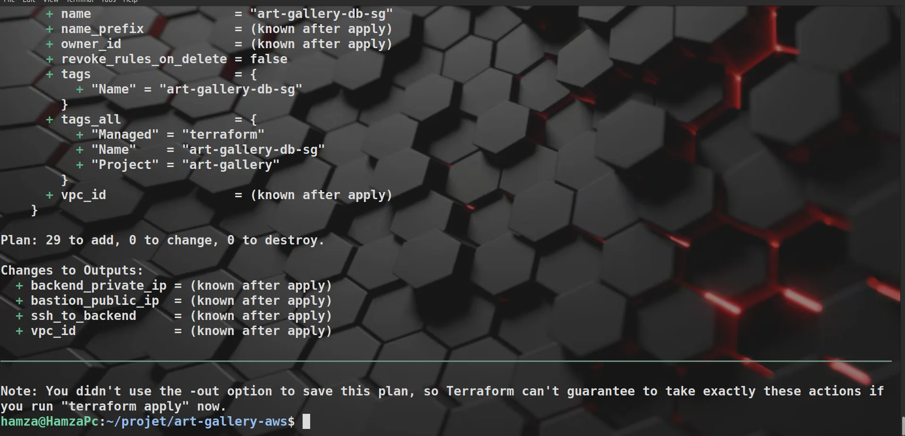

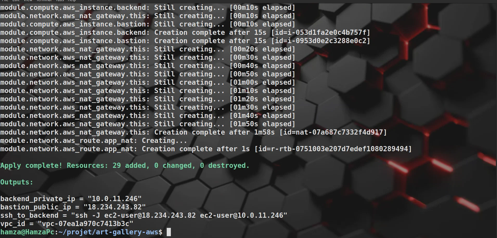

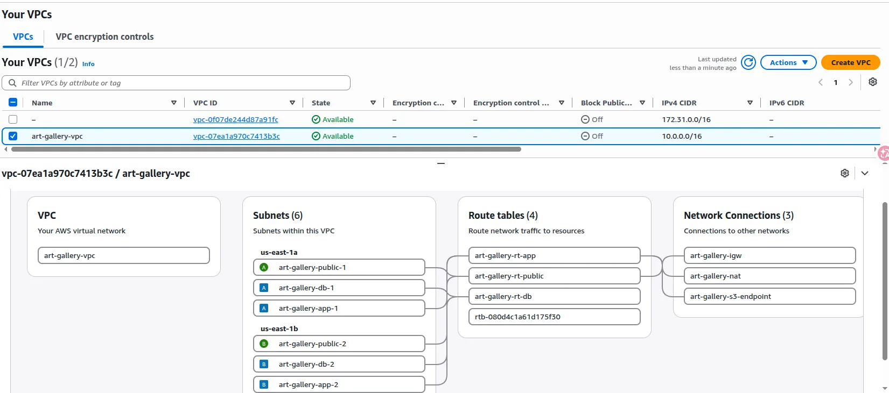

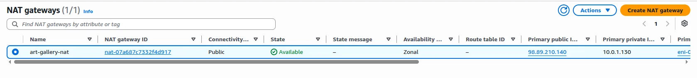

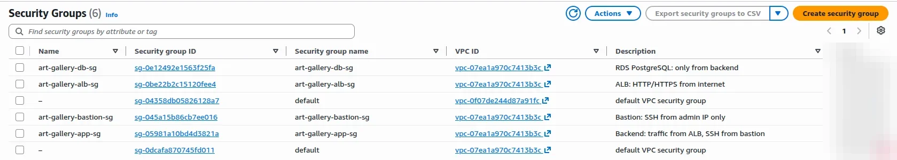

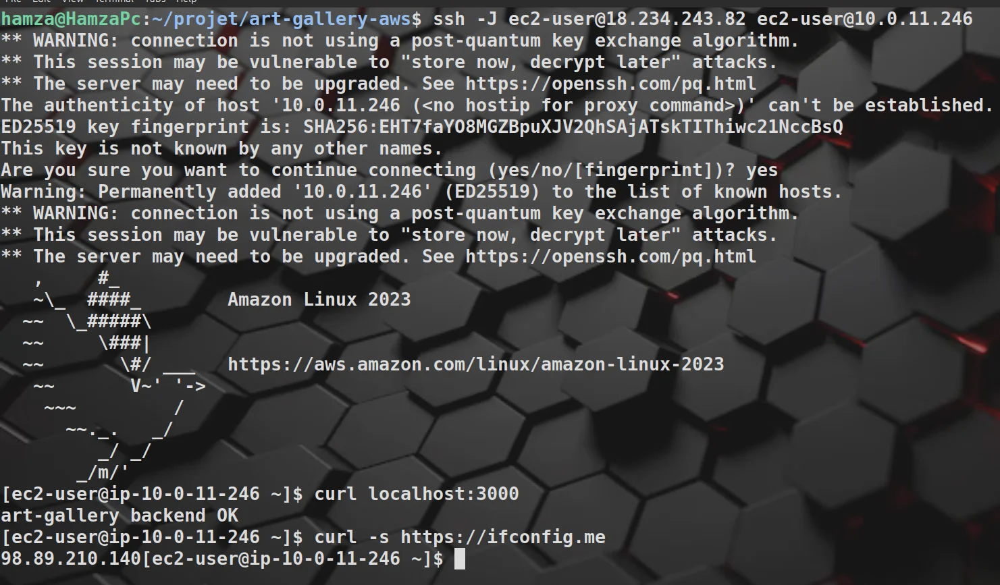

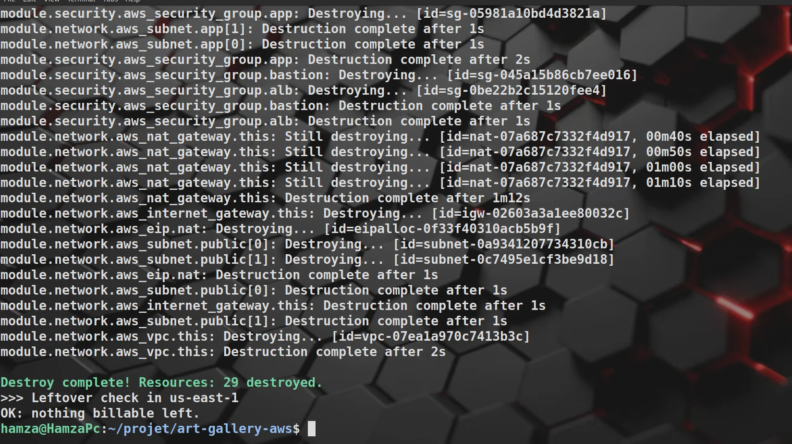

</details>