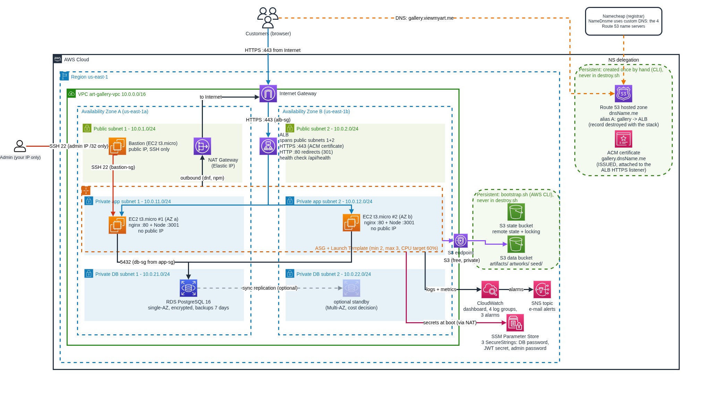

<!--
TODO before submission (delete this block when done):
1. Every [ADD SCREENSHOT] marker (now in docs/*.md) names the file to add in images/screenshots/. The other screenshots are listed in EVIDENCE.md.
2. Blur the admin IP, the AWS account ID and any password in each screenshot. Never screenshot `--with-decryption` output.
3. Fill every "___" in docs/cost-and-timing.md and docs/decisions.md (destroy time, artifact sizes, rolling update time).
4. HTTPS: add images/screenshots/v2-13-https.png (padlock and the `curl -sI http://...` redirect).
-->

# Online Art Gallery - AWS Infrastructure (Terraform)


-blue)

Infrastructure as Code for the **Online Art Gallery** ([project overview](../README.md)), deployed on **AWS Academy Learner Lab** (`us-east-1`). Architecture **v3** has been applied end to end: network, ALB with HTTPS, Auto Scaling Group, RDS, secrets, remote state and monitoring.

- This README covers **infrastructure only**. The application is in [`frontend/`](../frontend/README.md) and [`backend/`](../backend/README.md).
- `terraform apply` is the only command needed to get the application back **with its data**: the first booting instance restores `seed/gallery.sql` from S3 ([RDS.md](RDS.md)). Uploaded images go to S3 ([S3.md](S3.md)).
- Rule of the course: nothing is built by hand in the console, which is used only to look. Three documented exceptions are created once with the AWS CLI and kept between sessions: the two S3 buckets, the Route 53 hosted zone and the ACM certificate.
- Detailed procedures, decisions, costs and evidence are in [`docs/`](#more-documentation). Every command has its screenshot in [EVIDENCE.md](EVIDENCE.md).

## Contents

[At a glance](#at-a-glance) · [Architecture v3](#architecture-v3) · [What is deployed](#what-is-deployed) · [Quick start](#quick-start) · [Tests](#tests) · [Objectives](#non-functional-objectives) · [Known limits](#known-limits) · [Security notes](#security-notes) · [More documentation](#more-documentation)

## At a glance

| Item | Value |
|---|---|
| Region / account | `us-east-1`, AWS Academy Learner Lab (`LabRole`, `LabInstanceProfile`) |
| Resources | **52** (54 with `enable_https = true`). `terraform state list` shows 56 (60 with HTTPS) because it also lists read-only data sources |
| Full rebuild (measured) | **14 min 17 s** in real mode with HTTPS (`./apply.sh`). RDS (about 9 min) is the critical path |
| Running cost | about **0.15 USD per hour**, so destroy after every session ([details](docs/cost-and-timing.md)) |
| Deployment method | Versioned `tar.gz` artifacts in S3, installed at boot by `user_data` (no Docker, no ECR) ([why](docs/decisions.md)) |
| Entry point | `https://gallery.<your-domain>` when `enable_https = true` (HTTP redirects with 301), otherwise the ALB URL (`terraform output app_url`) |
| Persistent between sessions | 2 S3 buckets (state; artifacts, images, seed), Route 53 hosted zone, ACM certificate |
| Destroyed every session | Everything else (`./destroy.sh`, ends with `OK: nothing billable left.`) |

## Architecture v3

Editable source: `images/architecture-v3.drawio` (draw.io).



| # | Flow | Path |
|---|---|---|
| 1 | DNS | Customer asks Route 53 for `gallery.<your-domain>` (alias A record to the ALB). The registrar (Namecheap) only holds the NS delegation to the four Route 53 name servers. Route 53 is **not** in the traffic path |
| 2 | Web traffic | Customer, HTTPS :443, Internet Gateway, ALB (spans public subnets 1 and 2). The ACM certificate is attached to the HTTPS listener, :80 redirects with 301, target health check `/api/health` |
| 3 | Application | ALB to the Auto Scaling Group (min 2, max 3, CPU target 60%, one instance per AZ in the private app subnets): nginx :80 serves the site and proxies `/api` to Node.js :3001 |
| 4 | Database | App instances to RDS PostgreSQL 16 on :5432 (only from `app-sg`). Single-AZ, encrypted, 7-day backups, private DB subnets with no internet route. The standby in DB subnet 2 is optional (Multi-AZ is a cost decision, off by default) |
| 5 | Admin | Admin IP (`/32`) to the bastion on :22 (public subnet 1), then to the app instances on :22 (only from `bastion-sg`) |
| 6 | Outbound | App instances to the NAT Gateway (Elastic IP, AZ a) to the Internet Gateway, for `dnf` and `npm` only |
| 7 | S3 | App instances to S3 through the free S3 gateway endpoint (artifacts, images, seed), no NAT traffic |
| 8 | Secrets | At boot, instances read 3 SecureString parameters from SSM Parameter Store (DB password, JWT secret, admin password) through the NAT |
| 9 | Monitoring | Instances ship logs and metrics to CloudWatch (dashboard, 4 log groups, 3 alarms). Alarms publish to an SNS topic that sends e-mail alerts |

| Tier | AZ a | AZ b | Internet access |
|---|---|---|---|
| Public (ALB, bastion, NAT) | 10.0.1.0/24 | 10.0.2.0/24 | Two-way, via Internet Gateway |
| App (private) | 10.0.11.0/24 | 10.0.12.0/24 | Outbound only, via NAT Gateway |
| DB (private) | 10.0.21.0/24 | 10.0.22.0/24 | None |

VPC `art-gallery-vpc` is `10.0.0.0/16`, spread over `us-east-1a` and `us-east-1b`.

| Security group | Accepts | From |
|---|---|---|
| `art-gallery-alb-sg` | 80, 443 (443 answers only when `enable_https = true`) | Internet |
| `art-gallery-bastion-sg` | 22 | Admin IP only (`/32`) |
| `art-gallery-app-sg` | 80 (nginx), 22 | `alb-sg`, `bastion-sg` |
| `art-gallery-db-sg` | 5432 | `app-sg` only |

Each tier trusts only the tier before it. Rules reference security groups, not IP addresses.

### What persists and what is destroyed

| Lives | Resources | Created by |
|---|---|---|
| **Persistent** | S3 state bucket (versioned, remote state and locking) and S3 data bucket (`artifacts/`, `artworks/`, `seed/`) | `bootstrap/bootstrap.sh` (AWS CLI) |
| **Persistent** | Route 53 hosted zone and ACM certificate (`ISSUED`, with its DNS validation CNAME, which must stay in the zone so the certificate can renew) | By hand, once (CLI), see [docs/https.md](docs/https.md) |
| **Destroyed each session** | Everything else, including the Route 53 alias record `gallery` to the ALB | Terraform, `./destroy.sh` |

## What is deployed

52 resources (54 with HTTPS: the HTTPS listener and the alias record). Full list: `terraform state list`.

| Area | Resources | Module |
|---|---|---|
| Network | VPC, Internet Gateway, 6 subnets, 3 route tables, Elastic IP, NAT Gateway, S3 gateway endpoint, DB subnet group | `network` |
| Security | 4 security groups | `security` |
| Bastion | 1 `t3.micro` in public subnet 1 | `compute` |
| Secrets | 3 random values and 3 SSM SecureString parameters | `secrets` |
| Load balancer | ALB, target group, HTTP :80 listener (forward, or 301 redirect with HTTPS). With HTTPS: :443 listener and Route 53 alias record | `alb` / root |
| Database | RDS PostgreSQL 16 instance and parameter group | `rds` |
| Application | Launch Template (IMDSv2, `LabInstanceProfile`), Auto Scaling Group with CPU target-tracking policy | `asg` |
| Monitoring | Operations dashboard, 4 log groups (7-day retention), 3 alarms (unhealthy hosts, target 5xx, RDS CPU), SNS e-mail topic | `monitoring` |

After **every** apply, AWS sends a new SNS confirmation e-mail to `alarm_email`: click its link, or no alarm e-mail arrives. More: [docs/deployed.md](docs/deployed.md), [docs/boot-and-bootstrap.md](docs/boot-and-bootstrap.md) (how an instance boots).

```
infra/
|-- versions.tf, variables.tf, main.tf, outputs.tf, terraform.tfvars.example
|-- apply.sh, destroy.sh        apply with state backup / destroy with leftover check
|-- backend.hcl.example         S3 backend settings
|-- bootstrap/                  bootstrap.sh: the 2 persistent S3 buckets
|-- modules/                    network, security, compute, secrets, alb, rds, monitoring, asg
|-- docs/                       procedures, decisions, tests (t1..t13), cost, troubleshooting
|-- images/                     architecture diagrams and screenshots
`-- RDS.md, S3.md, EVIDENCE.md
```

## Quick start

All commands run from `infra/`. Full guide with prerequisites and screenshots: [docs/usage.md](docs/usage.md).

```bash
# 1. Credentials (every lab session): AWS Academy -> Start Lab -> AWS Details -> paste into ~/.aws/credentials
aws sts get-caller-identity

# 2. Configure: set unique_suffix (same as bootstrap) and alarm_email; for HTTPS also enable_https and domain_name
cp terraform.tfvars.example terraform.tfvars

# 3. Bootstrap (once)
cd bootstrap && ./bootstrap.sh <unique_suffix> && cd ..
cp backend.hcl.example backend.hcl        # bucket = art-gallery-tfstate-<suffix>

# 4. Upload artifacts and database seed (only when the code or data changes), see docs/usage.md
aws s3 cp /tmp/backend-v1.tar.gz  s3://art-gallery-data-<suffix>/artifacts/
aws s3 cp /tmp/frontend-v1.tar.gz s3://art-gallery-data-<suffix>/artifacts/

# 5. Deploy
terraform init -backend-config=backend.hcl
time ./apply.sh                           # detects your IP, asks for approval, backs up the state
curl "$(terraform output -raw health_url)"

# 6. Destroy (mandatory at the end of every session)
time ./destroy.sh                         # must end with: OK: nothing billable left.
```

For HTTPS, do the one-time Route 53 and ACM setup first: [docs/https.md](docs/https.md). If your public IP changes, run `./apply.sh` again to update the bastion rule.

## Tests

| # | Test | Proves | Status |
|---|---|---|---|
| T1 | Health endpoint | ALB, target group, API alive | PASS, [procedure](docs/t1-t3.md) |
| T2 | Frontend and DB-backed API through one URL | nginx and proxy, DB reachable | PASS, [procedure](docs/t1-t3.md) |
| T3 | Instances in real mode, secrets read | Artifacts, SSM access, no fallback | PASS, [procedure](docs/t1-t3.md) |
| T4 | Database reachable only from the app tier | Network isolation | PASS, [procedure](docs/t4.md) |
| T5 | Private instances not reachable from the Internet | Security groups, no public IP | PASS, [procedure](docs/t5.md) |
| T6 | Outbound goes through the NAT | NAT route works | PASS, [procedure](docs/t6.md) |
| T7 | Kill one instance | Fault tolerance | PASS, [procedure](docs/t7.md) |
| T8 | New version without total interruption | Rolling update | PASS, [procedure](docs/t8.md) |
| T9 | Backup and restore | Data protection | PASS, [procedure](docs/t9.md) |
| T10 | Rebuild from zero, timed | Rebuild target | PASS, 14 min 17 s, [details](docs/tests.md#t10-rebuild-from-zero-timed) |
| T11 | Load test (k6) | 50 concurrent users, 100 peak | planned, [details](docs/tests.md#t11-load-test-planned) |
| T12 | Password hashes and card data | bcrypt only, no card number stored | PASS, [RDS.md](RDS.md#5-verification-passwords-and-cards) |
| T13 | Alarms | Monitoring and notifications | PASS, [procedure](docs/t13.md) |

## Non-functional objectives

| Objective | Target | Status |
|---|---|---|
| Instance loss tolerance | No downtime if one app instance stops | 2 AZs, ALB, ASG with ELB health check. Demonstrated in [T7](docs/t7.md) |
| Load | 50 concurrent users (100 peak) | k6 test planned (T11) |
| Rebuild time | 15 minutes or less | **14 min 17 s** (margin 43 s) |
| Max data loss | 5 minutes or less | RDS automated backups (7 days) with point-in-time recovery. Demonstrated in [T9](docs/t9.md) |
| Budget | 50 USD or less | About 0.15 USD/h, destroy after every session, single NAT, `t3.micro` |

## Known limits

Full table: [docs/known-limits.md](docs/known-limits.md).

- **Single NAT (AZ a).** If AZ a fails, instances in AZ b lose outbound access (`dnf`, `npm`, SSM at boot). User traffic through the ALB is not affected. Accepted for cost.
- **Single-AZ database.** The application tier is highly available, the database is not unless the optional standby is enabled (about +0.018 USD/h). Data is restored from the seed after a destroy.
- **TLS ends at the ALB.** ALB to instance traffic is HTTP inside the VPC. TLS to PostgreSQL is off (`db_force_ssl = false`).
- **Route 53 zone and ACM certificate are not in Terraform.** They survive every destroy by design. The zone costs about 0.50 USD per month: delete both at the end of the course.
- **Secrets are also in the Terraform state**, which is why the state bucket is private, encrypted and versioned.
- **No instance refresh.** The lab denies `autoscaling:StartInstanceRefresh`, so rolling updates replace instances by hand ([T8](docs/t8.md)).
- **`npm ci` at boot** depends on the npm registry through the NAT.

Still to do: k6 load test (T11), `rebuild.sh` one-command rebuild, boto3 scripts, optional ECR upgrade ([roadmap](docs/roadmap.md)).

## Security notes

- Never commit `terraform.tfvars`, `*.tfstate`, `.terraform/`, `labsuser.pem`, AWS credentials or `gallery.sql` (covered by `.gitignore`). Commit `.terraform.lock.hcl`.
- Never delete the state bucket before `./destroy.sh`: Terraform could no longer find its resources.
- The DB password, JWT secret and admin password are generated by Terraform, stored in SSM and never in Git or `user_data`. Read the admin password with `terraform output read_admin_password`.
- Passwords are stored as bcrypt hashes and card numbers are never stored ([T12](RDS.md#5-verification-passwords-and-cards)).
- `seed/gallery.sql` contains e-mails and password hashes: keep it in the private bucket only.
- Blur the admin IP, account ID, public IPs and any secret in every screenshot.

## More documentation

| Topic | File |
|---|---|
| Prerequisites and full usage | [docs/usage.md](docs/usage.md) |
| Deployment options compared and design decisions | [docs/decisions.md](docs/decisions.md) |
| HTTPS, Route 53 and ACM setup | [docs/https.md](docs/https.md) |
| Resources, CloudWatch logs, CPU scaling | [docs/deployed.md](docs/deployed.md) |
| Persistent buckets and instance boot sequence | [docs/boot-and-bootstrap.md](docs/boot-and-bootstrap.md) |
| Build time and cost | [docs/cost-and-timing.md](docs/cost-and-timing.md) |
| AWS CLI verification of every resource (V0 to V11) | [docs/verification.md](docs/verification.md) |
| Tests T1 to T13 | [docs/tests.md](docs/tests.md) and `docs/t*.md` |
| Troubleshooting | [docs/troubleshooting.md](docs/troubleshooting.md) |
| Known limits and roadmap | [docs/known-limits.md](docs/known-limits.md), [docs/roadmap.md](docs/roadmap.md) |
| Database seed, queries, backup | [RDS.md](RDS.md) |
| S3 buckets and image uploads | [S3.md](S3.md) |
| Screenshot evidence | [EVIDENCE.md](EVIDENCE.md) |
| L3 baseline (history) | [docs/appendix-l3.md](docs/appendix-l3.md) |
