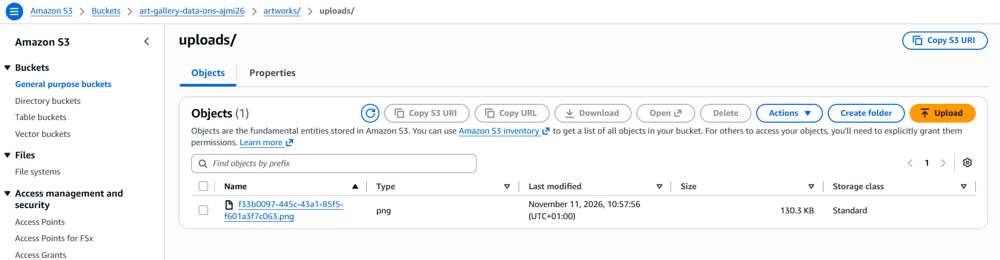

# S3: buckets and uploaded images

Companion of the [infrastructure README](README.md). It explains what lives in S3, how an image uploaded from a computer ends up there, and the commands to check it. The database side is in [RDS.md](RDS.md).

## 1. The two persistent buckets

Created once by `bootstrap/bootstrap.sh` (AWS CLI, in **Git Bash** on Windows), **not** deleted by `./destroy.sh`:

| Bucket | Content | Protection |
|---|---|---|
| `art-gallery-tfstate-<suffix>` | Terraform state (unused while the main stack keeps a local state file) | public access blocked, AES256, versioning on |
| `art-gallery-data-<suffix>` | Everything the application needs to come back (table below) | public access blocked, AES256 |

Layout of the data bucket:

| Prefix | Content | Written by | Read by |
|---|---|---|---|
| `artifacts/` | `backend-<version>.tar.gz`, `frontend-<version>.tar.gz` | you (`aws s3 cp`) | every app instance at boot |
| `seed/gallery.sql` | database dump restored into a fresh RDS | you (see [RDS.md](RDS.md#1-the-seed-data-that-comes-back-at-every-apply)) | the first app instance at boot |
| `artworks/uploads/` | images uploaded from a computer in the "new artwork" form | the backend, automatically | the backend (served at `/api/uploads/...`) |

Library images (`/artworks/painting/painting-11.jpg`...) are **not** in `artworks/uploads/`: they are part of the frontend package (`artifacts/frontend-<version>.tar.gz`), unpacked by each instance and served by nginx.



*An image uploaded through the site, stored under `artworks/uploads/` with a UUID name.*

## 2. How an uploaded image reaches S3

```
Artist chooses "send a file"  ->  POST /api/uploads  (nginx -> backend)
backend (S3_BUCKET set)       ->  s3://<data bucket>/artworks/uploads/<uuid>.<jpg|png|webp>
backend answers               ->  { "url": "/api/uploads/<uuid>.<ext>" }   (saved in artworks.image_url)
Browser shows the image       ->  GET /api/uploads/<uuid>.<ext>  ->  backend reads S3 and streams it
```

- **Nothing to run by hand.** The boot script (`modules/asg/user_data.sh.tpl`) writes `S3_BUCKET` and `AWS_REGION` into the backend environment of every instance. With `S3_BUCKET` set, uploads go to S3. Without it (local development), they stay on disk in `backend/uploads`.
- **The bucket stays private.** Opening the S3 object URL in a browser returns `AccessDenied`: this is expected. Visitors never use it: the API reads the object with the instance role and serves it.
- **Relative link.** The stored link is `/api/uploads/<file>`, without a host name, so it stays valid when the load balancer address changes after a rebuild.
- **Strict file names.** The API only serves `<uuid>.jpg|png|webp`, so nobody can request another object in the bucket.
- **Limits.** JPG, PNG or WebP, 5 MB maximum, artists and admins only.
- **No access key anywhere.** The instances use `LabInstanceProfile` (the Learner Lab role).

Code: `backend/src/uploads/` (`s3.storage.ts`, `uploads.controller.ts`, `uploads-files.controller.ts`).

## 3. What survives a destroy

| Item | After `./destroy.sh` | After the next `terraform apply` |
|---|---|---|
| Image files in `artworks/uploads/` | kept (persistent bucket) | still there |
| Packages in `artifacts/` and `seed/gallery.sql` | kept | used at boot |
| Artwork rows in the database | deleted with RDS | back **only as of the seed**: save the live database as the new seed first to keep artworks created on AWS ([RDS.md](RDS.md#3-keep-the-data-created-on-aws-before-a-destroy)) |

So an image uploaded on AWS stays in S3 forever, but it only shows on the site if an artwork row pointing to it exists in the restored database.

## 4. Commands

All in PowerShell (fresh Learner Lab credentials), replace `<suffix>`.

```powershell
# Images currently in S3 (name, date, size)
aws s3 ls s3://art-gallery-data-<suffix>/artworks/uploads/ --human-readable

# Everything in the data bucket
aws s3 ls s3://art-gallery-data-<suffix>/ --recursive --human-readable

# Copy images that exist only on your PC (backend\uploads) to S3, once
aws s3 sync backend\uploads s3://art-gallery-data-<suffix>/artworks/uploads/

# Download one image to look at it
aws s3 cp s3://art-gallery-data-<suffix>/artworks/uploads/<uuid>.png .

# Delete one image (for example a test)
aws s3 rm s3://art-gallery-data-<suffix>/artworks/uploads/<uuid>.png
```

Rescue images saved on an instance disk by the **old** backend (Session Manager terminal, on each instance):

```bash
ls -l /opt/art-gallery/backend/uploads
sudo aws s3 cp /opt/art-gallery/backend/uploads s3://art-gallery-data-<suffix>/artworks/uploads/ --recursive
```

Check an upload end to end: send an image from the new artwork form, then list `artworks/uploads/` (the new file appears with the time of the upload), then open `http://<app_url>/api/uploads/<file>` in the browser (the image displays).

## 5. Cost

S3 is billed by storage and by request, not by the hour: about 0.023 USD per GB and month. The project stores tens of MB, so the persistent buckets cost **less than 0.01 USD per month**. The costly resources are the NAT Gateway, the load balancer, RDS and the instances (about 0.15 USD per hour), which is why `./destroy.sh` is mandatory at the end of every session. Prices are approximate public `us-east-1` rates: the credit counter of AWS Academy is the real figure.

To delete everything for good (end of the project), after `./destroy.sh`:

```powershell
aws s3 rb s3://art-gallery-data-<suffix> --force
aws s3 rb s3://art-gallery-tfstate-<suffix> --force
```

This also deletes the packages, the seed and the images: the next apply would fail until `bootstrap.sh` and the uploads are done again.

## 6. Common problems

| Problem | Cause and fix |
|---|---|
| `AccessDenied` when opening the S3 object URL | Normal, the bucket is private. Use `http://<app_url>/api/uploads/<file>` |
| Uploaded image goes to the instance disk, `artworks/uploads/` stays empty | The site still runs the old backend. Rebuild and re-upload `backend-<version>.tar.gz` (with `@aws-sdk/client-s3` installed), then `terraform apply` |
| Upload fails with a 500 error | Read `sudo journalctl -u art-gallery -n 50` on an instance. An `AccessDenied` from S3 means the lab role cannot write to the bucket |
| Image shows as broken, or `404` on `/api/uploads/<file>` | The file is not in `artworks/uploads/` (never uploaded, or deleted), or the artwork row still holds an old `http://.../uploads/...` link (the boot script rewrites those after a seed restore) |
| `plan` fails on `data.aws_s3_bucket.data` | The data bucket was deleted or `unique_suffix` differs from the one used in `bootstrap.sh` |
| `npm ci` fails on the instance after adding the S3 library | `package.json` and `package-lock.json` disagree: run `npm install @aws-sdk/client-s3` in `backend/` (never edit `package.json` by hand), rebuild and re-upload the package |
