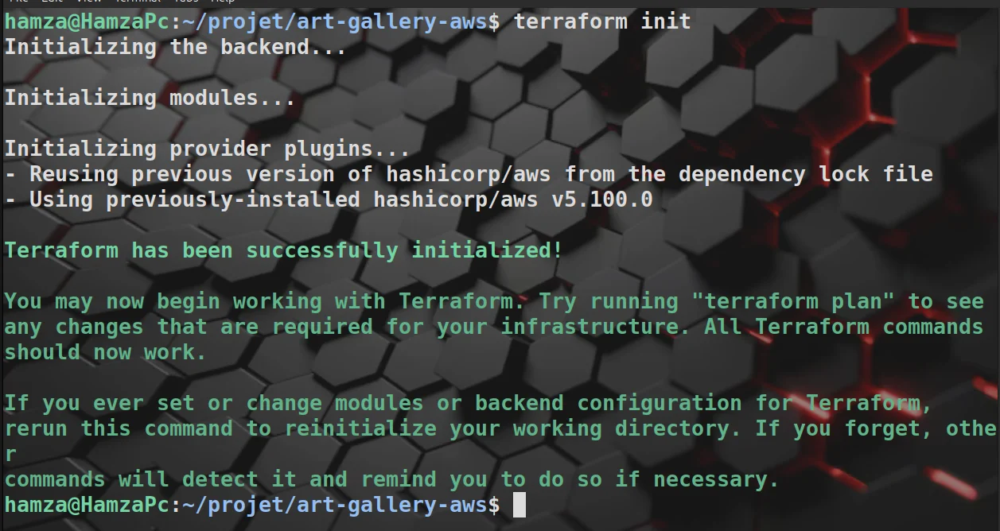
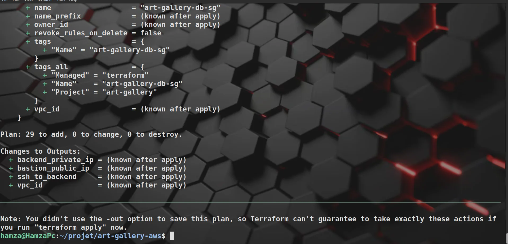
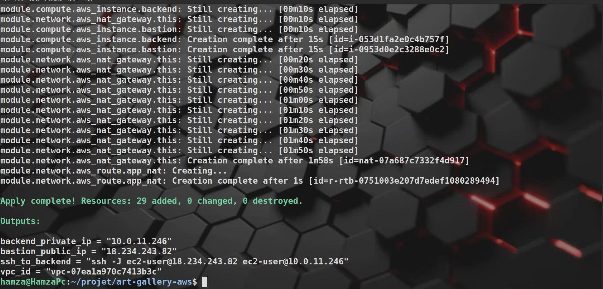
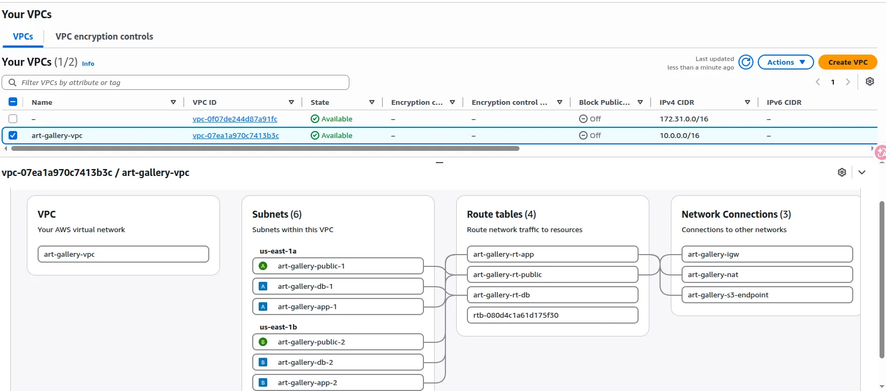
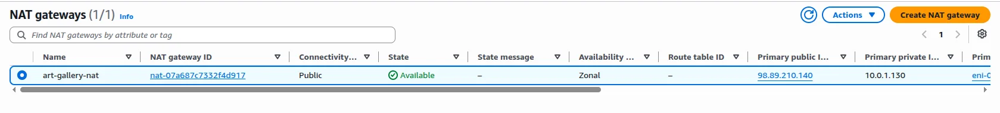
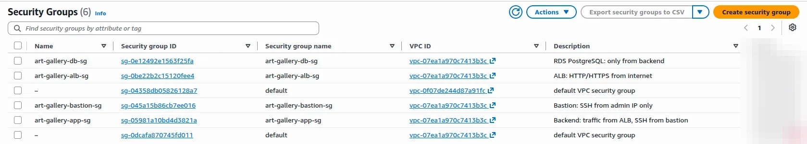
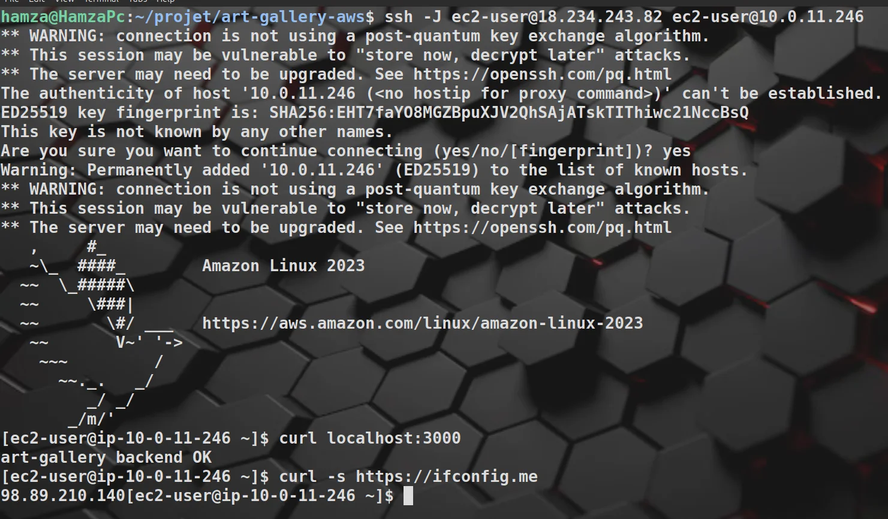
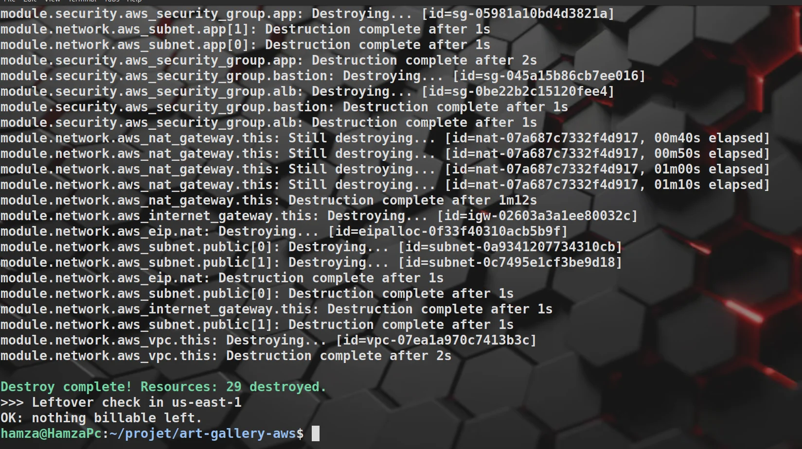

# Appendix: L3 baseline

> Moved out of the infra README. Back to the [README](../README.md).

## Appendix: L3 baseline (29 resources)

The first verified deployment (VPC, NAT, bastion, one test backend on port 3000). It was applied, tested through the bastion, and destroyed cleanly (29 created, 29 destroyed). The screenshots are kept as history; the v2 verification above replaces them.

Show the L3 screenshots

