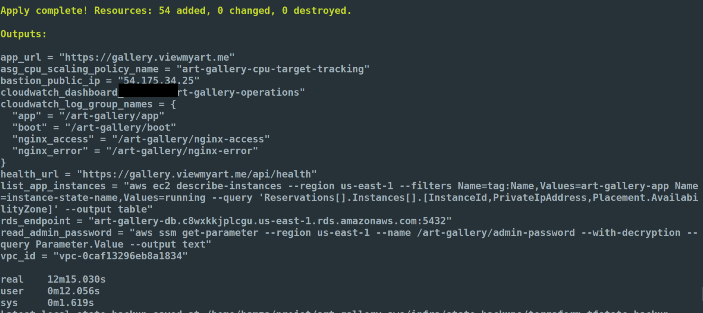

# Build time and cost

> Moved out of the infra README. Back to the [README](../README.md).

## Build time

### Measured: first full apply of architecture v2 (fallback mode, 41 resources)

Taken from the `terraform apply` log. Resources are created in parallel, so the total is the **critical path**, not the sum.

| Resource | Time to create | On the critical path |
|---|---|---|
| VPC | 15 s | start |
| Subnets, route tables, security groups, endpoint | 1 to 12 s each | no |
| NAT Gateway | 1 min 38 s | no (finishes long before RDS) |
| Application Load Balancer | 2 min 18 s | no |
| **RDS PostgreSQL** | **9 min 14 s** | **yes** |
| Launch Template | 8 s | yes (waits for the RDS endpoint) |
| **Auto Scaling Group** (waits for healthy targets) | **1 min 38 s** | **yes** |
| **Total** | **about 11.5 minutes** | RDS (9m14s) + Launch Template (8s) + ASG (1m38s) + network start |

The ASG depends on the RDS endpoint (the boot script needs the DB host), which is why it cannot start earlier.

### Measured: full rebuild in real mode with HTTPS (54 resources)

`time ./apply.sh` after a full destroy, on 15 Nov 2026: **14 min 17 s** (real mode, artifacts and seed from S3, HTTPS on). This includes the precheck and the local state backup done by `apply.sh`. The margin to the 15-minute target (L1) is 43 seconds, so RDS creation speed decides the result: measure again during the demonstration.

### Measurements to complete

| Measurement | Command | Result |
|---|---|---|
| Full apply, real mode (artifacts in S3, HTTPS on) | `time ./apply.sh` | 14 min 17 s |
| Destroy and leftover check | `time ./destroy.sh` | ___ min ___ s |
| Replacement of a killed instance (until `healthy`) | see [T7](t7.md) | approximately 53 s (`20:58:14` to `20:59:07`) |
| Rolling update to `v2` | see [T8](t8.md) | ___ min |
| Rebuild target (L1) | 15 minutes or less | Met: 14 min 17 s in real mode (11.5 min in fallback mode) |

> **[ADD SCREENSHOT]** `v2-08-timing.png`: timing of apply and destroy



## Cost

> Approximate, from public **on-demand `us-east-1`** prices. They can change, so confirm with the [AWS Pricing Calculator](https://calculator.aws/). The Learner Lab credit counter is the real source for what was charged.

### While the stack is running

| Item | Quantity | Price | Per hour |
|---|---|---|---|
| NAT Gateway | 1 | 0.045 USD/h (+ 0.045 USD per GB processed) | 0.045 |
| Application Load Balancer | 1 | 0.0225 USD/h | 0.0225 |
| ALB capacity units (low traffic) | about 1 | about 0.008 USD/h | 0.008 |
| EC2 `t3.micro` (2 app + 1 bastion) | 3 | 0.0104 USD/h | 0.031 |
| RDS `db.t3.micro` PostgreSQL, single-AZ | 1 | 0.018 USD/h | 0.018 |
| Public IPv4 addresses (NAT, bastion, 2 for the ALB) | 4 | 0.005 USD/h | 0.020 |
| EBS gp3, 3 x 8 GB | 24 GB | 0.08 USD/GB-month | 0.003 |
| RDS storage gp3, 20 GB | 20 GB | about 0.115 USD/GB-month | 0.003 |
| VPC, subnets, route tables, security groups, S3 gateway endpoint, SSM standard parameters | | free | 0 |
| **Total** | | | **about 0.15 USD/h** |

> Not in the hourly total: the Route 53 hosted zone (about 0.50 USD per month, kept between sessions). The ACM public certificate and the ALB HTTPS listener add no hourly cost.

### What it means for the budget (50 USD)

| Scenario | Estimate |
|---|---|
| One 2-hour session | about 0.30 USD |
| 10 sessions of 3 hours | about 4.50 USD |
| Left running one day | about 3.60 USD |
| Left running one week | about 25 USD (half the credit) |
| Left running one month | about 110 USD (more than the credit) |
| Hours of running time the whole 50 USD buys | about 330 hours |

### What stays between sessions

| Item | Cost |
|---|---|
| 2 S3 buckets (a few MB of artifacts, small state file) | well under 0.01 USD per month (about 0.023 USD/GB-month) |
| Manual RDS snapshot (if kept) | cents per month (billed on used size, about 0.095 USD/GB-month) |
| ECR (not used) | would be about 0.10 USD/GB-month |

### Where the money goes and how to reduce it

- **NAT Gateway + public IPv4 + ALB** are about 60% of the hourly cost and are billed even with zero traffic. Destroying at the end of each session is the biggest saving.
- **Multi-AZ RDS** would add about 0.018 USD/h. A second NAT would add 0.045 USD/h. Neither is enabled (budget decision).
- Cost of the deployment options not chosen: EKS would add about 0.10 USD/h for the control plane alone, more than the whole database and compute together.

### Check what was actually spent

```bash
# Often denied in the Learner Lab: if so, read the credit counter in the AWS Academy panel instead
aws ce get-cost-and-usage --time-period Start=2026-11-01,End=2026-11-09 \
  --granularity DAILY --metrics UnblendedCost --query 'ResultsByTime[].[TimePeriod.Start,Total.UnblendedCost.Amount]' --output table
```

*Screenshot: [cost evidence](../EVIDENCE.md#check-what-was-actually-spent)*
