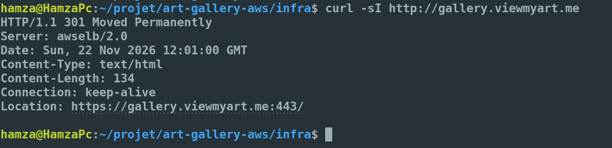

# HTTPS and custom domain

> Moved out of the infra README. Back to the [README](../README.md).

## HTTPS and custom domain

Each team member uses **their own domain**, so the name `<your-domain>` below stands for yours (for example `example.com`): replace it everywhere, in the commands and in `terraform.tfvars`. The site is served at `https://gallery.<your-domain>` when `enable_https = true` (default `false`: HTTP only).

### One-time setup (outside Terraform)

The hosted zone and the certificate are created **once** by hand and kept between sessions. Terraform only *looks them up*, so `./destroy.sh` never deletes them and a rebuild needs no new certificate.

```bash
# 1. Public hosted zone. Note the four name servers it returns.
aws route53 create-hosted-zone --name <your-domain> --caller-reference "$(date +%s)"

# 2. At the registrar (Namecheap): Nameservers -> Custom DNS -> the four name servers of the zone. Save.
#    Check (it can take from minutes to hours): dig +short NS <your-domain>

# 3. Certificate for the application hostname. It must be in us-east-1 (same region as the ALB).
aws acm request-certificate --region us-east-1 \
  --domain-name gallery.<your-domain> --validation-method DNS

# 4. Create the validation CNAME that ACM asks for, in the zone.
read NAME VALUE < <(aws acm describe-certificate --region us-east-1 --certificate-arn <CERTIFICATE_ARN> \
  --query 'Certificate.DomainValidationOptions[0].ResourceRecord.[Name,Value]' --output text)
aws route53 change-resource-record-sets --hosted-zone-id <ZONE_ID> --change-batch \
  "{\"Changes\":[{\"Action\":\"UPSERT\",\"ResourceRecordSet\":{\"Name\":\"$NAME\",\"Type\":\"CNAME\",\"TTL\":300,\"ResourceRecords\":[{\"Value\":\"$VALUE\"}]}}]}"

# 5. Wait for ISSUED (it validates by itself once the name servers are live).
aws acm describe-certificate --region us-east-1 --certificate-arn <CERTIFICATE_ARN> \
  --query 'Certificate.Status' --output text
```

**Windows PowerShell version** (run steps 1, 3, 4 and 5 once, in the same window; the zone and certificate IDs are saved in `mydns.txt`):

```powershell
$DOMAIN = "<your-domain>"
$ZONE_ID = aws route53 create-hosted-zone --name $DOMAIN --caller-reference "zone-$([DateTimeOffset]::UtcNow.ToUnixTimeSeconds())" --query 'HostedZone.Id' --output text
aws route53 get-hosted-zone --id $ZONE_ID --query 'DelegationSet.NameServers' --output text   # the four name servers, to set at the registrar
$CERT_ARN = aws acm request-certificate --region us-east-1 --domain-name "gallery.$DOMAIN" --validation-method DNS --query 'CertificateArn' --output text
@("ZONE_ID=$ZONE_ID","CERT_ARN=$CERT_ARN") | Set-Content "$HOME\mydns.txt"

# After the name servers are live (nslookup -type=NS <your-domain> 8.8.8.8 lists the four awsdns servers):
$rr = aws acm describe-certificate --region us-east-1 --certificate-arn $CERT_ARN --query 'Certificate.DomainValidationOptions[0].ResourceRecord' --output json | ConvertFrom-Json
@{Changes=@(@{Action="UPSERT";ResourceRecordSet=@{Name=$rr.Name;Type="CNAME";TTL=300;ResourceRecords=@(@{Value=$rr.Value})}})} | ConvertTo-Json -Depth 6 | Set-Content cname.json -Encoding ascii
aws route53 change-resource-record-sets --hosted-zone-id $ZONE_ID --change-batch file://cname.json
aws acm wait certificate-validated --region us-east-1 --certificate-arn $CERT_ARN
aws acm describe-certificate --region us-east-1 --certificate-arn $CERT_ARN --query 'Certificate.Status' --output text   # ISSUED
```

Run the zone creation only **once**: a second run creates a second zone with the same name and Terraform can no longer find it. Run the `.sh` scripts (`bootstrap.sh`, `apply.sh`, `destroy.sh`) in **Git Bash**, not in PowerShell, which would only open the file.

Never put the certificate ARN or the zone ID in a screenshot without blurring the account ID.

### Turn it on

Add to `terraform.tfvars` (it is not committed):

```
enable_https  = true
domain_name   = "<your-domain>"
app_subdomain = "gallery"
```

Variables: `domain_name` is **your own domain** (no default, required when `enable_https = true`) and `app_subdomain` (default `gallery`).

With `enable_https = true`, Terraform also:

- looks up the Route 53 zone and the **ISSUED** certificate (`plan` fails if the certificate is not issued, so nothing half-built is created),
- uses the TLS policy `ELBSecurityPolicy-TLS13-1-2-2021-06` on the HTTPS listener,
- gives the backend `https://gallery.<your-domain>` as `FRONTEND_URL` and `PUBLIC_API_URL`.

### Verify

```bash
curl -sI http://gallery.<your-domain> | head -3            # expected: 301 Moved Permanently
curl -s https://gallery.<your-domain>/api/health            # expected: the health JSON
curl -sI https://gallery.<your-domain> | head -3            # expected: HTTP/2 200
```

Result on 15 Nov 2026: the HTTP request is redirected with a 301 by the ALB, HTTPS answers `HTTP/2 200` and the health endpoint is healthy.



### After the project

`./destroy.sh` keeps the zone and the certificate. When the course is over, delete the validation record and the other records in the zone, then `aws route53 delete-hosted-zone --id <ZONE_ID>` and `aws acm delete-certificate --region us-east-1 --certificate-arn <CERTIFICATE_ARN>`.
