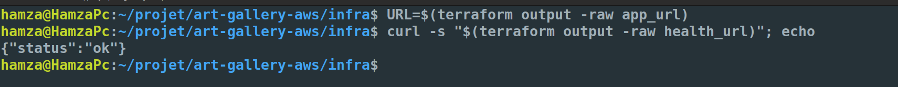
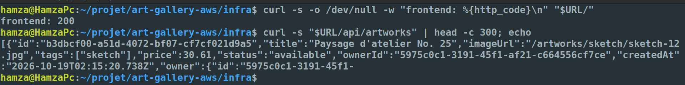
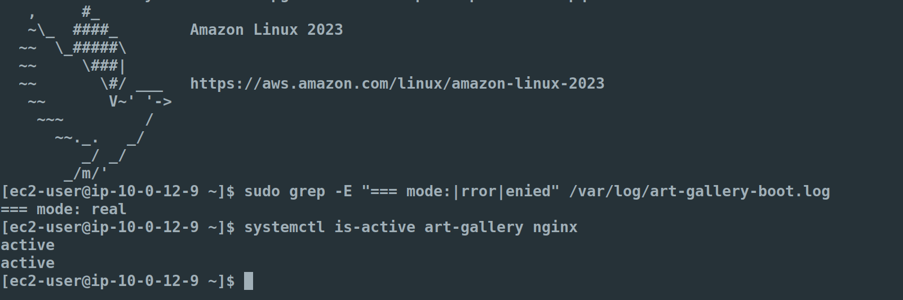

# Tests T1–T3 – Health, Frontend/API and Real-Mode Boot

## Test setup

| Item | Value |
| --- | --- |
| Region | `us-east-1` |
| Public entry point | Application Load Balancer URL |
| Health endpoint | `/api/health` |
| Frontend route | `/` |
| API route | `/api/artworks` |
| Application mode | Real mode |

# Test T1 – Health endpoint

## Objective

Verify that the public health endpoint is available through the Application Load Balancer and that the application reports a healthy status.

## Procedure

From the `infra` directory:

```bash
cd infra
URL=$(terraform output -raw app_url)
curl -s "$(terraform output -raw health_url)"; echo
```

## Observed result

The endpoint returned:

```json
{"status":"ok"}
```

**Screenshot – T1 health response:**



This screenshot proves that `/api/health` is reachable through the public load-balancer URL and returns a successful health status.

## Result

**PASS**

# Test T2 – Frontend and database-backed API through one URL

## Objective

Verify that the frontend and API are both available through the same public ALB URL, and that `/api/artworks` returns data from the database-backed backend.

## Procedure

From the `infra` directory:

```bash
cd infra
URL=$(terraform output -raw app_url)

curl -s -o /dev/null -w "frontend: %{http_code}\n" "$URL/"
curl -s "$URL/api/artworks" | head -c 300; echo
```

## Observed result

The frontend returned:

```text
frontend: 200
```

The API returned artwork JSON from the database, for example:

```json
{"id":"b3dbcf00-a51d-4072-bf07-c7cf021d95b","title":"Paysage d'atelier No. 25","status":"available"}
```

**Screenshot – T2 frontend and API responses:**



This screenshot proves that the public frontend responds with `200` and that `/api/artworks` serves database-backed artwork data through the same application URL.

## Result

**PASS**

# Test T3 – Real mode and secrets

## Objective

Verify that application instances boot in real mode, successfully read their deployment secrets, and start both `art-gallery` and `nginx`.

## Procedure

Connect to an app instance through the bastion:

```bash
cd infra
eval "$(ssh-agent -s)"
ssh-add ~/path/to/labsuser.pem
eval "$(terraform output -raw list_app_instances)"
ssh -J ec2-user@$(terraform output -raw bastion_public_ip) ec2-user@<private-ip>
```

Do not type the `<` `>` characters. Replace `<private-ip>` with an app-instance private IP.

On the app instance, check the boot log and service states:

```bash
sudo grep -E "=== mode:|mode:|error|denied|AccessDenied" /var/log/art-gallery-boot.log
sudo systemctl is-active art-gallery nginx
```

## Observed result

The boot log contained:

```text
=== mode: real
```

There was no `AccessDenied` or secret-reading error.

Both services were active:

```text
active
active
```

**Screenshot – T3 real mode and active services:**



This screenshot proves that the boot process ran in real mode and that both `art-gallery` and `nginx` were active.

## Result

**PASS**
