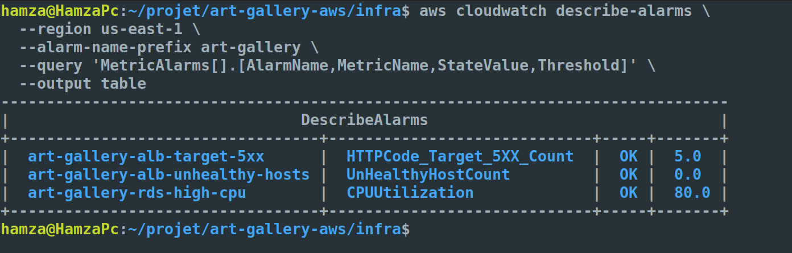
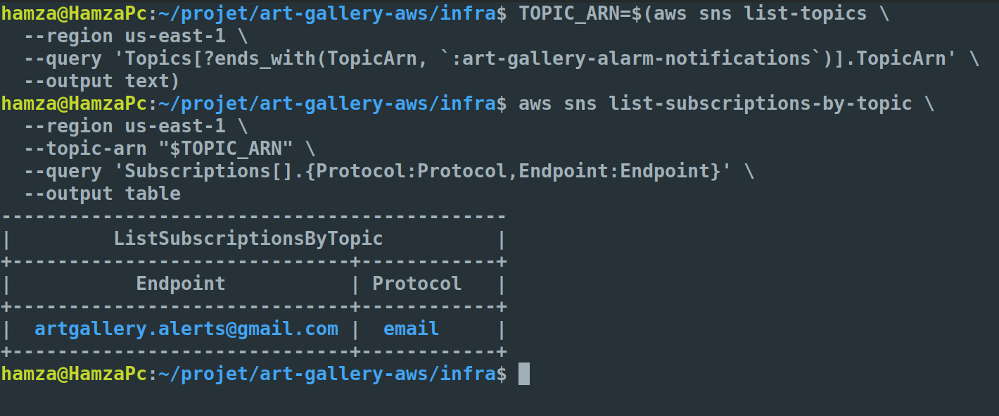
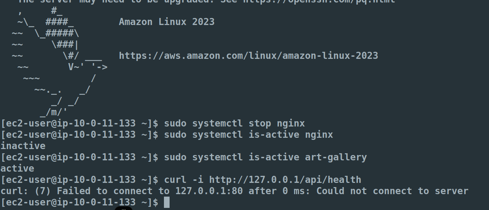
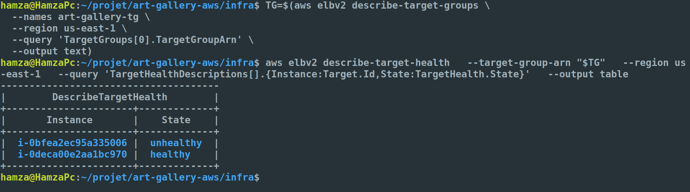
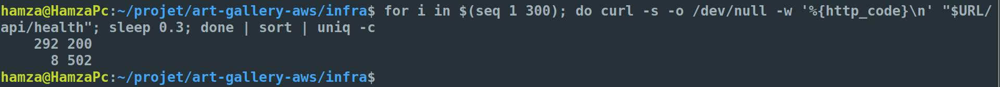
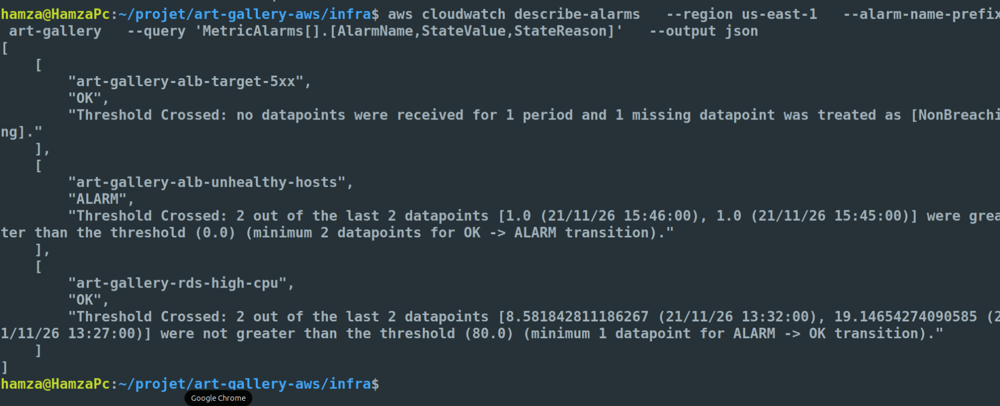
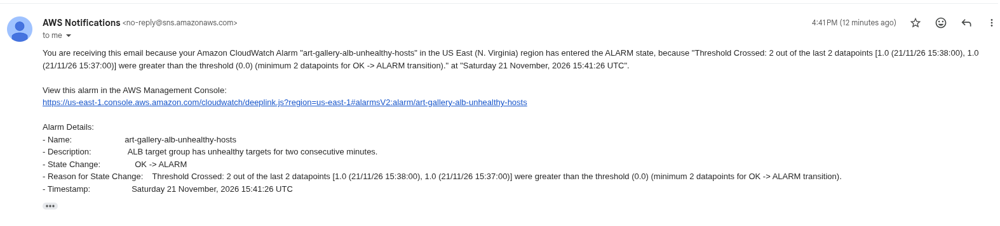
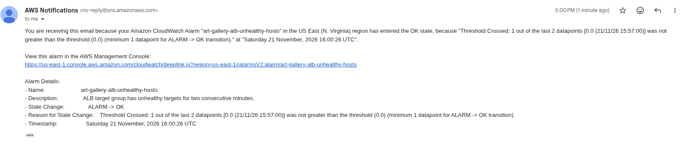
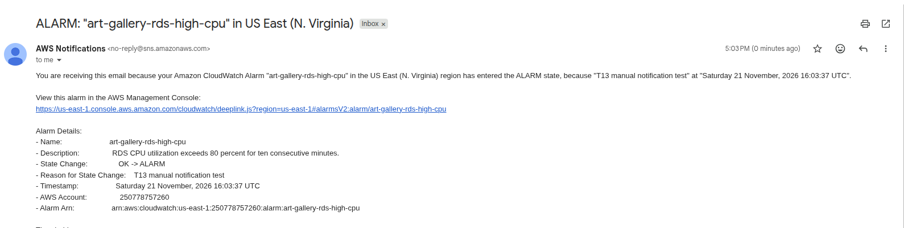
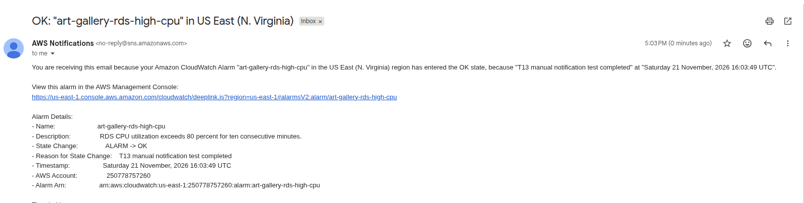

# Test T13 – CloudWatch Alarms and Notifications

## Objective

Verify that CloudWatch detects application and infrastructure failures, changes the configured alarms to `ALARM`, sends notifications through SNS, and returns the alarms to `OK` after recovery.

## Test setup

| Item                    | Value                                      |
| ----------------------- | ------------------------------------------ |
| Region                  | `us-east-1`                                |
| SNS topic               | `art-gallery-alarm-notifications`          |
| Notification destination| E-mail address configured with `alarm_email` |
| ALB target 5xx alarm    | `art-gallery-alb-target-5xx`               |
| Unhealthy hosts alarm   | `art-gallery-alb-unhealthy-hosts`          |
| RDS CPU alarm           | `art-gallery-rds-high-cpu`                 |

After every Terraform apply, AWS sends a new SNS subscription confirmation e-mail. Confirm the subscription before starting the test, or notifications will not arrive.

## Step 1 – Verify the alarm configuration

From the `infra` directory, list the alarms and their initial states:

```bash
cd infra
aws cloudwatch describe-alarms \
  --region us-east-1 \
  --alarm-name-prefix art-gallery \
  --query 'MetricAlarms[].[AlarmName,MetricName,StateValue,Threshold]' \
  --output table
```

Expected: the ALB, RDS and scaling-related alarms are listed. The three notification alarms should initially be in `OK` or `INSUFFICIENT_DATA`.

**Screenshot 1 – Initial CloudWatch alarm states:**



This screenshot proves that the CloudWatch alarms exist before the failure test.

## Step 2 – Confirm the SNS subscription

Check that the SNS topic has a confirmed subscription:

```bash
TOPIC_ARN=$(aws sns list-topics \
  --region us-east-1 \
  --query 'Topics[?ends_with(TopicArn, `:art-gallery-alarm-notifications`)].TopicArn' \
  --output text)

aws sns list-subscriptions-by-topic \
  --region us-east-1 \
  --topic-arn "$TOPIC_ARN" \
  --query 'Subscriptions[].{Protocol:Protocol,Endpoint:Endpoint}' \
  --output table
```

Expected: one e-mail subscription with a subscription ARN rather than `PendingConfirmation`.

**Screenshot 2 – Confirmed SNS e-mail subscription:**



This screenshot proves that alarm notifications are delivered to the configured e-mail address.

## Step 3 – Stop the API on one app instance

Connect to one application instance through the bastion:

```bash
cd infra
eval "$(ssh-agent -s)"
ssh-add ~/path/to/labsuser.pem
eval "$(terraform output -raw list_app_instances)"
ssh -J ec2-user@$(terraform output -raw bastion_public_ip) ec2-user@<private-ip>
```
```bash
sudo systemctl stop nginx
sudo systemctl is-active nginx
sudo systemctl is-active art-gallery
curl -i http://127.0.0.1/api/health
```
Do not type the `<` `>` characters. Replace `<private-ip-of-one-instance>` with a real private app-instance IP.

Nginx remains active and may answer `502` for `/api` requests while the API is stopped.

**Screenshot 3 – API stopped on one app instance:**




This screenshot proves that one application target was intentionally taken out of service while the other instance remained available.

## Step 4 – Generate ALB 5xx responses

From the laptop, send repeated health-check requests for about 90 seconds:

```bash
cd infra
URL=$(terraform output -raw app_url)

for i in $(seq 1 300); do
  curl -s -o /dev/null -w '%{http_code}\n' "$URL/api/health"
  sleep 0.3
done | sort | uniq -c
```

Expected: a mix of `200` and `502` responses while the stopped target remains in the target group.

**Screenshot 4 – 200 and 502 responses during the alarm test:**



Observed result: 292 requests returned `200` and 8 requests returned `502`. This screenshot proves that stopping the API generated 5xx responses through the ALB. The `art-gallery-alb-target-5xx` alarm remained `OK` in subsequent checks because the 8 502 responses did not provide enough target 5xx metric data within the required CloudWatch threshold window.

## Step 5 – Observe the alarms change to ALARM

Keep the API stopped for at least three minutes, then check the alarm states:

```bash
aws cloudwatch describe-alarms \
  --region us-east-1 \
  --alarm-name-prefix art-gallery \
  --query 'MetricAlarms[].[AlarmName,StateValue,StateReason]' \
  --output table
```

The configured alarm behavior is:

| Alarm | Trigger | Expected state |
| ----- | ------- | -------------- |
| `art-gallery-alb-target-5xx` | 5 or more target 5xx responses in one minute | `ALARM` if the threshold is reached; observed `OK` with 8 502 responses in the test window |
| `art-gallery-alb-unhealthy-hosts` | `UnHealthyHostCount` above 0 for 2 consecutive minutes | `ALARM` |
| `art-gallery-rds-high-cpu` | RDS CPU above 80% for 10 minutes | Remains `OK` unless the RDS instance is loaded |

**Screenshot 5 – CloudWatch alarms in ALARM state:**



Observed result: `art-gallery-alb-unhealthy-hosts` is `ALARM`, with two consecutive unhealthy datapoints (`1.0`) above the threshold `0`. This screenshot proves that CloudWatch detected the failed ALB target.

**Screenshot 6 – SNS notification e-mail:**



Observed result: SNS sent an e-mail for `art-gallery-alb-unhealthy-hosts` when the alarm changed from `OK` to `ALARM` at `15:41:26 UTC`. This screenshot proves that the alarm notification was delivered successfully.

## Step 6 – Restore the application

Restart the API on the stopped instance:

```bash
cd infra
KEY=labsuser.pem
BASTION=$(terraform output -raw bastion_public_ip)
IP=<private-ip-of-one-instance>

ssh -i "$KEY" -o StrictHostKeyChecking=accept-new \
  -o ProxyCommand="ssh -i $KEY -o StrictHostKeyChecking=accept-new -W %h:%p ec2-user@$BASTION" \
  ec2-user@"$IP" "sudo systemctl start art-gallery"
```

Wait for the target to become healthy, then check the ALB alarm states again:

```bash
aws cloudwatch describe-alarms \
  --region us-east-1 \
  --alarm-name-prefix art-gallery \
  --query 'MetricAlarms[].[AlarmName,StateValue,StateReason]' \
  --output table
```

Expected: the target health and alarm states return to `OK` after the recovery periods have elapsed.

**Screenshot 7 – Alarm notification after recovery:**



Observed result: SNS sent an e-mail for `art-gallery-alb-unhealthy-hosts` when the alarm changed from `ALARM` to `OK` at `16:00:26 UTC`. This screenshot proves that the alert cleared after the target became healthy again.

## RDS CPU alarm

A sustained RDS CPU load test is not practical on the small `db.t3.micro` instance. The RDS alarm can be verified as configured in `OK` or `INSUFFICIENT_DATA`, or the SNS notification path can be tested manually if AWS permissions allow:

```bash
aws cloudwatch set-alarm-state \
  --region us-east-1 \
  --alarm-name art-gallery-rds-high-cpu \
  --state-value ALARM \
  --state-reason "T13 manual notification test"
```

Restore the alarm state afterward:

```bash
aws cloudwatch set-alarm-state \
  --region us-east-1 \
  --alarm-name art-gallery-rds-high-cpu \
  --state-value OK \
  --state-reason "T13 manual notification test completed"
```

**Screenshot 8 – RDS alarm notification test:**



Observed result: the manual `set-alarm-state` test changed `art-gallery-rds-high-cpu` from `OK` to `ALARM` at `16:03:37 UTC`, and SNS sent an e-mail notification.

**Screenshot 9 – RDS alarm recovery notification:**



Observed result: restoring the alarm state changed it from `ALARM` to `OK` at `16:03:49 UTC`, and SNS sent the recovery e-mail.

## Result

**PASS**

Stopping nginx or the API on one app instance generated unhealthy-target activity and, during the API-stop test, ALB 5xx responses. The `art-gallery-alb-unhealthy-hosts` alarm moved to `ALARM`, SNS sent e-mail notifications for the `ALARM` and `OK` transitions, and target recovery returned the alarm to `OK`. The RDS CPU alarm was verified through configuration or a manual alarm-state test.
