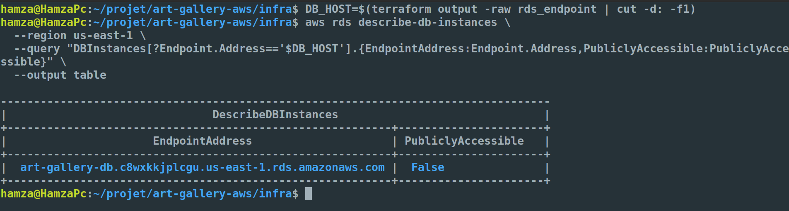
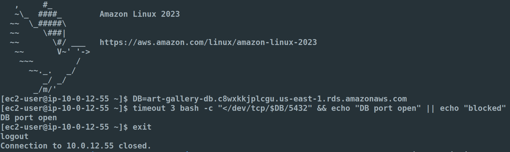
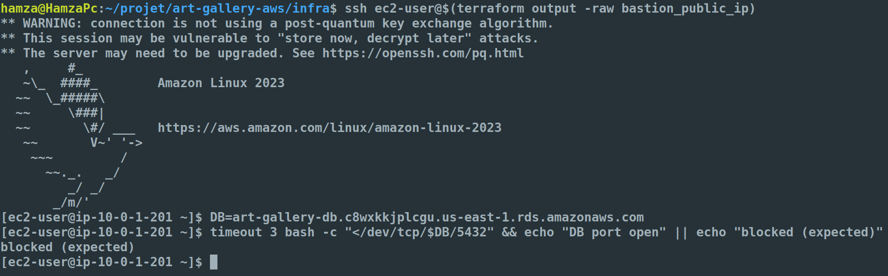
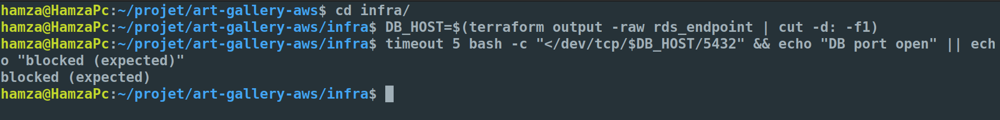

# Test T4 – Database Reachable from the App Tier Only

## Objective

Verify that the RDS PostgreSQL database is network-isolated: application instances must be able to reach its PostgreSQL port, while the laptop and bastion host must not be able to reach it.

## Test setup

| Item          | Value                         |
| ------------- | ----------------------------- |
| Region        | `us-east-1`                   |
| Database      | PostgreSQL on RDS             |
| Database port | `5432`                        |
| App tier      | Private application instances |
| Bastion       | Public bastion instance       |
| Laptop        | Test workstation outside AWS  |

## Step 1 – Verify the RDS hostname and public-access state

From the laptop or workstation in the `infra` directory, retrieve the RDS hostname and show it together with the public-access state in a table:

```bash
cd infra
DB_HOST=$(terraform output -raw rds_endpoint | cut -d: -f1)

aws rds describe-db-instances \
  --region us-east-1 \
  --query "DBInstances[?Endpoint.Address=='$DB_HOST'].{EndpointAddress:Endpoint.Address,PubliclyAccessible:PubliclyAccessible}" \
  --output table
```

Copy the returned hostname for use in the next steps.

Expected output:

```text
-------------------------------------------------------
|                 DescribeDBInstances                  |
+----------------------+-------------------------------+
| EndpointAddress      | PubliclyAccessible            |
+----------------------+-------------------------------+
| art-gallery-db...   | False                         |
+----------------------+-------------------------------+
```

**Screenshot 1 – RDS hostname and public-access state:**



This screenshot proves that the RDS endpoint is the displayed hostname and that `PubliclyAccessible` is `False`.


## Step 2 – Test connectivity from an application instance

Connect to an app instance through the bastion:

```bash
cd infra
eval "$(ssh-agent -s)"
ssh-add ~/path/to/labsuser.pem
eval "$(terraform output -raw list_app_instances)"
ssh -J ec2-user@$(terraform output -raw bastion_public_ip) ec2-user@<private-ip>
```

On the application instance, set the RDS hostname and test TCP port `5432`:

```bash
DB=art-gallery-db.xxxxxxxx.us-east-1.rds.amazonaws.com
timeout 3 bash -c "</dev/tcp/$DB/5432" && echo "DB port open" || echo "blocked"
```

Expected result:

```text
DB port open
```

**Screenshot 3 – Database port open from the app instance:**



This screenshot is dedicated to the successful TCP connection from the app-tier instance.

## Step 3 – Test connectivity from the bastion

Open a separate SSH session to the bastion:

```bash
ssh ec2-user@$(terraform output -raw bastion_public_ip)
```

Set the same RDS hostname and run the same port test:

```bash
DB=art-gallery-db.xxxxxxxx.us-east-1.rds.amazonaws.com
timeout 3 bash -c "</dev/tcp/$DB/5432" && echo "DB port open" || echo "blocked (expected)"
```

Expected result:

```text
blocked (expected)
```

**Screenshot 4 – Database port blocked from the bastion:**



This screenshot is dedicated to the failed or blocked TCP connection from the bastion, because the bastion is not in the RDS security-group rule.

## Step 4 – Test connectivity from the laptop

From the laptop, use the RDS hostname and try to open TCP port `5432`:

```bash
cd infra
DB_HOST=$(terraform output -raw rds_endpoint | cut -d: -f1)
timeout 5 bash -c "</dev/tcp/$DB_HOST/5432" && echo "DB port open" || echo "blocked (expected)"
```

Expected result:

```text
blocked (expected)
```

**Screenshot 2 – Database port blocked from the laptop:**



This screenshot proves that RDS is not reachable directly from outside the AWS private network.

## Result

**PASS**

The database endpoint is not publicly accessible. TCP port `5432` is blocked from the laptop and bastion but reachable from an application instance, demonstrating that RDS is reachable only from the app tier.
