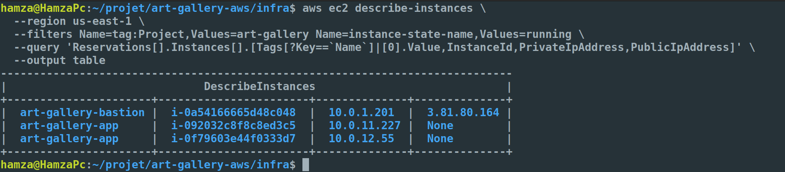
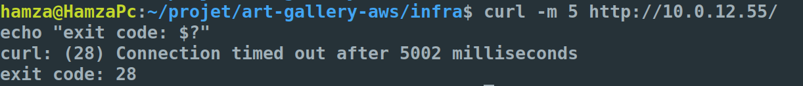
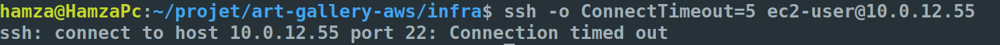
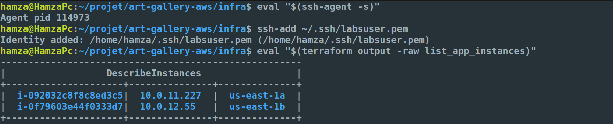
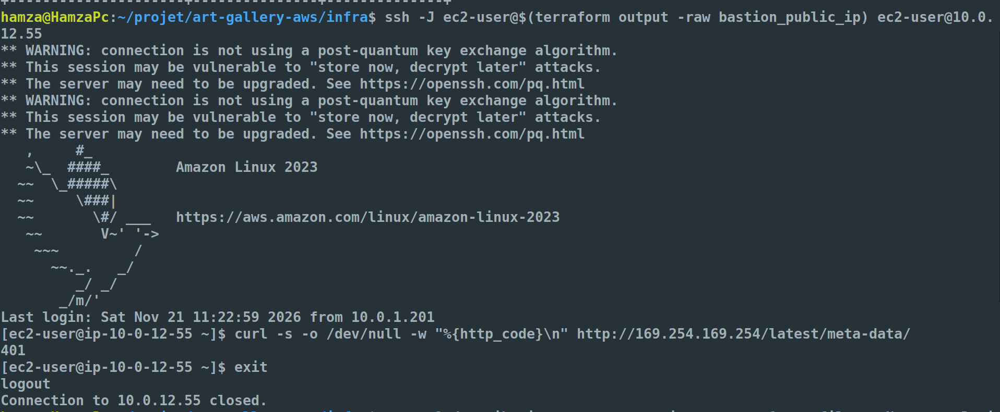

# Test T5 – Private Instances and Database from Outside the App Tier

## Objective

Verify that application instances are private and cannot be reached directly from the Internet, that only the bastion path is used for SSH access, and that the RDS database is also unreachable from the laptop.

## Test setup

| Item                   | Value                                      |
| ---------------------- | ------------------------------------------ |
| Region                 | `us-east-1`                                |
| Application instances  | Two private EC2 instances in the app tier  |
| Bastion                | Public EC2 instance                        |
| RDS database           | PostgreSQL private endpoint on port `5432` |
| Direct public access   | Not permitted                              |

## Step 1 – Confirm that app instances have no public IP

List the running EC2 instances and inspect their public and private IP fields:

```bash
cd infra
aws ec2 describe-instances \
  --region us-east-1 \
  --filters Name=tag:Project,Values=art-gallery Name=instance-state-name,Values=running \
  --query 'Reservations[].Instances[].[Tags[?Key==`Name`]|[0].Value,InstanceId,PrivateIpAddress,PublicIpAddress]' \
  --output table
```

Expected: the two `art-gallery-app` instances have private IP addresses and an empty `PublicIpAddress` column. The bastion is the only expected instance with a public IP.

**Screenshot 1 – App instances without public IP addresses:**



This screenshot proves that application traffic cannot be addressed directly from the Internet.

## Step 2 – Test HTTP access to an app instance from the laptop

From the laptop, copy one application private IP from the table above and run:

```bash
curl -m 5 http://<app-private-ip>/
echo "exit code: $?"
```

Do not type the `<` `>` characters. They indicate a placeholder.

Expected result:

```text
exit code: 28
```

Exit code `28` means the connection timed out.

**Screenshot 2 – Direct HTTP timeout from the laptop:**



This screenshot proves that an app instance's private IP cannot be reached directly over HTTP from the laptop.

## Step 3 – Test direct SSH access from the laptop

Attempt SSH directly to the application private IP without using the bastion:

```bash
ssh -o ConnectTimeout=5 ec2-user@<app-private-ip>
```

Expected: connection timeout or failure after five seconds.

**Screenshot 3 – Direct SSH timeout from the laptop:**



This screenshot proves that app instances must be reached through the bastion rather than through a direct Internet SSH connection.


## Step 4 – Verify IMDSv2 is required on an app instance

Connect to an app instance through the bastion:

```bash
cd infra
eval "$(ssh-agent -s)"
ssh-add ~/path/to/labsuser.pem
eval "$(terraform output -raw list_app_instances)"
ssh -J ec2-user@$(terraform output -raw bastion_public_ip) ec2-user@<private-ip>
```
**Screenshot 5 – Connect to an app instance through the bastion:**




On the app instance, try the IMDSv1 metadata request:

```bash
curl -s -o /dev/null -w "%{http_code}\n" http://169.254.169.254/latest/meta-data/
```

Expected result:

```text
401
```

**Screenshot 5 – IMDSv1 refused on the app instance:**



This screenshot proves that metadata access requires IMDSv2, which reduces the risk of server-side request forgery and credential theft.

## Result

**PASS**

The app instances have no public IP addresses. Direct HTTP and SSH attempts from the laptop time out. IMDSv1 requests on an app instance return `401`, confirming that IMDSv2 is required.
