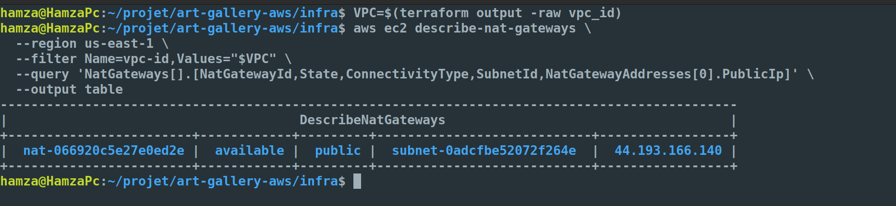
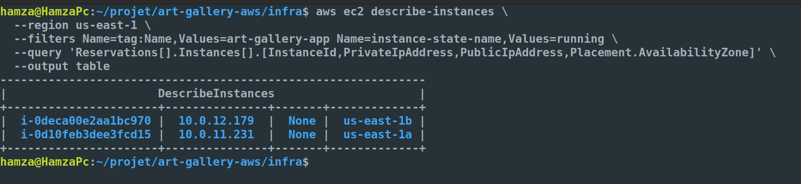
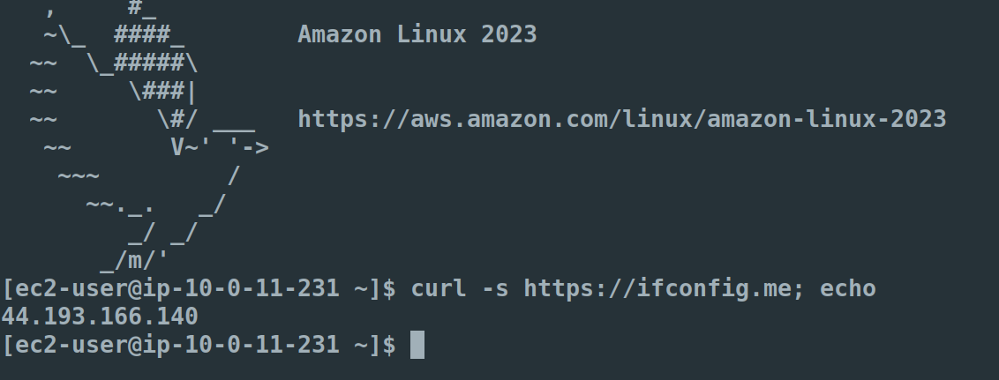
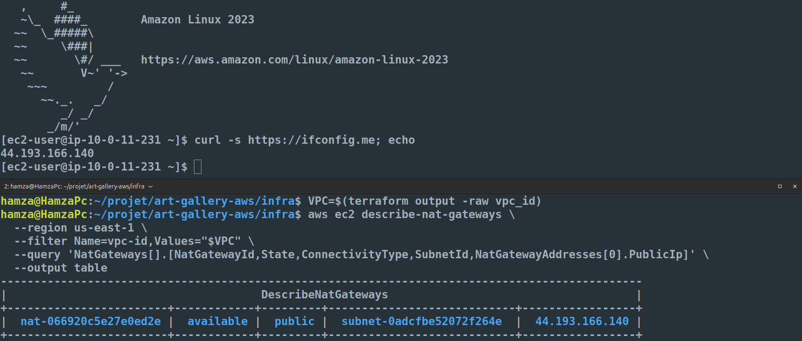

# Test T6 – Outbound Access Through the NAT Gateway

## Objective

Verify that private application instances can access the Internet only for outbound traffic, and that their public source address is the NAT Gateway Elastic IP rather than an address assigned directly to an instance.

## Test setup

| Item                   | Value                            |
| ---------------------- | -------------------------------- |
| Region                 | `us-east-1`                      |
| NAT Gateway            | One NAT Gateway in a public subnet |
| Application instances  | Private EC2 instances            |
| Internet route         | App subnet route to the NAT Gateway |
| External IP check      | `https://ifconfig.me`            |

## Step 1 – Identify the NAT Gateway public IP

From the `infra` directory, obtain the VPC ID and list the NAT Gateway plus its public IP:

```bash
cd infra
VPC=$(terraform output -raw vpc_id)

aws ec2 describe-nat-gateways \
  --region us-east-1 \
  --filter Name=vpc-id,Values="$VPC" \
  --query 'NatGateways[].[NatGatewayId,State,ConnectivityType,SubnetId,NatGatewayAddresses[0].PublicIp]' \
  --output table
```

Expected: the NAT Gateway state is `available`, connectivity type is `public`, and `PublicIp` contains the Elastic IP.

**Screenshot 1 – NAT Gateway public IP:**



This screenshot is dedicated to recording the NAT Gateway public IP used for app-instance outbound traffic.

## Step 2 – List the app-instance addresses

List the private application instances and confirm that they have no public IP:

```bash
aws ec2 describe-instances \
  --region us-east-1 \
  --filters Name=tag:Name,Values=art-gallery-app Name=instance-state-name,Values=running \
  --query 'Reservations[].Instances[].[InstanceId,PrivateIpAddress,PublicIpAddress,Placement.AvailabilityZone]' \
  --output table
```

Expected: each app instance has a private IP and an empty `PublicIpAddress` field.

**Screenshot 2 – App instances have no public IP:**



This screenshot proves that outbound traffic cannot originate from a public IP assigned directly to an app instance.

## Step 3 – Test outbound access from an app instance

Connect to an app instance through the bastion:

```bash
eval "$(ssh-agent -s)"
ssh-add ~/path/to/labsuser.pem
eval "$(terraform output -raw list_app_instances)"
ssh -J ec2-user@$(terraform output -raw bastion_public_ip) ec2-user@<private-ip>
```

Do not type the `<` `>` characters. Replace `<private-ip>` with one private app-instance IP.

On the app instance, query the public IP seen by an external service:

```bash
curl -s https://ifconfig.me; echo
```

Expected: the returned IP is the NAT Gateway's public Elastic IP.

**Screenshot 3 – Outbound public IP from the app instance:**



This screenshot proves that the private app instance reached the Internet and that the NAT Gateway translated it to the NAT Elastic IP.

## Step 4 – Compare both IPs

Compare the public IP from Step 1 with the IP returned by `ifconfig.me` in Step 3.

| Source | Public IP |
| ------ | --------- |
| NAT Gateway | `44.193.166.140` |
| App instance outbound request | `44.193.166.140` |

They must be identical.

**Screenshot 4 – NAT and app outbound IP comparison:**




## Result

**PASS**

The app instances have no public IP addresses, but they can make outbound Internet requests. The external IP returned by `curl https://ifconfig.me` matches the NAT Gateway public Elastic IP, proving that outbound traffic is routed through the NAT Gateway.
