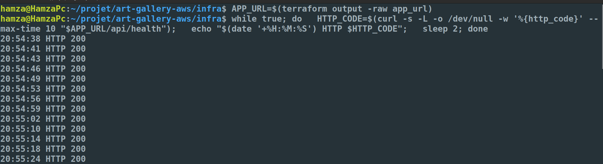
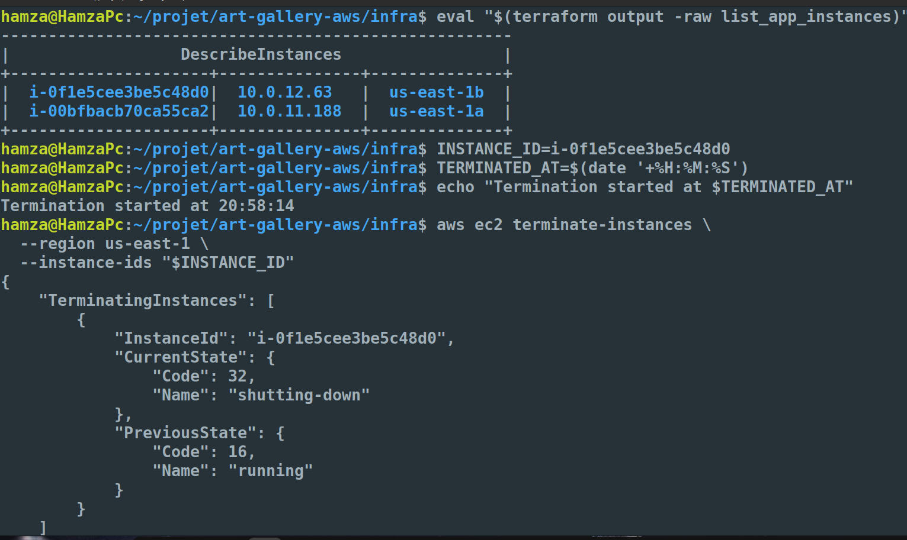
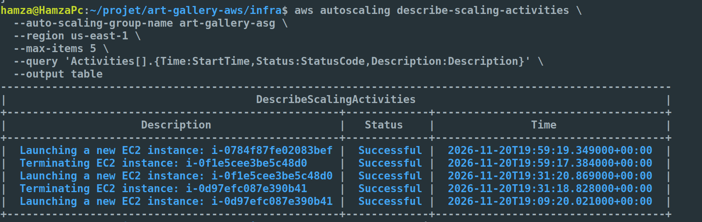
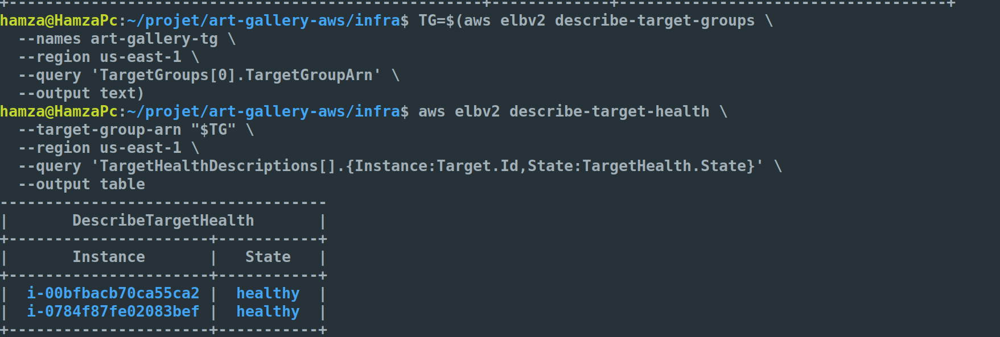
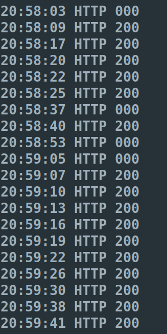

# Test T7 – Instance Loss and Automatic Replacement

## Objective

Verify that terminating one application instance does not make the application permanently unavailable, and that the Auto Scaling Group (ASG) launches and registers a replacement instance.

## Test setup

| Item                 | Value                   |
| -------------------- | ----------------------- |
| Region               | `us-east-1`             |
| ASG                  | `art-gallery-asg`       |
| ALB target group     | `art-gallery-tg`        |
| Health endpoint      | `/api/health`           |
| Instance terminated  | `i-0f1e5cee3be5c48d0`   |
| Surviving instance   | `i-00bfbacb70ca55ca2`   |
| Replacement instance | `i-0784f87fe02083bef`   |

Times are local time (UTC+1) unless marked UTC. AWS CLI outputs are in UTC.

## Step 1 – Start the continuous health check

Open a first terminal and start the loop **before** terminating anything, so that the test shows the normal state before the interruption. Keep this terminal open for the whole test.

```bash
cd infra
APP_URL=$(terraform output -raw app_url)

while true; do
  HTTP_CODE=$(curl -s -L -o /dev/null -w '%{http_code}' --max-time 10 "$APP_URL/api/health")
  echo "$(date '+%H:%M:%S') HTTP $HTTP_CODE"
  sleep 2
done
```

Every line must show `HTTP 200`. Let the loop run for at least 10 seconds before moving on.

**Screenshot 1 – Health check in normal state:**



## Step 2 – Terminate one instance

Open a second terminal. List the running application instances, record the termination time, then terminate one instance. The first terminal keeps checking `/api/health` during this step.

```bash
cd infra
eval "$(terraform output -raw list_app_instances)"

INSTANCE_ID=i-0f1e5cee3be5c48d0
TERMINATED_AT=$(date '+%H:%M:%S')

echo "Termination started at $TERMINATED_AT"
aws ec2 terminate-instances \
  --region us-east-1 \
  --instance-ids "$INSTANCE_ID"
```

The listing shows two running instances: `i-0f1e5cee3be5c48d0` (`us-east-1b`) and `i-00bfbacb70ca55ca2` (`us-east-1a`). Termination started at **20:58:14**, and the instance moved from `running` to `shutting-down`.

**Screenshot 2 – Instance listing, termination command and timestamp:**



## Step 3 – Verify the ASG replacement

```bash
aws autoscaling describe-scaling-activities \
  --auto-scaling-group-name art-gallery-asg \
  --region us-east-1 \
  --max-items 5 \
  --query 'Activities[].{Time:StartTime,Status:StatusCode,Description:Description}' \
  --output table
```

The two most recent activities are (the `Time` column is the start time of each activity, in UTC):

| Time (UTC)     | Activity                                       | Status       |
| -------------- | ---------------------------------------------- | ------------ |
| 19:59:19       | Launching a new EC2 instance: `i-0784f87fe02083bef` | `Successful` |
| 19:59:17       | Terminating EC2 instance: `i-0f1e5cee3be5c48d0`     | `Successful` |

**Screenshot 3 – ASG scaling activities:**



## Step 4 – Check the ALB target health

```bash
TG=$(aws elbv2 describe-target-groups \
  --names art-gallery-tg \
  --region us-east-1 \
  --query 'TargetGroups[0].TargetGroupArn' \
  --output text)

aws elbv2 describe-target-health \
  --target-group-arn "$TG" \
  --region us-east-1 \
  --query 'TargetHealthDescriptions[].{Instance:Target.Id,State:TargetHealth.State}' \
  --output table
```

Observed result: both targets are `healthy`.

- `i-00bfbacb70ca55ca2`: `healthy`
- `i-0784f87fe02083bef`: `healthy`

**Screenshot 4 – Two healthy ALB targets:**



## Step 5 – Confirm that the health check recovered

Go back to the first terminal. While the terminated instance is removed from the load balancer, the loop can show some `HTTP 000` results. Once the traffic is served normally again, the loop must return to sustained `HTTP 200`.

Observed in the loop:

- Termination started at `20:58:14`.
- `HTTP 000` at `20:58:37`, `20:58:53` and `20:59:05`.
- Sustained `HTTP 200` from `20:59:07` onward.
- One isolated `HTTP 000` at `20:58:03` is also visible, 11 seconds **before** the termination command.

`HTTP 000` means that curl received no HTTP response, here after the 10-second timeout set by `--max-time 10`. It is not an HTTP error returned by the server.

**Screenshot 5 – Health check recovered:**



### Timeline

| Local time | UTC      | Event                                                       |
| ---------- | -------- | ----------------------------------------------------------- |
| 20:58:14   | 19:58:14 | Termination command issued for `i-0f1e5cee3be5c48d0`        |
| 20:58:37 – 20:59:05 | 19:58:37 – 19:59:05 | Three `HTTP 000` timeouts                    |
| 20:59:07   | 19:59:07 | Sustained `HTTP 200` starts                                 |
| 20:59:17   | 19:59:17 | ASG activity: terminating `i-0f1e5cee3be5c48d0`             |
| 20:59:19   | 19:59:19 | ASG activity: launching `i-0784f87fe02083bef`               |

The health check was back to sustained `HTTP 200` 10 to 12 seconds before the ASG recorded the replacement. At that point only the surviving instance `i-00bfbacb70ca55ca2` could answer, so it was serving the traffic alone. The replacement then restored the capacity to two healthy targets (Step 4).

## Result

**PASS**

Terminating one application instance triggered an automatic replacement by the ASG. The health endpoint had a few timeout interruptions (`HTTP 000`), then returned sustained `HTTP 200`. The surviving instance kept the application available, and the final target group showed two healthy targets.