# Test T8 – Rolling Application Update (v1 → v2)

## Objective

Deploy application version `v2` without stopping the whole service. The two application instances are replaced one at a time, and `/api/health` is monitored continuously between and during the replacements.

## Test setup

| Item                      | Value                 |
| ------------------------- | --------------------- |
| Region                    | `us-east-1`           |
| ASG                       | `art-gallery-asg`     |
| ALB target group          | `art-gallery-tg`      |
| Initial version           | `v1`                  |
| Updated version           | `v2`                  |
| Old instance 1            | `i-00bfbacb70ca55ca2` |
| Old instance 2            | `i-0784f87fe02083bef` |
| Replacement instance 1    | `i-03862a51a9ba0debc` |
| Replacement instance 2    | `i-01f0810d8de560452` |

Times are local time.

## Step 1 – Capture the V1 health response

Before changing the application, check the current response:

```bash
curl "$(terraform output -raw health_url)"; echo
```

Observed V1 response:

```json
{"status":"ok"}
```

**Screenshot 1 – V1 health response:**

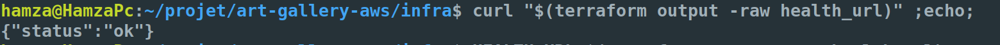

## Step 2 – Change the health response to V2

Modify [backend/src/health/health.controller.ts](../../backend/src/health/health.controller.ts) so that the health endpoint identifies the new version:

```ts
return { status: 'ok', version: 'v2' };
```

**Screenshot 2 – V2 health response in the code:**

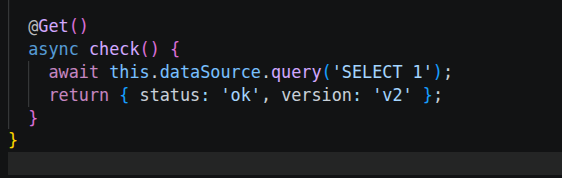

Build and package the backend and the frontend:

```bash
cd backend
npm ci
npm run build
cd ..

tar -czf /tmp/backend-v2.tar.gz \
  -C backend dist package.json package-lock.json

cd frontend
NEXT_PUBLIC_API_URL=/api npm run build
cd ..

tar -czf /tmp/frontend-v2.tar.gz -C frontend/out .
```

## Step 3 – Upload the V2 artifacts to S3

Get the suffix of the persistent data bucket, then upload both archives:

```bash
SUFFIX=$(sed -n 's/^unique_suffix *= *"\([^"]*\)".*/\1/p' infra/terraform.tfvars)
DATA_BUCKET="art-gallery-data-$SUFFIX"

aws s3 cp /tmp/backend-v2.tar.gz \
  "s3://$DATA_BUCKET/artifacts/backend-v2.tar.gz"

aws s3 cp /tmp/frontend-v2.tar.gz \
  "s3://$DATA_BUCKET/artifacts/frontend-v2.tar.gz"

aws s3 ls "s3://$DATA_BUCKET/artifacts/" --human-readable --region us-east-1
```

Check that both `backend-v2.tar.gz` and `frontend-v2.tar.gz` are listed before applying the new version.

**Screenshot – New V2 artifacts in S3:**

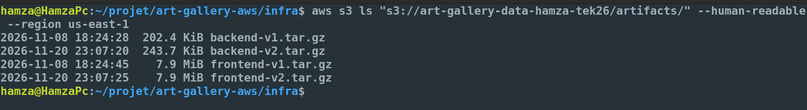

## Step 4 – Apply the V2 Launch Template

From the `infra` directory:

```bash
terraform apply -var="app_version=v2"
```

Terraform creates Launch Template version 2. The instances that are already running stay on version 1 until they are replaced.

Observed result: `Apply complete! Resources: 0 added, 3 changed, 0 destroyed.`

**Screenshot 3 – `terraform apply` with `app_version=v2`:**

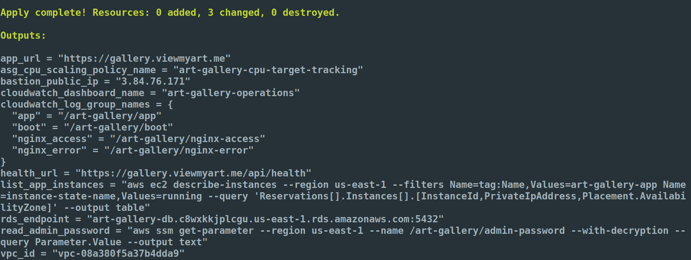

## Step 5 – Start the continuous health monitoring

In Terminal 1, start the loop and keep it running during both replacements:

```bash
cd infra
HEALTH_URL=$(terraform output -raw health_url)

while true; do
  echo "$(date '+%H:%M:%S') $(curl -sS -o /dev/null -w '%{http_code}' "$HEALTH_URL")"
  sleep 2
done
```

The loop and its first `200` responses are visible at the top of Screenshot 5.

## Step 6 – Replace the first instance

In Terminal 2, terminate the first old instance:

```bash
aws ec2 terminate-instances \
  --region us-east-1 \
  --instance-ids i-00bfbacb70ca55ca2
```

**Screenshot 4 – Termination of instance 1:**

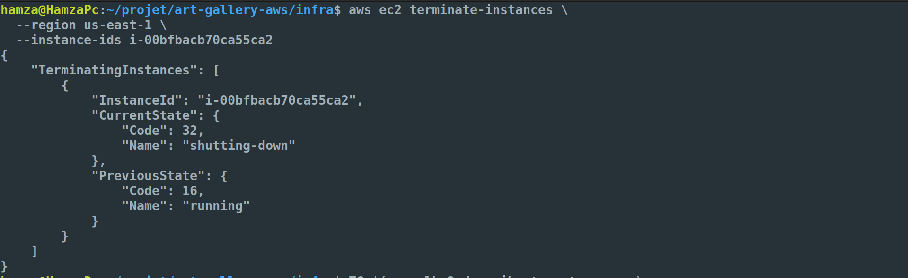

Watch the health loop. During this replacement it showed:

- `23:21:06 502`
- `23:21:08 200`
- `23:21:11 504`
- `23:21:24 200`, then `200` on every following check

**Screenshot 5 – Health loop during and after the replacement of instance 1:**

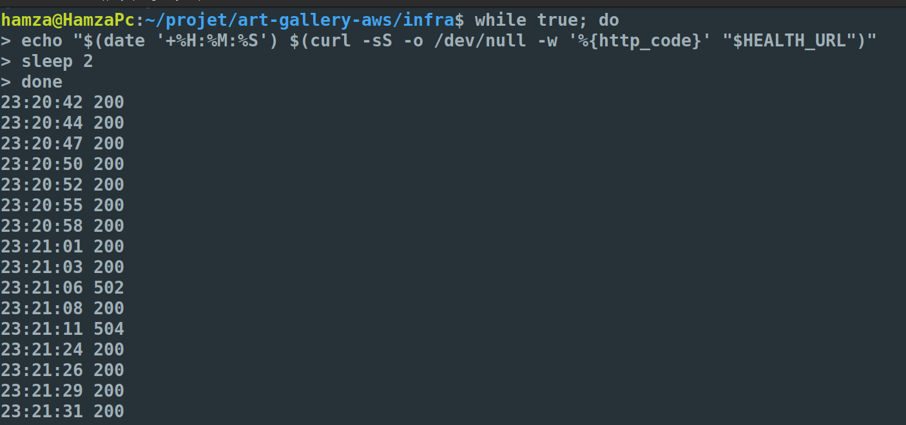

Check the target group:

```bash
TG=$(aws elbv2 describe-target-groups \
  --names art-gallery-tg \
  --region us-east-1 \
  --query 'TargetGroups[0].TargetGroupArn' \
  --output text)

aws elbv2 describe-target-health \
  --target-group-arn "$TG" \
  --region us-east-1 \
  --query 'TargetHealthDescriptions[].{Instance:Target.Id,State:TargetHealth.State}' \
  --output table
```

Right after the termination, only the remaining old instance is listed:

- `i-0784f87fe02083bef`: `healthy`

**Screenshot 6 – Target group right after the termination of instance 1:**

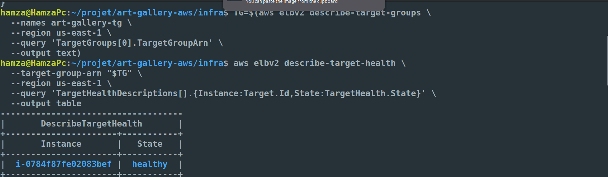

Wait until the replacement instance is registered and both targets are healthy:

- `i-03862a51a9ba0debc`: `healthy`
- `i-0784f87fe02083bef`: `healthy`

After the first replacement instance starts, run one direct health check through the load balancer:

```bash
cd infra
curl "$(terraform output -raw health_url)"; echo
```

**Screenshot – Health check with `curl` after instance 1 is terminated and the replacement starts:**

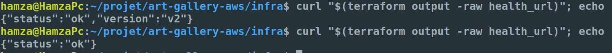

**Do not continue until both targets are healthy.**


## Step 7 – Replace the second instance

Terminate the remaining old instance:

```bash
aws ec2 terminate-instances \
  --region us-east-1 \
  --instance-ids i-0784f87fe02083bef
```

**Screenshot 7 – Two healthy targets before the termination (top) and termination of instance 2 (bottom):**

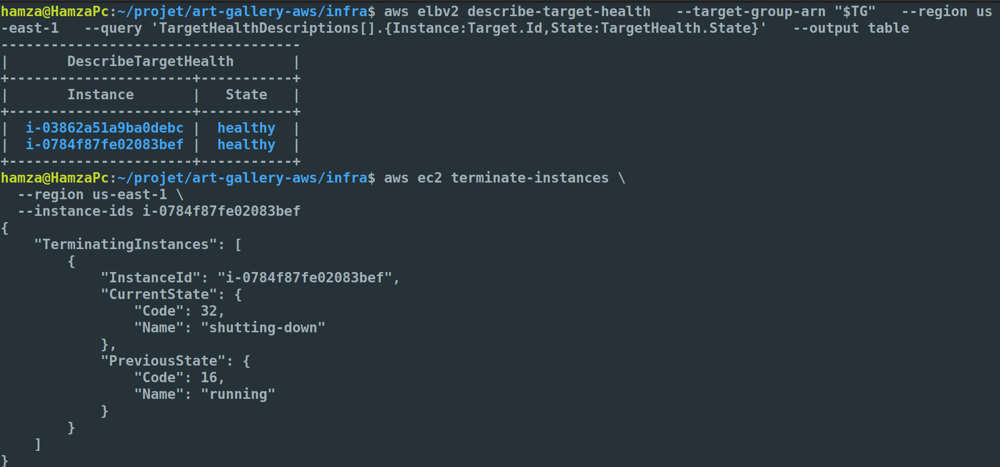

Watch the health loop. During the second replacement it showed:

- `23:26:16 502`
- `23:26:18 200`
- `23:26:21 504`
- `23:26:34 200`, then `200` on every following check

**Screenshot 8 – Health loop during and after the replacement of instance 2:**

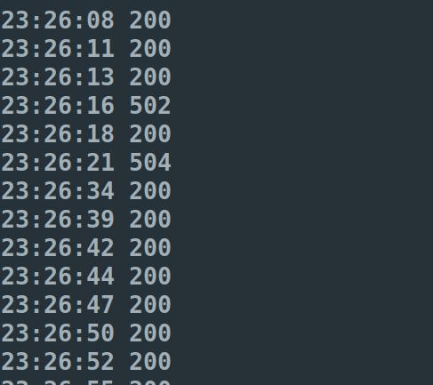

While the replacement starts, the target group shows it as `unhealthy` for a short time, then as `healthy`:

- `i-01f0810d8de560452`: `unhealthy`, then `healthy`
- `i-03862a51a9ba0debc`: `healthy`

**Screenshot 9 – Target group during the replacement (top) and after it (bottom):**

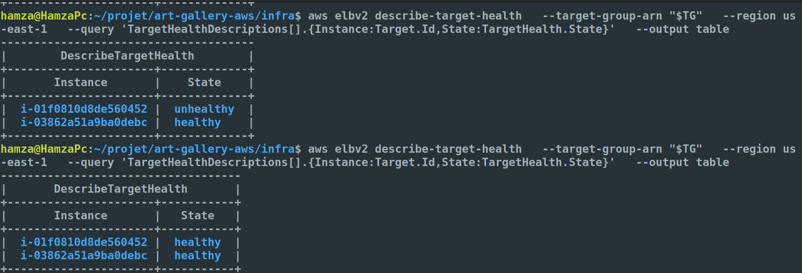

## Step 8 – Verify the final state

Check that the ASG instances run Launch Template version 2:

```bash
aws autoscaling describe-auto-scaling-groups \
  --auto-scaling-group-names art-gallery-asg \
  --region us-east-1 \
  --query 'AutoScalingGroups[0].Instances[].[InstanceId,LifecycleState,HealthStatus,LaunchTemplate.Version]' \
  --output table
```

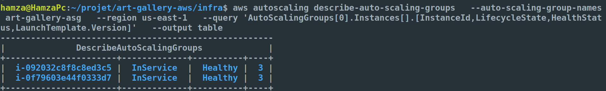

Then run the health check again:

```bash
cd infra
curl "$(terraform output -raw health_url)"; echo
```

Observed V2 response:

```json
{"status":"ok","version":"v2"}
```

**Screenshot 10 – Final V2 health response:**

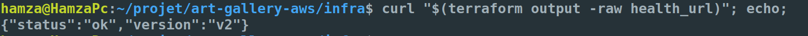

## Summary of the health loop

| Replacement | Terminated instance   | Errors seen                    | Back to sustained `200` |
| ----------- | --------------------- | ------------------------------ | ----------------------- |
| 1           | `i-00bfbacb70ca55ca2` | `23:21:06 502`, `23:21:11 504` | `23:21:24`              |
| 2           | `i-0784f87fe02083bef` | `23:26:16 502`, `23:26:21 504` | `23:26:34`              |

Each replacement caused about 18 seconds of intermittent errors. A `200` was still returned between the errors (`23:21:08` and `23:26:18`).

## Result

**PASS**

Version `v1` was replaced by version `v2` through two manual, sequential instance replacements. The service was not fully interrupted, but each replacement caused brief `502` and `504` responses before the health check recovered to `200`. At the end, both targets were healthy and the health endpoint returned `{"status":"ok","version":"v2"}`.