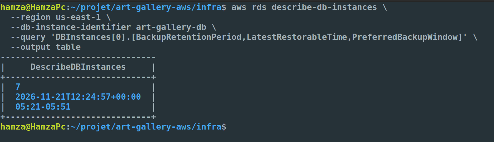
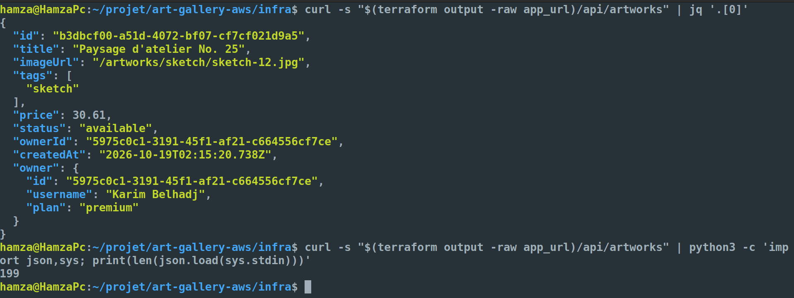
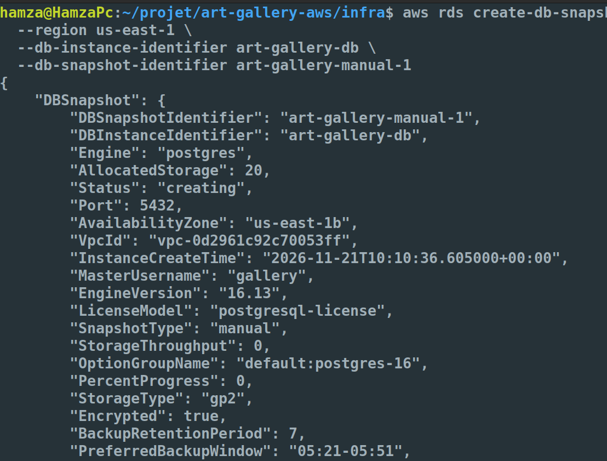
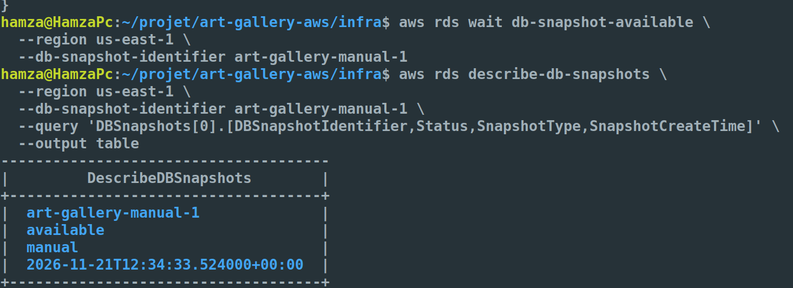
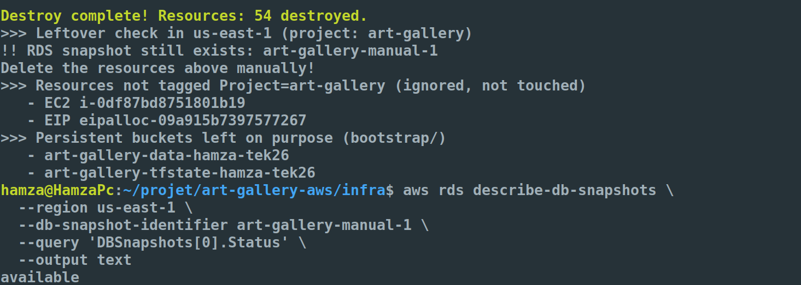
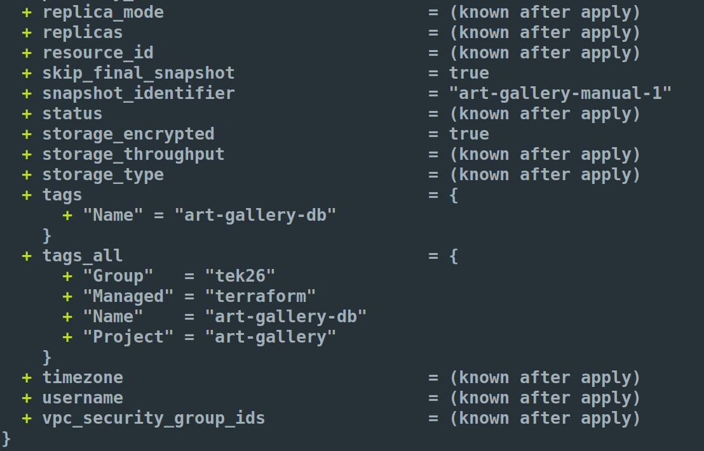

# Test T9 – RDS Backup and Restore

## Objective

Verify that the RDS database has backup protection and that live data can be preserved through an infrastructure destroy and restored by snapshot.

## Test setup

| Item                    | Value                              |
| ----------------------- | ---------------------------------- |
| Region                  | `us-east-1`                        |
| RDS instance identifier | `art-gallery-db`                   |
| Snapshot identifier     | `art-gallery-manual-1`             |
| Restore variable        | `db_snapshot_identifier`           |
| Application URL         | Terraform `app_url` output        |

## Step 1 – Verify automated backup settings

Before creating a manual snapshot, check the automated backup configuration and latest restorable time:

```bash
cd infra
aws rds describe-db-instances \
  --region us-east-1 \
  --db-instance-identifier art-gallery-db \
  --query 'DBInstances[0].[BackupRetentionPeriod,LatestRestorableTime,PreferredBackupWindow]' \
  --output table
```

Expected: a backup retention period greater than `0`, plus a latest restorable time when automated backups are available.

**Screenshot 1 – RDS automated backup settings:**



This screenshot proves that RDS automated backups are enabled and shows the backup window or latest restorable time.

## Step 2 – Record existing application data

Open the application or use the API to record the data that must survive the destroy and restore:

```bash
cd infra
curl -s "$(terraform output -raw app_url)/api/artworks" | jq '.[0]'
```

Record at least one known artwork or database row. Optionally, count all returned rows:

```bash
curl -s "$(terraform output -raw app_url)/api/artworks" | python3 -c 'import json,sys; print(len(json.load(sys.stdin)))'
```

**Screenshot 2 – Data before destroy:**



This screenshot is dedicated to the known database value or row count before the backup and restore.

## Step 3 – Create a manual RDS snapshot

Create a snapshot from the live database:

```bash
cd infra
aws rds create-db-snapshot \
  --region us-east-1 \
  --db-instance-identifier art-gallery-db \
  --db-snapshot-identifier art-gallery-manual-1

aws rds wait db-snapshot-available \
  --region us-east-1 \
  --db-snapshot-identifier art-gallery-manual-1
```

Verify that the snapshot exists and is available:

```bash
aws rds describe-db-snapshots \
  --region us-east-1 \
  --db-snapshot-identifier art-gallery-manual-1 \
  --query 'DBSnapshots[0].[DBSnapshotIdentifier,Status,SnapshotType,SnapshotCreateTime]' \
  --output table
```

Expected status:

```text
available
```

**Screenshot 3 – Manual snapshot creation and status:**






This screenshots proves that a manual RDS snapshot was created and reached `available` status.

## Step 4 – Destroy the infrastructure

Destroy the Terraform stack after the snapshot is available:

```bash
cd infra
./destroy.sh
```

The destroy script removes RDS without a final snapshot. The manual snapshot remains independently stored in RDS.

Verify that the snapshot still exists:

```bash
aws rds describe-db-snapshots \
  --region us-east-1 \
  --db-snapshot-identifier art-gallery-manual-1 \
  --query 'DBSnapshots[0].Status' \
  --output text
```
**Screenshot 4 – Infrastructure destroyed while snapshot remains:**



This screenshot proves the infrastructure was destroyed and should be paired with the snapshot verification below.

## Step 5 – Rebuild and restore from the snapshot

Apply Terraform with the snapshot identifier:

```bash
cd infra
./apply.sh -var="db_snapshot_identifier=art-gallery-manual-1"
```

When restoring from a snapshot, Terraform reuses the database data and the instance setup identifies an existing table instead of loading the default S3 seed.

**Screenshot 5 – Terraform restore configuration:**



This screenshot proves that the rebuild used `db_snapshot_identifier=art-gallery-manual-1`.

## Step 6 – Verify the restored data

Wait until the ALB targets are healthy, then retrieve the same API data:

```bash
curl -s "$(terraform output -raw app_url)/api/artworks" | jq '.[0]'

curl -s "$(terraform output -raw app_url)/api/artworks" | python3 -c 'import json,sys; print(len(json.load(sys.stdin)))'
```

The original known row or row count must be present again.

**Screenshot 6 – Restored data after rebuild:**


This screenshot proves that the database state was recovered from the RDS snapshot rather than recreated from an empty database.

## Result

**PASS**

RDS automated backups are configured, a manual snapshot was created successfully, the infrastructure was destroyed, and Terraform rebuilt RDS from `art-gallery-manual-1`. The original application data was available again after the restore.
