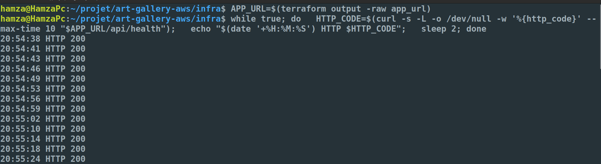
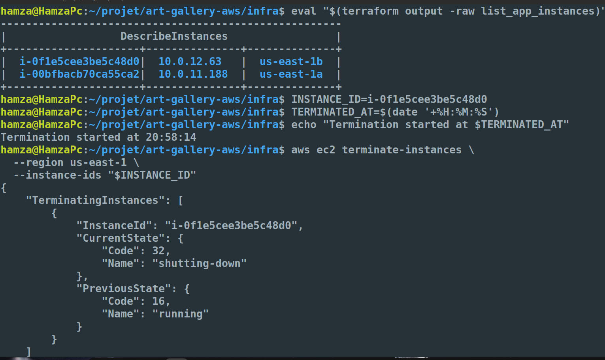
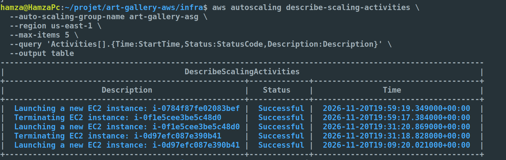
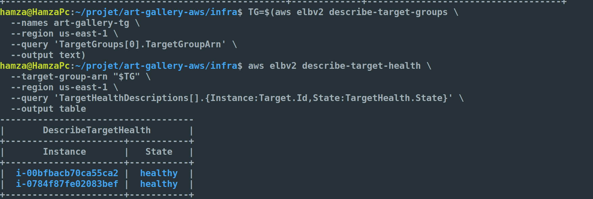
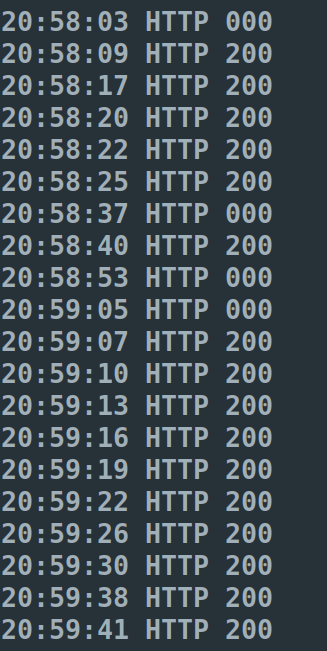

# Test T7 - Instance Loss and Automatic Replacement

## Objective

Verify that terminating one application instance does not make the application unavailable permanently and that the Auto Scaling Group launches and registers a replacement instance.

## Test setup

- Region: `us-east-1`
- ASG: `art-gallery-asg`
- ALB target group: `art-gallery-tg`
- Health endpoint: `/api/health`
- Instance terminated: `i-0f1e5cee3be5c48d0`
- Replacement instance: `i-0784f87fe02083bef`

## Step 1: Start the continuous HTTPS health check

Open a first terminal. Run the loop before terminating anything so that the screenshot and the test output show the normal state before the interruption.

```bash
cd infra
APP_URL=$(terraform output -raw app_url)

while true; do
  HTTP_CODE=$(curl -s -L -o /dev/null -w '%{http_code}' --max-time 10 "$APP_URL/api/health")
  echo "$(date '+%H:%M:%S') HTTP $HTTP_CODE"
  sleep 2
done
```

At the start of the test, the loop must continuously print `HTTP 200`. Wait for at least 10 seconds and keep this terminal open.

**Screenshot 1 - Health check before termination:**



## Step 2: Terminate one instance while the health loop keeps running

Open a second terminal. This terminal records the instance ID and termination time while the first terminal continues checking `/api/health`.

```bash
cd infra
eval "$(terraform output -raw list_app_instances)"

INSTANCE_ID=i-0f1e5cee3be5c48d0
TERMINATED_AT=$(date '+%H:%M:%S')

echo "Termination started at $TERMINATED_AT"
aws ec2 terminate-instances --region us-east-1 --instance-ids "$INSTANCE_ID"
```

**Screenshot 2 - Termination command and timestamp:**



## Step 3: Verify the ASG replacement

AWS scaling activity:

- Terminated instance: `i-0f1e5cee3be5c48d0`
- Termination completed: `2026-11-20T19:59:17.384000+00:00`
- Replacement launched: `i-0784f87fe02083bef`
- Replacement launch successful: `2026-11-20T19:59:19.349000+00:00`

```bash
aws autoscaling describe-scaling-activities \
  --auto-scaling-group-name art-gallery-asg \
  --region us-east-1 \
  --max-items 5 \
  --query 'Activities[].{Time:StartTime,Status:StatusCode,Description:Description}' \
  --output table
```

**Screenshot 3 - ASG scaling activity:**



## Step 4: Check the ALB target health

```bash
TG=$(aws elbv2 describe-target-groups \
  --names art-gallery-tg \
  --region us-east-1 \
  --query 'TargetGroups[0].TargetGroupArn' \
  --output text)

aws elbv2 describe-target-health \
  --target-group-arn "$TG" \
  --region us-east-1 \
  --query 'TargetHealthDescriptions[].{Instance:Target.Id,State:TargetHealth.State}' \
  --output table
```

Observed result: both current targets were healthy:

- `i-00bfbacb70ca55ca2`: `healthy`
- `i-0784f87fe02083bef`: `healthy`

**Screenshot 4 - Two healthy ALB targets:**



## Step 5: Verify that the health check returns to normal

Keep watching the first terminal. The health check may show one or more `HTTP 000` results while the terminated target is removed and the replacement is registered. Once the replacement is healthy, the loop must return to sustained `HTTP 200`.

Observed local time:

- Termination started: `20:58:14`
- HTTP interruptions: `20:58:37`, `20:58:53`, `20:59:05`
- Sustained `HTTP 200` from `20:59:07` onward
- `HTTP 000` means that no HTTP response arrived within the 10-second curl timeout; it was not an HTTP server error.

**Screenshot 5 - Health check recovered after replacement:**



## Result

**PASS**

Terminating one application instance triggered automatic replacement. The health endpoint had brief timeout interruptions, then returned sustained HTTP `200`. The final target group showed two healthy targets.
