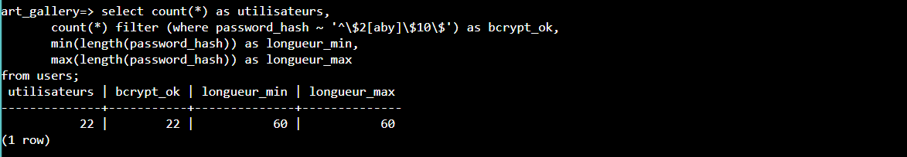
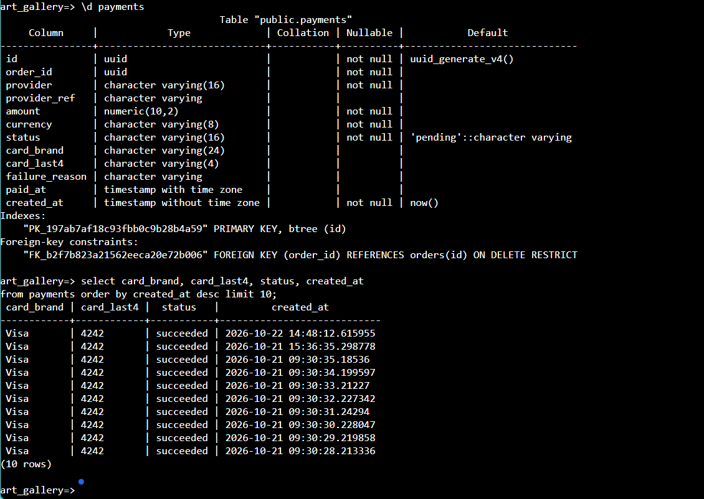

# Tests

> Moved out of the infra README. Back to the [README](../README.md).

## Tests

Each test: what it proves, the commands, the expected result, a screenshot. Run T1 to T6 on a fresh apply, then the destructive ones (T7, T8) and finish with T10.

| # | Test | Proves | Status |
|---|---|---|---|
| T1 | Health endpoint | ALB, target group, API alive | PASS — [full procedure and screenshots](t1-t3.md) |
| T2 | Frontend and DB-backed API through the single URL | nginx serves the pages and proxies `/api`, DB reachable | PASS — [full procedure and screenshots](t1-t3.md) |
| T3 | Instances booted in real mode, secrets read | Artifacts, SSM access, no fallback | PASS — [full procedure and screenshots](t1-t3.md) |
| T4 | Database reachable only from the app tier | Network isolation | PASS — [full procedure and screenshots](t4.md) |
| T5 | Private instances not reachable from the Internet | Security groups, no public IP | PASS — [full procedure and screenshots](t5.md) |
| T6 | Outbound goes through the NAT | NAT route works | PASS — [full procedure and screenshots](t6.md) |
| T7 | Resilience: kill one instance | Fault tolerance (graded) | PASS — [full procedure and screenshots](t7.md) |
| T8 | New version without total interruption | Rolling update | PASS — [full procedure and screenshots](t8.md) |
| T9 | Backup and restore | Data protection (graded) | PASS — [full procedure and screenshots](t9.md) |
| T10 | Rebuild from zero, timed | Rebuild target | partly done (11.5 min fallback) |
| T11 | Load test (k6) | 50 concurrent users, 100 peak | planned |
| T12 | Sensitive data: password hashes and card data | Passwords stored as bcrypt hashes, no card number or security code stored | done, see [RDS.md](../RDS.md#5-verification-passwords-and-cards) |
| T13 | Alarms: trigger each one | Monitoring and notifications | PASS — [full procedure and screenshots](t13.md) |

### T10. Rebuild from zero, timed

After a full `./destroy.sh` (leftover check clean):

```bash
time terraform apply -auto-approve
curl -s "$(terraform output -raw health_url)"; echo
```

Expected: 15 minutes or less and a healthy application. Result: **14 min 17 s** (15 Nov 2026, real mode, HTTPS on, `./apply.sh`).

*Screenshot: [T10 rebuild time](../EVIDENCE.md#t10-rebuild-from-zero-timed)*

### T11. Load test (planned)

k6 against `app_url`: 50 concurrent users, 100 at peak, report p95 latency and error rate, while watching `aws autoscaling describe-auto-scaling-groups`. Script and results to add.

### T12. Sensitive data: passwords and cards

Checks on the RDS database itself (queried from an app instance through Session Manager, see [RDS.md](../RDS.md#2-look-inside-the-database-tables-and-select)) that the sensitive data is protected:

```sql
select count(*) as utilisateurs,
       count(*) filter (where password_hash ~ '^\$2[aby]\$10\$') as bcrypt_ok,
       min(length(password_hash)) as longueur_min,
       max(length(password_hash)) as longueur_max
from users;

select count(*) as lignes_suspectes from payments where card_last4 !~ '^\d{4}$';
```

Result: **22 users, 22 bcrypt hashes** (cost 10, 60 characters), and **0 suspect rows** in `payments`: the application stores only the card brand and the last 4 digits, never the card number or the security code. Full steps with the five screenshots: [RDS.md, section 5](../RDS.md#5-verification-passwords-and-cards).




