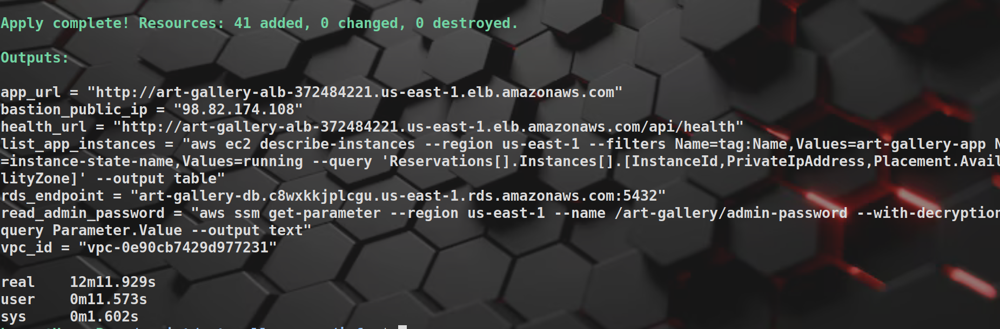
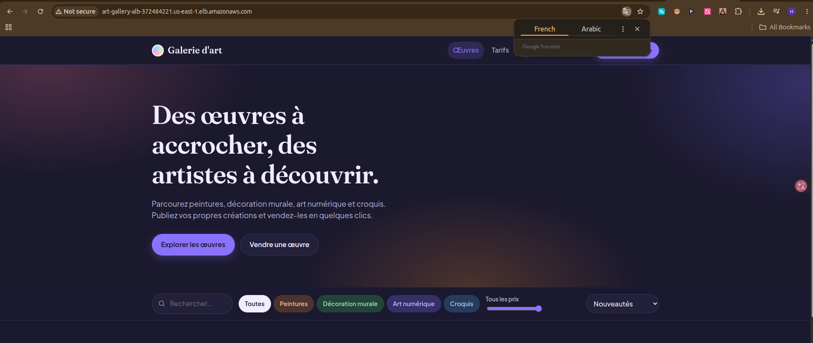

# Prerequisites and usage

> Moved out of the infra README. Back to the [README](../README.md).

## Prerequisites

- Terraform >= 1.5 (`sudo snap install terraform --classic`)
- AWS CLI v2 (`sudo snap install aws-cli --classic`)
- Node.js 20+ and npm (to build the artifacts)
- Docker Desktop with the local `art-gallery-db` container (to make the database seed)
- On Windows: **Git Bash** to run `.sh` scripts, and a `.gitattributes` with `*.sh text eol=lf` and `*.tpl text eol=lf` so Git never converts them to CRLF
- An active AWS Academy Learner Lab session
- The Learner Lab key `labsuser.pem` (`chmod 400 labsuser.pem`)

## Usage

All commands are run from the `infra/` folder.

### 1. Credentials (every lab session)

AWS Academy -> Start Lab -> AWS Details -> Show. Paste the 3 values into `~/.aws/credentials`:

```
[default]
aws_access_key_id=...
aws_secret_access_key=...
aws_session_token=...
```

Check: `aws sts get-caller-identity`. Credentials expire when the lab session ends.

### 2. Configure

```bash
cp terraform.tfvars.example terraform.tfvars
nano terraform.tfvars        # set unique_suffix (same value as bootstrap) and alarm_email
```

`alarm_email` is the address that receives the CloudWatch alarm e-mails. It has no default: if it is missing from `terraform.tfvars`, `terraform plan` and `./apply.sh` stop and ask for it at every run.

`./apply.sh` detects your current public IPv4 and passes it as `admin_cidr` for bastion SSH access. For a plan that matches the apply, run:

```bash
ADMIN_IP=$(curl -4fsS https://checkip.amazonaws.com | tr -d '[:space:]')
terraform plan -var="admin_cidr=${ADMIN_IP}/32"
```

Each variable name must appear **once** in `terraform.tfvars` (a duplicate keeps the last value and is easy to miss).

To serve the site over HTTPS on your domain, add `enable_https = true` (after the one-time setup in [HTTPS and custom domain](https.md#https-and-custom-domain)). Without it the stack is HTTP only, as before.

*Screenshot: [admin IP and tfvars](../EVIDENCE.md#2-configure)*

### 3. Bootstrap (once)

```bash
cd bootstrap && ./bootstrap.sh <unique_suffix> && cd ..
cp backend.hcl.example backend.hcl
# Set bucket in backend.hcl to art-gallery-tfstate-<same suffix>
```

*Screenshot: [bootstrap](../EVIDENCE.md#3-bootstrap-once)*

### 4. Upload the artifacts (only when the code changes)

The infrastructure expects two files in the persistent data bucket, one pair per version:

| File | Content | Built following |
|---|---|---|
| `artifacts/backend-<version>.tar.gz` | the backend build output and its package files | [backend README](../../backend/README.md#déploiement) |
| `artifacts/frontend-<version>.tar.gz` | the static export of the site | [frontend README](../../frontend/README.md#build-et-déploiement) |

```bash
ls -lh /tmp/backend-v1.tar.gz /tmp/frontend-v1.tar.gz      # sizes for the comparison table
aws s3 cp /tmp/backend-v1.tar.gz  s3://art-gallery-data-<suffix>/artifacts/
aws s3 cp /tmp/frontend-v1.tar.gz s3://art-gallery-data-<suffix>/artifacts/
```

The version in the file names must match the Terraform variable `app_version` (default `v1`).

*Screenshot: [artifact sizes and upload](../EVIDENCE.md#4-upload-the-artifacts-only-when-the-code-changes)*

### 4b. Upload the database seed (once, and again only when you want newer data)

The boot script restores `seed/gallery.sql` into the empty RDS of every new stack. Create it from the local Docker database (Docker Desktop running, PowerShell, from `infra/`):

```powershell
docker exec art-gallery-db pg_dump -U gallery --no-owner --no-acl -f /tmp/gallery.sql art_gallery
docker cp art-gallery-db:/tmp/gallery.sql ..\gallery.sql
aws s3 cp ..\gallery.sql s3://art-gallery-data-<suffix>/seed/gallery.sql
aws s3 ls s3://art-gallery-data-<suffix>/seed/ --human-readable
```

> **Do not** write the dump with `pg_dump ... > gallery.sql` in Windows PowerShell: it saves the file as UTF-16 and the restore fails with `invalid byte sequence for encoding "UTF8": 0xff`. The `-f` + `docker cp` way above keeps plain UTF-8.

The file contains the users' emails and password hashes: keep it in the private bucket, never commit it (`gallery.sql` is in `.gitignore`).

### 5. Deploy

```bash
cd infra
terraform init -backend-config=backend.hcl
terraform validate
ADMIN_IP=$(curl -4fsS https://checkip.amazonaws.com | tr -d '[:space:]')
terraform plan -var="admin_cidr=${ADMIN_IP}/32"  # review the current plan with your public IP
time ./apply.sh                                  # prompts for approval; saves a local state backup
```

During the apply, the first app instance restores the seed into RDS (see [How an instance boots](boot-and-bootstrap.md#how-an-instance-boots)). Nothing to run by hand: when `apply` returns, the site already shows the data.

*Screenshot: [terraform plan summary](../EVIDENCE.md#5-deploy)*



```bash
terraform output app_url                                # open it in a browser
curl "$(terraform output -raw health_url)"
eval "$(terraform output -raw read_admin_password)"     # admin password of this session
```



### 6. Destroy (mandatory at the end of every session)

```bash
time ./destroy.sh
```

The script runs `terraform destroy`, then checks EC2, NAT Gateways, Elastic IPs, load balancers and RDS. It must finish with `OK: nothing billable left.` RDS takes several minutes to delete, so do not close the terminal early.

RDS and its data are deleted with the stack. The next `terraform apply` restores `seed/gallery.sql`. Anything created on the live site since then (new orders, accounts) is lost, unless you first save it as the new seed: [RDS.md, section 3](../RDS.md#3-keep-the-data-created-on-aws-before-a-destroy).

*Screenshot: [destroy and leftover check](../EVIDENCE.md#6-destroy-mandatory-at-the-end-of-every-session)*
