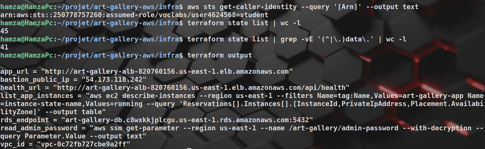
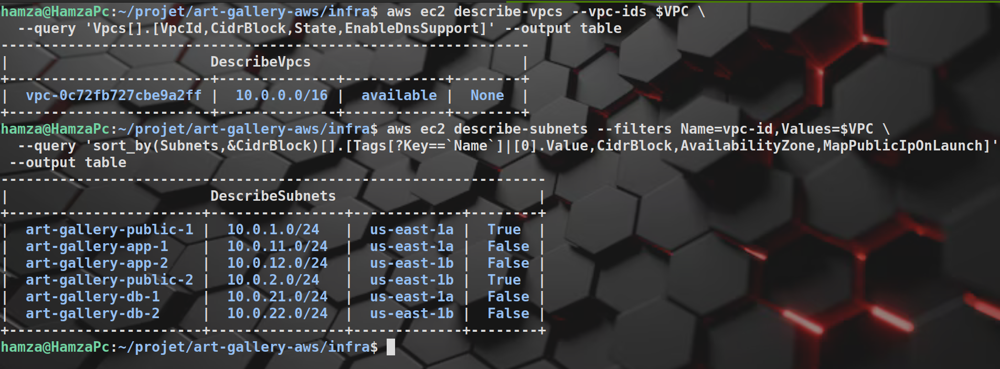
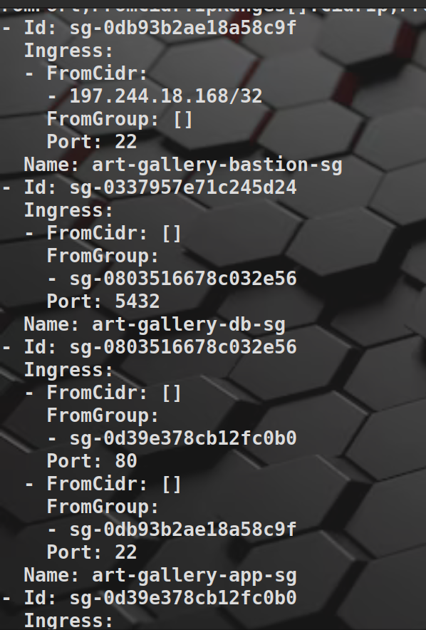
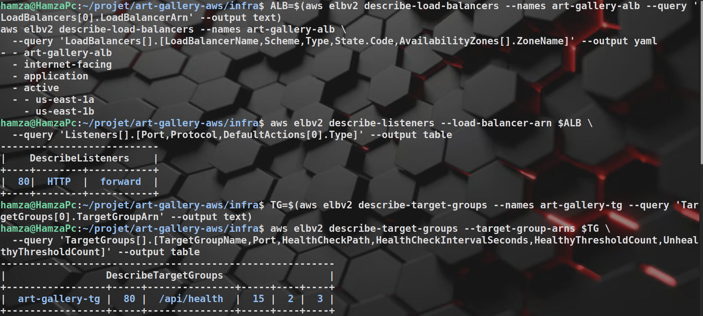
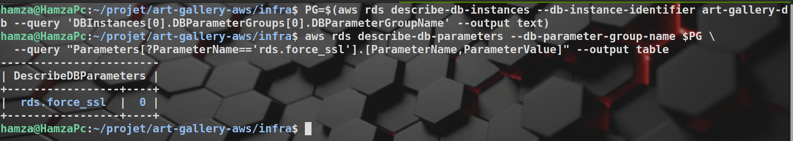
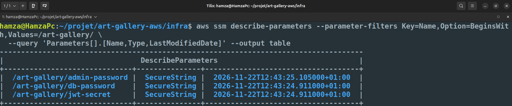

# Verification with the AWS CLI

> Moved out of the infra README. Back to the [README](../README.md).

## Verification with the AWS CLI (every resource)

Run these **while the stack is up**, in one terminal, and take one screenshot per block. Nothing here changes anything. Set the variables first:

```bash
cd ~/projet/art-gallery-aws/infra
export AWS_REGION=us-east-1
SUFFIX=<your unique_suffix>
VPC=$(terraform output -raw vpc_id)
DATA=art-gallery-data-$SUFFIX
STATE=art-gallery-tfstate-$SUFFIX
```

### V0. Who am I, and what does Terraform manage?

```bash
aws sts get-caller-identity --query '[Arn]' --output text      # blur the account ID
terraform state list | wc -l                                    # expected: 56 (52 resources + 4 data sources); 60 with HTTPS (54 + 6)
terraform state list | grep -vE '(^|\.)data\.' | wc -l          # expected: 52 (resources only); 54 with HTTPS
terraform output
```



### V1. Inventory of everything tagged for the project

Common Terraform tags are `Project` (default `art-gallery`), `Managed=terraform`, and `Group` (default `tek26`); resource-specific `Name` and existing subnet `Tier` tags are retained.
ASG tags propagate `Name`, `Project`, `Managed`, and `Group`; the launch template applies common tags to instances, EBS volumes, and network interfaces.
The bootstrap script applies `Group` to persistent S3 buckets alongside their existing `Project`, `Managed`, `Lifecycle`, and `Purpose` tags.

```bash
aws resourcegroupstaggingapi get-resources --tag-filters Key=Project,Values=art-gallery \
  --query 'ResourceTagMappingList[].ResourceARN' --output text | tr '\t' '\n' | sed 's/:[0-9]\{12\}:/:ACCOUNT:/' | sort
```

If this call is denied in the lab, skip it: the blocks below cover each resource type. (Some resources, such as route table associations, are not taggable, so the count is lower than 41.)

*Screenshot: [tagged resource inventory](../images/inventory-of-everything-tagged-for-the-project.png)*

### V2. Persistent buckets and artifacts

```bash
aws s3api list-buckets --query "Buckets[?starts_with(Name,'art-gallery-')].Name" --output table
for b in $STATE $DATA; do
  echo "== $b"
  aws s3api get-public-access-block --bucket $b --query 'PublicAccessBlockConfiguration' --output table
  aws s3api get-bucket-encryption   --bucket $b --query 'ServerSideEncryptionConfiguration.Rules[0].ApplyServerSideEncryptionByDefault.SSEAlgorithm' --output text
  aws s3api get-bucket-versioning   --bucket $b --query 'Status' --output text
done
aws s3 ls s3://$DATA/artifacts/ --human-readable
```

Expected: all four public-access settings `True`, encryption `AES256`, versioning `Enabled` on the state bucket, and both `.tar.gz` artifacts listed.

*Screenshot: [S3 buckets and artifacts](../EVIDENCE.md#v2-persistent-buckets-and-artifacts)*

### V3. VPC and subnets

```bash
aws ec2 describe-vpcs --vpc-ids $VPC \
  --query 'Vpcs[].[VpcId,CidrBlock,State,EnableDnsSupport]' --output table

aws ec2 describe-subnets --filters Name=vpc-id,Values=$VPC \
  --query 'sort_by(Subnets,&CidrBlock)[].[Tags[?Key==`Name`]|[0].Value,CidrBlock,AvailabilityZone,MapPublicIpOnLaunch]' --output table
```

Expected: `10.0.0.0/16` and 6 subnets over `us-east-1a` / `us-east-1b` (`MapPublicIpOnLaunch` true only for the 2 public ones, if set in the module).



### V4. Internet Gateway, NAT Gateway, Elastic IP, S3 endpoint

```bash
aws ec2 describe-internet-gateways --filters Name=attachment.vpc-id,Values=$VPC \
  --query 'InternetGateways[].[InternetGatewayId,Attachments[0].State]' --output table

aws ec2 describe-nat-gateways --filter Name=vpc-id,Values=$VPC \
  --query 'NatGateways[].[NatGatewayId,State,ConnectivityType,SubnetId,NatGatewayAddresses[0].PublicIp]' --output table

aws ec2 describe-addresses \
  --query 'Addresses[].[AllocationId,PublicIp,AssociationId,Tags[?Key==`Name`]|[0].Value]' --output table

aws ec2 describe-vpc-endpoints --filters Name=vpc-id,Values=$VPC \
  --query 'VpcEndpoints[].[VpcEndpointId,ServiceName,VpcEndpointType,State]' --output table
```

Expected: IGW `available`, NAT `available` and `public` in a public subnet, an Elastic IP attached to the NAT, an S3 endpoint of type `Gateway` (keep the NAT public IP: [T6](t6.md) compares it).

*Screenshot: [gateways and endpoint](../EVIDENCE.md#v4-internet-gateway-nat-gateway-elastic-ip-s3-endpoint)*

### V5. Route tables

```bash
aws ec2 describe-route-tables --filters Name=vpc-id,Values=$VPC \
  --query 'RouteTables[].{Name:Tags[?Key==`Name`]|[0].Value,Subnets:length(Associations[?SubnetId]),Routes:Routes[].[DestinationCidrBlock,GatewayId,NatGatewayId]}' \
  --output yaml
```

Expected: `rt-public` (2 subnets) has `0.0.0.0/0` to the Internet Gateway, `rt-app` (2 subnets) has `0.0.0.0/0` to the NAT Gateway, `rt-db` (2 subnets) has **only the local route**. The unnamed table is the VPC's automatic main route table (0 subnets).

*Screenshot: [route tables](../EVIDENCE.md#v5-route-tables)*

### V6. Security groups and their rules

```bash
aws ec2 describe-security-groups --filters Name=vpc-id,Values=$VPC Name=group-name,Values='art-gallery-*' \
  --query 'SecurityGroups[].{Name:GroupName,Id:GroupId,Ingress:IpPermissions[].{Port:FromPort,FromCidr:IpRanges[].CidrIp,FromGroup:UserIdGroupPairs[].GroupId}}' \
  --output yaml     # blur the admin IP
```

Expected: `alb-sg` open to `0.0.0.0/0` on 80, `bastion-sg` only to the admin `/32` on 22, `app-sg` only from the ALB and bastion groups, `db-sg` only from the `app-sg` id on 5432.



### V7. Instances (bastion and application)

```bash
aws ec2 describe-instances --filters Name=tag:Project,Values=art-gallery Name=instance-state-name,Values=running \
  --query 'Reservations[].Instances[].[Tags[?Key==`Name`]|[0].Value,InstanceId,InstanceType,Placement.AvailabilityZone,PrivateIpAddress,PublicIpAddress]' --output table
```

Expected: 1 `art-gallery-bastion` with a public IP, 2 `art-gallery-app` in **different AZs** and with **no public IP** (blur the bastion IP).

*Screenshot: [instances](../EVIDENCE.md#v7-instances-bastion-and-application)*

### V8. Launch Template and Auto Scaling Group

```bash
ASG=art-gallery-asg
aws autoscaling describe-auto-scaling-groups --auto-scaling-group-names $ASG \
  --query 'AutoScalingGroups[].{Min:MinSize,Max:MaxSize,Desired:DesiredCapacity,HealthCheck:HealthCheckType,Grace:HealthCheckGracePeriod,Subnets:VPCZoneIdentifier,Instances:Instances[].[InstanceId,AvailabilityZone,LifecycleState,HealthStatus]}' \
  --output yaml

LT=$(aws autoscaling describe-auto-scaling-groups --auto-scaling-group-names $ASG --query 'AutoScalingGroups[0].LaunchTemplate.LaunchTemplateId' --output text)
aws ec2 describe-launch-template-versions --launch-template-id $LT --versions '$Latest' \
  --query 'LaunchTemplateVersions[0].LaunchTemplateData.{Type:InstanceType,Profile:IamInstanceProfile.Name,IMDS:MetadataOptions,Disk:BlockDeviceMappings[0].Ebs}' --output yaml
```

Expected: min 2, max 3, desired 2, health check `ELB`, 2 instances `InService` / `Healthy` in two AZs. Launch template: `t3.micro`, `LabInstanceProfile`, `HttpTokens: required`, encrypted 8 GB gp3 volume.

*Screenshot: [auto scaling group and launch template](../EVIDENCE.md#v8-launch-template-and-auto-scaling-group)*

### V9. Load balancer, listener, target group, target health

```bash
ALB=$(aws elbv2 describe-load-balancers --names art-gallery-alb --query 'LoadBalancers[0].LoadBalancerArn' --output text)
aws elbv2 describe-load-balancers --names art-gallery-alb \
  --query 'LoadBalancers[].[LoadBalancerName,Scheme,Type,State.Code,AvailabilityZones[].ZoneName]' --output yaml

aws elbv2 describe-listeners --load-balancer-arn $ALB \
  --query 'Listeners[].[Port,Protocol,DefaultActions[0].Type]' --output table

TG=$(aws elbv2 describe-target-groups --names art-gallery-tg --query 'TargetGroups[0].TargetGroupArn' --output text)
aws elbv2 describe-target-groups --target-group-arns $TG \
  --query 'TargetGroups[].[TargetGroupName,Port,HealthCheckPath,HealthCheckIntervalSeconds,HealthyThresholdCount,UnhealthyThresholdCount]' --output table

aws elbv2 describe-target-health --target-group-arn $TG \
  --query 'TargetHealthDescriptions[].[Target.Id,Target.Port,TargetHealth.State]' --output table
```

Expected: `internet-facing` `application` ALB `active` in 2 AZs, listener `80 HTTP forward`, health path `/api/health` every 15 s, **both targets `healthy`**.



### V10. RDS

```bash
aws rds describe-db-instances --db-instance-identifier art-gallery-db \
  --query 'DBInstances[].{Status:DBInstanceStatus,Engine:Engine,Version:EngineVersion,Class:DBInstanceClass,MultiAZ:MultiAZ,Public:PubliclyAccessible,Encrypted:StorageEncrypted,BackupDays:BackupRetentionPeriod,Storage:AllocatedStorage,AZ:AvailabilityZone,Endpoint:Endpoint.Address}' --output yaml

PG=$(aws rds describe-db-instances --db-instance-identifier art-gallery-db --query 'DBInstances[0].DBParameterGroups[0].DBParameterGroupName' --output text)
aws rds describe-db-parameters --db-parameter-group-name $PG \
  --query "Parameters[?ParameterName=='rds.force_ssl'].[ParameterName,ParameterValue]" --output table
```

Expected: `available`, PostgreSQL 16, `db.t3.micro`, `Public: false`, `Encrypted: true`, 7 backup days, endpoint in the DB subnets, `rds.force_ssl` = `0` (documented limit).



### V11. Secrets (names and type only, never the values)

```bash
aws ssm describe-parameters --parameter-filters Key=Name,Option=BeginsWith,Values=/art-gallery/ \
  --query 'Parameters[].[Name,Type,LastModifiedDate]' --output table
```

Expected: 3 parameters of type `SecureString`. **Do not** add `get-parameter --with-decryption` to a screenshot.



### Leftover check

After `./destroy.sh`, the same check as the script, written out so it can be shown:

```bash
aws ec2 describe-instances --filters Name=instance-state-name,Values=pending,running,stopping,stopped --query 'Reservations[].Instances[].InstanceId' --output text
aws ec2 describe-nat-gateways --filter Name=state,Values=pending,available --query 'NatGateways[].NatGatewayId' --output text
aws ec2 describe-addresses --query 'Addresses[].AllocationId' --output text
aws elbv2 describe-load-balancers --query 'LoadBalancers[].LoadBalancerArn' --output text
aws rds describe-db-instances --query 'DBInstances[].DBInstanceIdentifier' --output text
aws ecr describe-repositories --query 'repositories[].repositoryName' --output text   # old experiments
aws s3api list-buckets --query "Buckets[?starts_with(Name,'art-gallery-')].Name" --output text   # expected: the 2 persistent buckets
```

Expected: every line empty except the 2 persistent buckets.

> **[ADD SCREENSHOT]** `v2-22-leftover.png`: leftover check


